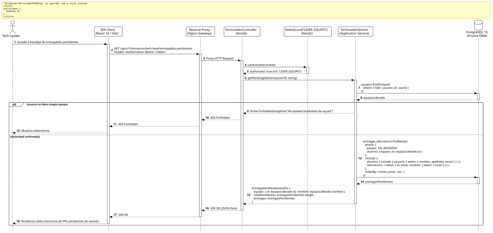

<div align="center">

| [Inicio](/README.md) | [RUP Hub](/RUP/README.md) | [00 Dominio](/RUP/00-modelo-del-dominio/README.md) | [01 Requisitos](/RUP/01-requisitos/README.md) | [02 Análisis](/RUP/02-analisis/README.md) | [03 Diseño](/RUP/03-diseño/README.md) | [Catálogo Diseño](/RUP/03-diseño/casos-uso/README.md) |
|:---:|:---:|:---:|:---:|:---:|:---:|:---:|

<sub>**Fase 03 Diseño** › **Realización de Casos de Uso** › `abrirEntregablesPendientes()`</sub>

</div>

# Realización de Diseño: `abrirEntregablesPendientes()`

Esta especificación formaliza el diseño técnico y contrato de interfaz para el caso de uso `abrirEntregablesPendientes()`. Modela la bandeja de entrada técnica del Tech Leader titular ([ADR-004](/RUP/BITACORA.md#adr-004-embudo-en-2-fases-y-asignaci%C3%B3n-a-los-6-equipos-de-cts), [ADR-013](/RUP/BITACORA.md#adr-013-simplificaci%C3%B3n-pragm%C3%A1tica-del-modelo-de-datos-der-y-alineaci%C3%B3n-con-la-operativa-real-de-cts)), filtrando automáticamente por el squad asignado a través de `equipos.lider_usuario_id`.

---

<div align="center">

| Diagrama de Secuencia de Diseño UML |
| :---: |
|  |
| <sup><i>[Código fuente PlantUML](secuenciaDiseño.puml)</i></sup> |

</div>

---

## 1. Contrato de Interfaz REST (OpenAPI 3.1)

### 1.1 Definición del Endpoint

* **Ruta HTTP**: `GET /api/v1/formacion/tech-lead/entregables-pendientes`
* **Acceso / Seguridad**: Autenticado mediante `Bearer <accessToken>` con rol exclusivo `LIDER_EQUIPO`.
* **Cabeceras de Petición**:
  * `Authorization: Bearer <accessToken>`
  * `Accept: application/json`

### 1.2 Respuestas Canónicas (DTOs de Salida)

#### `200 OK` — Bandeja de Entregas Pendientes

```json
{
  "statusCode": 200,
  "data": {
    "equipo": {
      "id": "77777777-8888-9999-aaaa-bbbbbbbbbbbb",
      "nombre": "Squad Fénix - Core & Arquitectura"
    },
    "totalPendientes": 1,
    "entregas": [
      {
        "id": "e1f2a3b4-c5d6-7e8f-9a0b-1c2d3e4f5a6b",
        "laboratorioTitulo": "Refactor de Repositorio Desacoplado",
        "moduloTitulo": "Clean Architecture & Principios SOLID",
        "alumno": {
          "nombre": "Carlos Gómez",
          "email": "carlos.gomez@alumnos.uneatlantico.es"
        },
        "urlPullRequest": "https://github.com/CTS-PROFER/proyecto-base/pull/12",
        "commitHash": "9f8379f71e832e3a5f423abac32f19523f009249",
        "numeroIntento": 1,
        "fechaEnvio": "2026-11-02T14:26:00.000Z"
      }
    ]
  }
}
```

---

## 2. Componentes de Software de Diseño (NestJS)

* **`TechLeaderController`**: Endpoint `GET /tech-lead/entregables-pendientes` con `@Roles('LIDER_EQUIPO')`.
* **`TechLeaderService.getPendingDeliveries`**: Identificación del squad titular mediante `motor_equipos.equipos.lider_usuario_id = req.user.id` y consulta sobre `entregas_laboratorio` con `estado = 'EN_REVISION'`.

---

## 3. Trazabilidad con Requisitos y Análisis

| Requisito / Análisis | Realización de Diseño |
| :--- | :--- |
| **Caso de Uso `abrirEntregablesPendientes()`** | Endpoint `GET /api/v1/formacion/tech-lead/entregables-pendientes`. |
| **Aislamiento del TL (ADR-009)** | El Tech Leader únicamente visualiza y califica a los alumnos adscritos a su squad titular. |
| **RBAC Puro (ADR-013)** | Asociación directa `equipos.lider_usuario_id` sin tabla intermedia `lideres_equipo`. |

---

<div align="center">

[Ver Análisis previo (Fase 02)](/RUP/02-analisis/casos-uso/abrirEntregablesPendientes/README.md) • [Catálogo de Casos de Uso (Diseño)](/RUP/03-diseño/casos-uso/README.md) • [Siguiente: `revisarEntregable()`](../revisarEntregable/README.md)

</div>
