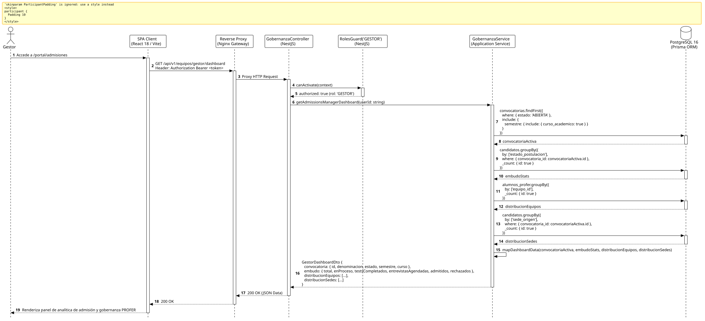

<div align="center">

| [Inicio](/README.md) | [RUP Hub](/RUP/README.md) | [00 Dominio](/RUP/00-modelo-del-dominio/README.md) | [01 Requisitos](/RUP/01-requisitos/README.md) | [02 Análisis](/RUP/02-analisis/README.md) | [03 Diseño](/RUP/03-diseño/README.md) | [Catálogo Diseño](/RUP/03-diseño/casos-uso/README.md) |
|:---:|:---:|:---:|:---:|:---:|:---:|:---:|

<sub>**Fase 03 Diseño** › **Realización de Casos de Uso** › `abrirPanelAdmisiones()`</sub>

</div>

# Realización de Diseño: `abrirPanelAdmisiones()`

Esta especificación formaliza el diseño técnico y contrato de interfaz para el caso de uso `abrirPanelAdmisiones()`. Constituye el tablero ejecutivo de gobernanza institucional para el Gestor del Programa PROFER ([ADR-003](/RUP/BITACORA.md#adr-003-adopci%C3%B3n-de-nomenclatura-institucional-programa-profer), [ADR-005](/RUP/BITACORA.md#adr-005-gobernanza-institucional-convenio-programa-profer-%E2%80%93-universidad)), consolidando las métricas agregadas del embudo de selección continua ([ADR-007](/RUP/BITACORA.md#adr-007-admisi%C3%B3n-continua-por-ciclos-acad%C3%A9micos-bater%C3%ADa-de-3-tests-e-inclusi%C3%B3n-de-entrevista)), la distribución por sedes internacionales ([ADR-008](/RUP/BITACORA.md#adr-008-canalizaci%C3%B3n-de-candidatos-por-sedes-internacionales-y-eliminaci%C3%B3n-de-usuarionologueado)) y el balance de plazas entre los 6 squads técnicos ([ADR-013](/RUP/BITACORA.md#adr-013-simplificaci%C3%B3n-pragm%C3%A1tica-del-modelo-de-datos-der-y-alineaci%C3%B3n-con-la-operativa-real-de-cts)).

---

<div align="center">

| Diagrama de Secuencia de Diseño UML |
| :---: |
|  |
| <sup><i>[Código fuente PlantUML](secuenciaDiseño.puml)</i></sup> |

</div>

---

## 1. Contrato de Interfaz REST (OpenAPI 3.1)

### 1.1 Definición del Endpoint

* **Ruta HTTP**: `GET /api/v1/equipos/gestor/dashboard`
* **Acceso / Seguridad**: Autenticado mediante `Bearer <accessToken>` con rol exclusivo `GESTOR`.
* **Cabeceras de Petición**:
  * `Authorization: Bearer <accessToken>`
  * `Accept: application/json`

### 1.2 Respuestas Canónicas (DTOs de Salida)

#### `200 OK` — Dashboard Ejecutivo de Admisiones

```json
{
  "statusCode": 200,
  "data": {
    "convocatoriaActiva": {
      "id": "e2a3b4c5-0011-2233-4455-66778899aabb",
      "denominacion": "Convocatoria PROFER 2026-I",
      "semestre": "2026-1",
      "cursoAcademico": "2025-2026"
    },
    "metricasEmbudo": {
      "totalPostulados": 120,
      "enProcesoTests": 45,
      "testsCompletados": 35,
      "entrevistasAgendadas": 15,
      "admitidos": 18,
      "rechazados": 7
    },
    "distribucionEquipos": [
      { "codigo": "TEAM-01", "nombre": "Squad Fénix", "totalAlumnos": 12 },
      { "codigo": "TEAM-02", "nombre": "Squad Vulcano", "totalAlumnos": 4 },
      { "codigo": "TEAM-03", "nombre": "Squad Titán", "totalAlumnos": 1 }
    ],
    "distribucionSedes": [
      { "sede": "El Salvador (SDR)", "total": 65 },
      { "sede": "Colombia (BOG)", "total": 30 },
      { "sede": "México (CDMX)", "total": 25 }
    ]
  }
}
```

---

## 2. Componentes de Software de Diseño (NestJS)

* **`GobernanzaController`**: Endpoint `GET /gestor/dashboard` con `@Roles('GESTOR')`.
* **`GobernanzaService.getAdmissionsManagerDashboard`**: Agregaciones SQL nativas optimizadas mediante consultas `groupBy` sobre PostgreSQL 16.

---

## 3. Trazabilidad con Requisitos y Análisis

| Requisito / Análisis | Realización de Diseño |
| :--- | :--- |
| **Caso de Uso `abrirPanelAdmisiones()`** | Endpoint `GET /api/v1/equipos/gestor/dashboard`. |
| **Embudo en 2 Fases (ADR-004)** | Seguimiento consolidado de fase diagnóstica y resolución de admisión. |
| **Flexibilidad de Squads (ADR-013)** | Visualización transparente de dotación real sin topes forzados por tabla. |

---

<div align="center">

[Ver Análisis previo (Fase 02)](/RUP/02-analisis/casos-uso/abrirPanelAdmisiones/README.md) • [Catálogo de Casos de Uso (Diseño)](/RUP/03-diseño/casos-uso/README.md) • [Siguiente: `abrirPeriodoIngreso()`](../abrirPeriodoIngreso/README.md)

</div>
