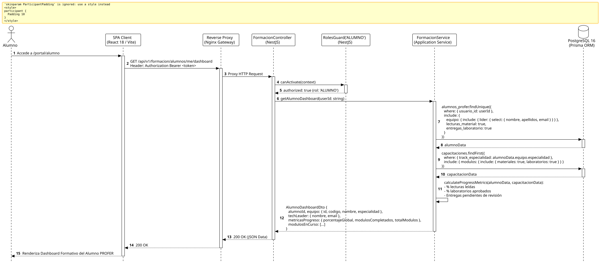

<div align="center">

| [Inicio](/README.md) | [RUP Hub](/RUP/README.md) | [00 Dominio](/RUP/00-modelo-del-dominio/README.md) | [01 Requisitos](/RUP/01-requisitos/README.md) | [02 Análisis](/RUP/02-analisis/README.md) | [03 Diseño](/RUP/03-diseño/README.md) | [Catálogo Diseño](/RUP/03-diseño/casos-uso/README.md) |
|:---:|:---:|:---:|:---:|:---:|:---:|:---:|

<sub>**Fase 03 Diseño** › **Realización de Casos de Uso** › `abrirPanelAlumno()`</sub>

</div>

# Realización de Diseño: `abrirPanelAlumno()`

Esta especificación formaliza el diseño técnico y contrato de interfaz para el caso de uso `abrirPanelAlumno()`. Constituye el espacio de trabajo central del becario PROFER, consolidando su vinculación al Squad técnico ([ADR-004](/RUP/BITACORA.md#adr-004-embudo-en-2-fases-y-asignaci%C3%B3n-a-los-6-equipos-de-cts)), su Tech Leader asignado ([ADR-013](/RUP/BITACORA.md#adr-013-simplificaci%C3%B3n-pragm%C3%A1tica-del-modelo-de-datos-der-y-alineaci%C3%B3n-con-la-operativa-real-de-cts)) y las métricas de avance en el track formativo.

---

<div align="center">

| Diagrama de Secuencia de Diseño UML |
| :---: |
|  |
| <sup><i>[Código fuente PlantUML](secuenciaDiseño.puml)</i></sup> |

</div>

---

## 1. Contrato de Interfaz REST (OpenAPI 3.1)

### 1.1 Definición del Endpoint

* **Ruta HTTP**: `GET /api/v1/formacion/alumnos/me/dashboard`
* **Acceso / Seguridad**: Autenticado mediante `Bearer <accessToken>` con rol exclusivo `ALUMNO`.
* **Cabeceras de Petición**:
  * `Authorization: Bearer <accessToken>`
  * `Accept: application/json`

### 1.2 Respuestas Canónicas (DTOs de Salida)

#### `200 OK` — Dashboard Formativo

```json
{
  "statusCode": 200,
  "data": {
    "alumnoId": "3b2c1a09-87d6-454a-12a6-9998987ecda1",
    "equipo": {
      "id": "77777777-8888-9999-aaaa-bbbbbbbbbbbb",
      "codigo": "TEAM-01",
      "nombre": "Squad Fénix - Core & Arquitectura",
      "especialidad": "Backend & Cloud Architecture"
    },
    "techLeader": {
      "nombre": "Diego Moys",
      "email": "diego.moys@ctdesarrollo-sdr.org"
    },
    "metricasProgreso": {
      "porcentajeGlobal": 65.0,
      "modulosCompletados": 2,
      "totalModulos": 4,
      "laboratoriosAprobados": 5,
      "laboratoriosPendientes": 1
    },
    "modulos": [
      {
        "id": "m1a2b3c4-d5e6-7f8a-9b0c-1d2e3f4a5b6c",
        "titulo": "Arquitectura Hexagonal y DDD en NestJS",
        "orden": 1,
        "estado": "EN_CURSO",
        "porcentaje": 75.0
      }
    ]
  }
}
```

---

## 2. Componentes de Software de Diseño (NestJS)

* **`FormacionController`**: Endpoint `GET /alumnos/me/dashboard` con `@Roles('ALUMNO')`.
* **`FormacionService.getAlumnoDashboard`**: Agregación de datos entre `motor_equipos.alumnos_profer`, `equipos` y `motor_formacion.capacitaciones`.

---

## 3. Trazabilidad con Requisitos y Análisis

| Requisito / Análisis | Realización de Diseño |
| :--- | :--- |
| **Caso de Uso `abrirPanelAlumno()`** | Endpoint `GET /api/v1/formacion/alumnos/me/dashboard`. |
| **Pertenencia a Squad (ADR-004)** | Información directa de `equipos` y su Tech Leader titular (`lider_usuario_id`). |
| **Estructura Formativa (ADR-010)** | Seguimiento curricular modular en `motor_formacion`. |

---

<div align="center">

[Ver Análisis previo (Fase 02)](/RUP/02-analisis/casos-uso/abrirPanelAlumno/README.md) • [Catálogo de Casos de Uso (Diseño)](/RUP/03-diseño/casos-uso/README.md) • [Siguiente: `consultarCapacitacion()`](../consultarCapacitacion/README.md)

</div>
