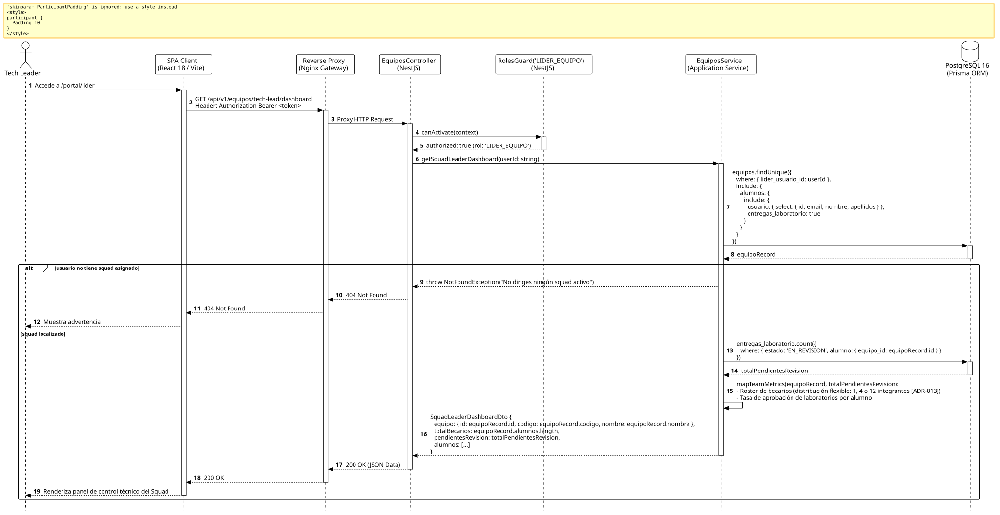

<div align="center">

| [Inicio](/README.md) | [RUP Hub](/RUP/README.md) | [00 Dominio](/RUP/00-modelo-del-dominio/README.md) | [01 Requisitos](/RUP/01-requisitos/README.md) | [02 Análisis](/RUP/02-analisis/README.md) | [03 Diseño](/RUP/03-diseño/README.md) | [Catálogo Diseño](/RUP/03-diseño/casos-uso/README.md) |
|:---:|:---:|:---:|:---:|:---:|:---:|:---:|

<sub>**Fase 03 Diseño** › **Realización de Casos de Uso** › `abrirPanelLider()`</sub>

</div>

# Realización de Diseño: `abrirPanelLider()`

Esta especificación formaliza el diseño técnico y contrato de interfaz para el caso de uso `abrirPanelLider()`. Modela el acceso al panel directivo del Tech Leader sobre su Squad técnico, aplicando la vinculación limpia mediante `motor_equipos.equipos.lider_usuario_id` ([ADR-013](/RUP/BITACORA.md#adr-013-simplificaci%C3%B3n-pragm%C3%A1tica-del-modelo-de-datos-der-y-alineaci%C3%B3n-con-la-operativa-real-de-cts)) y permitiendo la gestión de plantillas de becarios flexibles sin restricciones artificiales de cupo (equipos de 1, 4 o 12 integrantes).

---

<div align="center">

| Diagrama de Secuencia de Diseño UML |
| :---: |
|  |
| <sup><i>[Código fuente PlantUML](secuenciaDiseño.puml)</i></sup> |

</div>

---

## 1. Contrato de Interfaz REST (OpenAPI 3.1)

### 1.1 Definición del Endpoint

* **Ruta HTTP**: `GET /api/v1/equipos/tech-lead/dashboard`
* **Acceso / Seguridad**: Autenticado mediante `Bearer <accessToken>` con rol exclusivo `LIDER_EQUIPO`.
* **Cabeceras de Petición**:
  * `Authorization: Bearer <accessToken>`
  * `Accept: application/json`

### 1.2 Respuestas Canónicas (DTOs de Salida)

#### `200 OK` — Dashboard del Squad

```json
{
  "statusCode": 200,
  "data": {
    "equipo": {
      "id": "77777777-8888-9999-aaaa-bbbbbbbbbbbb",
      "codigo": "TEAM-01",
      "nombre": "Squad Fénix - Core & Arquitectura",
      "especialidad": "Backend & Cloud Architecture"
    },
    "totalBecarios": 4,
    "pendientesRevision": 2,
    "alumnos": [
      {
        "id": "3b2c1a09-87d6-454a-12a6-9998987ecda1",
        "nombre": "Carlos Gómez",
        "email": "carlos.gomez@alumnos.uneatlantico.es",
        "matriculaActiva": true,
        "laboratoriosCompletados": 5,
        "entregasPendientes": 1
      }
    ]
  }
}
```

---

## 2. Componentes de Software de Diseño (NestJS)

* **`EquiposController`**: Endpoint `GET /tech-lead/dashboard` protegido con `@Roles('LIDER_EQUIPO')`.
* **`EquiposService.getSquadLeaderDashboard`**: Identificación inmediata del squad a través de `motor_equipos.equipos.lider_usuario_id = req.user.id`.

---

## 3. Trazabilidad con Requisitos y Análisis

| Requisito / Análisis | Realización de Diseño |
| :--- | :--- |
| **Caso de Uso `abrirPanelLider()`** | Endpoint `GET /api/v1/equipos/tech-lead/dashboard`. |
| **Gobernanza de Squad (ADR-004)** | Tutoría exclusiva sobre los alumnos del equipo liderado. |
| **Plantilla Flexible (ADR-013)** | Modelo dinámico sin cuotas fijas por equipo. |

---

<div align="center">

[Ver Análisis previo (Fase 02)](/RUP/02-analisis/casos-uso/abrirPanelLider/README.md) • [Catálogo de Casos de Uso (Diseño)](/RUP/03-diseño/casos-uso/README.md) • [Siguiente: `abrirPanelAdmisiones()`](../abrirPanelAdmisiones/README.md)

</div>
