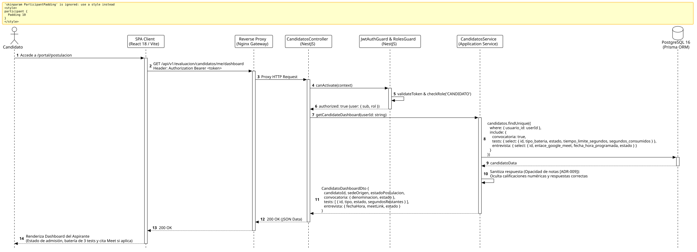

<div align="center">

| [Inicio](/README.md) | [RUP Hub](/RUP/README.md) | [00 Dominio](/RUP/00-modelo-del-dominio/README.md) | [01 Requisitos](/RUP/01-requisitos/README.md) | [02 Análisis](/RUP/02-analisis/README.md) | [03 Diseño](/RUP/03-diseño/README.md) | [Catálogo Diseño](/RUP/03-diseño/casos-uso/README.md) |
|:---:|:---:|:---:|:---:|:---:|:---:|:---:|

<sub>**Fase 03 Diseño** › **Realización de Casos de Uso** › `abrirPanelPostulacion()`</sub>

</div>

# Realización de Diseño: `abrirPanelPostulacion()`

Esta especificación formaliza el diseño técnico y contrato de interfaz para el caso de uso `abrirPanelPostulacion()`, puerta de entrada para los aspirantes admitidos al proceso de selección del Programa PROFER. Cumple estrictamente con la política de **opacidad de calificaciones** ([ADR-009](/RUP/BITACORA.md#adr-009-delimitaci%C3%B3n-de-actores-opacidad-de-tests-para-el-candidato-entrevistas-google-meet-en-el-perfil-por-el-gestor-y-aislamiento-del-tl)), exponiendo únicamente el estado de avance, las 3 pruebas de la batería y la cita de entrevista virtual en Google Meet si ha sido programada.

---

<div align="center">

| Diagrama de Secuencia de Diseño UML |
| :---: |
|  |
| <sup><i>[Código fuente PlantUML](secuenciaDiseño.puml)</i></sup> |

</div>

---

## 1. Contrato de Interfaz REST (OpenAPI 3.1)

### 1.1 Definición del Endpoint

* **Ruta HTTP**: `GET /api/v1/evaluacion/candidatos/me/dashboard`
* **Acceso / Seguridad**: Autenticado mediante `Bearer <accessToken>` con rol exclusivo `CANDIDATO` (`@UseGuards(JwtAuthGuard, RolesGuard)`).
* **Cabeceras de Petición**:
  * `Authorization: Bearer <accessToken>`
  * `Accept: application/json`

### 1.2 Respuestas Canónicas (DTOs de Salida)

#### `200 OK` — Dashboard del Aspirante

```json
{
  "statusCode": 200,
  "data": {
    "candidatoId": "c1f7a049-74d6-444a-97a6-8968987ecda8",
    "sedeOrigen": "El Salvador (SDR)",
    "estadoPostulacion": "EN_PROCESO",
    "convocatoria": {
      "id": "e2a3b4c5-0011-2233-4455-66778899aabb",
      "denominacion": "Convocatoria PROFER 2026-I",
      "estado": "ABIERTA"
    },
    "bateriaTests": [
      {
        "testId": "a1b2c3d4-e5f6-7a8b-9c0d-1e2f3a4b5c6d",
        "tipoBateria": "ACTITUD",
        "estado": "COMPLETADO",
        "tiempoLimiteSegundos": 1800,
        "segundosConsumidos": 1240
      },
      {
        "testId": "b2c3d4e5-f6a7-8b9c-0d1e-2f3a4b5c6d7e",
        "tipoBateria": "APTITUD",
        "estado": "NO_INICIADO",
        "tiempoLimiteSegundos": 2400,
        "segundosConsumidos": 0
      },
      {
        "testId": "c3d4e5f6-a7b8-9c0d-1e2f-3a4b5c6d7e8f",
        "tipoBateria": "TECNICO",
        "estado": "NO_INICIADO",
        "tiempoLimiteSegundos": 3600,
        "segundosConsumidos": 0
      }
    ],
    "entrevista": {
      "programada": true,
      "fechaHoraProgramada": "2026-11-15T15:00:00.000Z",
      "enlaceGoogleMeet": "https://meet.google.com/cts-prof-sel",
      "estado": "PROGRAMADA"
    }
  }
}
```

#### `403 Forbidden` — Acceso Denegado por Rol

Emitido si un usuario con rol distinto de `CANDIDATO` intenta consultar este recurso.

```json
{
  "statusCode": 403,
  "error": "Forbidden",
  "message": "Acceso restringido a postulantes del proceso de selección"
}
```

---

## 2. Componentes de Software de Diseño (NestJS)

```text
src/modules/evaluacion/
├── controllers/
│   └── candidatos.controller.ts     ──► Endpoint GET /me/dashboard con @Roles('CANDIDATO').
├── services/
│   └── candidatos.service.ts        ──► Obtención de expediente y sanitización opaca de notas.
├── dto/
│   └── candidato-dashboard.dto.ts   ──► Esquema serializado sin atributos confidenciales.
└── repositories/
    └── candidatos.repository.ts     ──► Query relacional contra motor_evaluacion.candidatos.
```

---

## 3. Trazabilidad con Requisitos y Análisis

| Requisito / Análisis | Realización de Diseño |
| :--- | :--- |
| **Caso de Uso `abrirPanelPostulacion()`** | Endpoint `GET /api/v1/evaluacion/candidatos/me/dashboard` en `CandidatosController`. |
| **Actor `Candidato` (ADR-008)** | Validador `RolesGuard('CANDIDATO')`. |
| **Regla de Opacidad (ADR-009)** | DTO `CandidatoDashboardDto` omite campos `calificacion_obtenida` y notas cualitativas. |
| **Batería de 3 Tests (ADR-007)** | Array estructurado de las instancias `ACTITUD`, `APTITUD` y `TECNICO`. |
| **Cita Google Meet (ADR-009)** | Objeto condicional `entrevista` vinculado si el Gestor ha fijado el agendamiento. |

---

<div align="center">

[Ver Análisis previo (Fase 02)](/RUP/02-analisis/casos-uso/abrirPanelPostulacion/README.md) • [Catálogo de Casos de Uso (Diseño)](/RUP/03-diseño/casos-uso/README.md) • [Siguiente: `iniciarTest()`](../iniciarTest/README.md)

</div>
