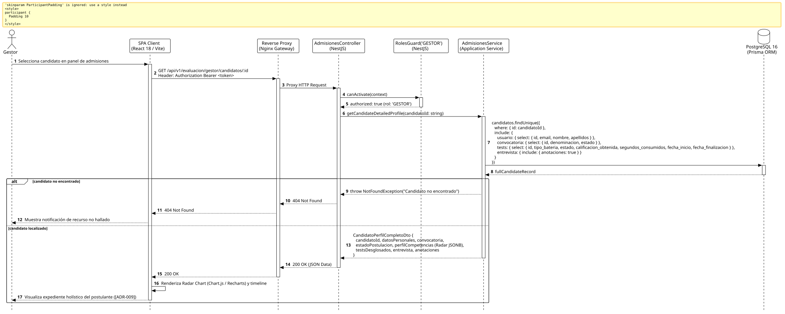

<div align="center">

| [Inicio](/README.md) | [RUP Hub](/RUP/README.md) | [00 Dominio](/RUP/00-modelo-del-dominio/README.md) | [01 Requisitos](/RUP/01-requisitos/README.md) | [02 Análisis](/RUP/02-analisis/README.md) | [03 Diseño](/RUP/03-diseño/README.md) | [Catálogo Diseño](/RUP/03-diseño/casos-uso/README.md) |
|:---:|:---:|:---:|:---:|:---:|:---:|:---:|

<sub>**Fase 03 Diseño** › **Realización de Casos de Uso** › `abrirPerfilCandidato()`</sub>

</div>

# Realización de Diseño: `abrirPerfilCandidato()`

Esta especificación formaliza el diseño técnico y contrato de interfaz para el caso de uso `abrirPerfilCandidato()`. Constituye el centro de mando de toma de decisiones del Gestor de Admisiones ([ADR-009](/RUP/BITACORA.md#adr-009-delimitaci%C3%B3n-de-actores-opacidad-de-tests-para-el-candidato-entrevistas-google-meet-en-el-perfil-por-el-gestor-y-aislamiento-del-tl)), donde se consume el objeto JSONB de **radar de competencias multidimensional** ([ADR-013](/RUP/BITACORA.md#adr-013-simplificaci%C3%B3n-pragm%C3%A1tica-del-modelo-de-datos-der-y-alineaci%C3%B3n-con-la-operativa-real-de-cts)), el desglose analítico de los 3 tests y el historial de entrevistas.

---

<div align="center">

| Diagrama de Secuencia de Diseño UML |
| :---: |
|  |
| <sup><i>[Código fuente PlantUML](secuenciaDiseño.puml)</i></sup> |

</div>

---

## 1. Contrato de Interfaz REST (OpenAPI 3.1)

### 1.1 Definición del Endpoint

* **Ruta HTTP**: `GET /api/v1/evaluacion/gestor/candidatos/:id`
* **Acceso / Seguridad**: Autenticado con `Bearer <accessToken>` y rol exclusivo `GESTOR` (`@UseGuards(JwtAuthGuard, RolesGuard)`).
* **Parámetros de Ruta**:
  * `id` (`uuid`, obligatorio): Identificador único de `Candidato`.
* **Cabeceras de Petición**:
  * `Authorization: Bearer <accessToken>`
  * `Accept: application/json`

### 1.2 Respuestas Canónicas (DTOs de Salida)

#### `200 OK` — Expediente Detallado del Candidato

```json
{
  "statusCode": 200,
  "data": {
    "candidatoId": "c1f7a049-74d6-444a-97a6-8968987ecda8",
    "datosPersonales": {
      "nombre": "Carlos",
      "apellidos": "Gómez",
      "email": "carlos.gomez@alumnos.uneatlantico.es",
      "telefono": "+503 7123-4567",
      "sedeOrigen": "El Salvador (SDR)"
    },
    "convocatoria": {
      "id": "e2a3b4c5-0011-2233-4455-66778899aabb",
      "denominacion": "Convocatoria PROFER 2026-I"
    },
    "estadoPostulacion": "TESTS_COMPLETADOS",
    "decisionAdmision": "PENDIENTE",
    "perfilCompetencias": {
      "dimensiones": {
        "actitud": { "puntaje": 88.5, "factores": { "compromiso": 90, "trabajoEquipo": 85 } },
        "aptitud": { "puntaje": 82.0, "factores": { "razonamientoLogico": 80, "resolucion": 84 } },
        "tecnico": { "puntaje": 85.0, "factores": { "javascript": 90, "sql": 75, "algoritmos": 90 } }
      },
      "indiceAfinidadGlobal": 85.16
    },
    "bateriaTests": [
      {
        "tipoBateria": "ACTITUD",
        "estado": "COMPLETADO",
        "calificacionObtenida": 88.5,
        "segundosConsumidos": 1240
      },
      {
        "tipoBateria": "APTITUD",
        "estado": "COMPLETADO",
        "calificacionObtenida": 82.0,
        "segundosConsumidos": 1820
      },
      {
        "tipoBateria": "TECNICO",
        "estado": "COMPLETADO",
        "calificacionObtenida": 85.0,
        "segundosConsumidos": 3100
      }
    ],
    "entrevista": null
  }
}
```

---

## 2. Componentes de Software de Diseño (NestJS)

* **`AdmisionesController`**: Endpoint `GET /gestor/candidatos/:id` decorado con `@Roles('GESTOR')`.
* **`AdmisionesService.getCandidateDetailedProfile`**: Query optimizada con `include` relacional hacia `motor_equipos.usuarios`, `motor_evaluacion.tests` y `motor_evaluacion.entrevistas`.
* **Frontend SPA (`CandidatoProfileView`)**: Componente React con visualizador de radar SVG (`Recharts / Chart.js`) que mapea directamente el campo JSONB.

---

## 3. Trazabilidad con Requisitos y Análisis

| Requisito / Análisis | Realización de Diseño |
| :--- | :--- |
| **Caso de Uso `abrirPerfilCandidato()`** | Endpoint `GET /api/v1/evaluacion/gestor/candidatos/:id`. |
| **Actor `Gestor` (ADR-009)** | Restricción por rol RBAC `@Roles('GESTOR')`. |
| **Visualización del Radar (ADR-013)** | Retorno transparente de `perfil_competencias (jsonb)` para renderizado gráfico. |

---

<div align="center">

[Ver Análisis previo (Fase 02)](/RUP/02-analisis/casos-uso/abrirPerfilCandidato/README.md) • [Catálogo de Casos de Uso (Diseño)](/RUP/03-diseño/casos-uso/README.md) • [Siguiente: `agendarEntrevistaGoogleMeet()`](../agendarEntrevistaGoogleMeet/README.md)

</div>
