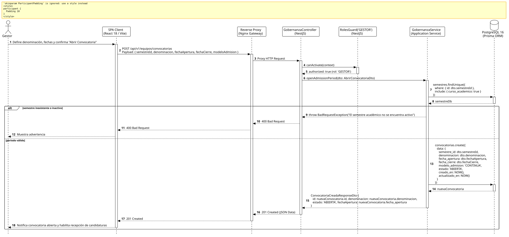

<div align="center">

| [Inicio](/README.md) | [RUP Hub](/RUP/README.md) | [00 Dominio](/RUP/00-modelo-del-dominio/README.md) | [01 Requisitos](/RUP/01-requisitos/README.md) | [02 Análisis](/RUP/02-analisis/README.md) | [03 Diseño](/RUP/03-diseño/README.md) | [Catálogo Diseño](/RUP/03-diseño/casos-uso/README.md) |
|:---:|:---:|:---:|:---:|:---:|:---:|:---:|

<sub>**Fase 03 Diseño** › **Realización de Casos de Uso** › `abrirPeriodoIngreso()`</sub>

</div>

# Realización de Diseño: `abrirPeriodoIngreso()`

Esta especificación formaliza el diseño técnico y contrato de interfaz para el caso de uso `abrirPeriodoIngreso()`. Modela la creación e inicio formal de un ciclo de admisión bajo el esquema de **admisión continua 365 días al año** ([ADR-007](/RUP/BITACORA.md#adr-007-admisi%C3%B3n-continua-por-ciclos-acad%C3%A9micos-bater%C3%ADa-de-3-tests-e-inclusi%C3%B3n-de-entrevista)), canalizado a través de los semestres académicos en `motor_evaluacion.convocatorias`.

---

<div align="center">

| Diagrama de Secuencia de Diseño UML |
| :---: |
|  |
| <sup><i>[Código fuente PlantUML](secuenciaDiseño.puml)</i></sup> |

</div>

---

## 1. Contrato de Interfaz REST (OpenAPI 3.1)

### 1.1 Definición del Endpoint

* **Ruta HTTP**: `POST /api/v1/equipos/convocatorias`
* **Acceso / Seguridad**: Autenticado mediante `Bearer <accessToken>` con rol exclusivo `GESTOR`.
* **Cabeceras de Petición**:
  * `Authorization: Bearer <accessToken>`
  * `Content-Type: application/json`

### 1.2 DTO de Entrada (`AbrirConvocatoriaDto`)

```typescript
import { IsUUID, IsNotEmpty, IsString, IsISO8601, IsIn } from 'class-validator';

export class AbrirConvocatoriaDto {
  @IsUUID('4')
  @IsNotEmpty()
  semestreId: string;

  @IsString()
  @IsNotEmpty()
  denominacion: string;

  @IsISO8601()
  @IsNotEmpty()
  fechaApertura: string;

  @IsISO8601()
  @IsNotEmpty()
  fechaCierre: string;

  @IsIn(['CONTINUA', 'ORDINARIA'])
  modeloAdmision: 'CONTINUA' | 'ORDINARIA' = 'CONTINUA';
}
```

### 1.3 Respuestas Canónicas (DTOs de Salida)

#### `201 Created` — Convocatoria Abierta

```json
{
  "statusCode": 201,
  "message": "Periodo de ingreso académico abierto satisfactoriamente",
  "data": {
    "id": "e2a3b4c5-0011-2233-4455-66778899aabb",
    "semestreId": "sem-2026-1",
    "denominacion": "Convocatoria PROFER 2026-I",
    "estado": "ABIERTA",
    "fechaApertura": "2026-11-01T00:00:00.000Z",
    "fechaCierre": "2027-02-28T23:59:59.000Z"
  }
}
```

---

## 2. Componentes de Software de Diseño (NestJS)

* **`GobernanzaController`**: Endpoint `POST /convocatorias` con `@Roles('GESTOR')`.
* **`GobernanzaService.openAdmissionPeriod`**: Inserción en `motor_evaluacion.convocatorias`.

---

## 3. Trazabilidad con Requisitos y Análisis

| Requisito / Análisis | Realización de Diseño |
| :--- | :--- |
| **Caso de Uso `abrirPeriodoIngreso()`** | Endpoint `POST /api/v1/equipos/convocatorias`. |
| **Admisión Continua (ADR-007)** | `modelo_admision = 'CONTINUA'` asociado al ciclo de semestre. |
| **Apertura Institucional** | Estado inicial `ABIERTA` que permite recepcionar lotes de candidatos por sede. |

---

<div align="center">

[Ver Análisis previo (Fase 02)](/RUP/02-analisis/casos-uso/abrirPeriodoIngreso/README.md) • [Catálogo de Casos de Uso (Diseño)](/RUP/03-diseño/casos-uso/README.md) • [Siguiente: `cerrarCorteSemestral()`](../cerrarCorteSemestral/README.md)

</div>
