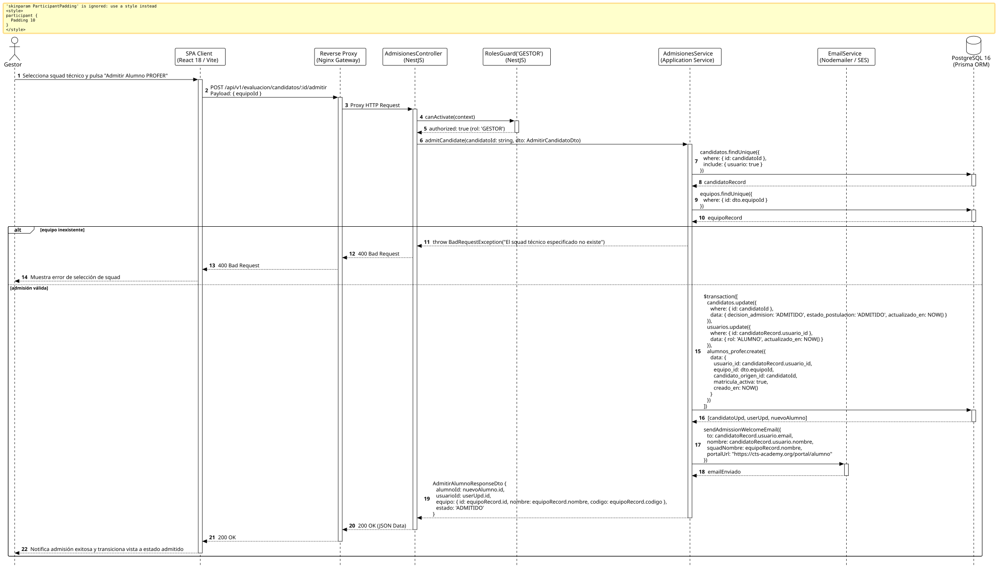

<div align="center">

| [Inicio](/README.md) | [RUP Hub](/RUP/README.md) | [00 Dominio](/RUP/00-modelo-del-dominio/README.md) | [01 Requisitos](/RUP/01-requisitos/README.md) | [02 Análisis](/RUP/02-analisis/README.md) | [03 Diseño](/RUP/03-diseño/README.md) | [Catálogo Diseño](/RUP/03-diseño/casos-uso/README.md) |
|:---:|:---:|:---:|:---:|:---:|:---:|:---:|

<sub>**Fase 03 Diseño** › **Realización de Casos de Uso** › `admitirAlumnoProfer()`</sub>

</div>

# Realización de Diseño: `admitirAlumnoProfer()`

Esta especificación formaliza el diseño técnico y contrato de interfaz para el caso de uso `admitirAlumnoProfer()`. Modela la transacción atómica crítica de **transición de ciclo de vida de Candidato a Alumno PROFER** ([ADR-010](/RUP/BITACORA.md#adr-010-refinamiento-estructural-del-dominio-top-to-bottom-transici%C3%B3n-candidato-alumno-y-redise%C3%B1o-pedag%C3%B3gico-de-materiales)), actualización de permisos RBAC en `motor_equipos.usuarios.rol = 'ALUMNO'`, adscripción flexible a uno de los 6 squads técnicos (`motor_equipos.alumnos_profer`) ([ADR-013](/RUP/BITACORA.md#adr-013-simplificaci%C3%B3n-pragm%C3%A1tica-del-modelo-de-datos-der-y-alineaci%C3%B3n-con-la-operativa-real-de-cts)) y notificación de bienvenida.

---

<div align="center">

| Diagrama de Secuencia de Diseño UML |
| :---: |
|  |
| <sup><i>[Código fuente PlantUML](secuenciaDiseño.puml)</i></sup> |

</div>

---

## 1. Contrato de Interfaz REST (OpenAPI 3.1)

### 1.1 Definición del Endpoint

* **Ruta HTTP**: `POST /api/v1/evaluacion/candidatos/:id/admitir`
* **Acceso / Seguridad**: Autenticado mediante `Bearer <accessToken>` con rol exclusivo `GESTOR`.
* **Parámetros de Ruta**:
  * `id` (`uuid`, obligatorio): Identificador del candidato a admitir.
* **Cabeceras de Petición**:
  * `Authorization: Bearer <accessToken>`
  * `Content-Type: application/json`

### 1.2 DTO de Entrada (`AdmitirCandidatoDto`)

```typescript
import { IsUUID, IsNotEmpty } from 'class-validator';

export class AdmitirCandidatoDto {
  @IsUUID('4', { message: 'El identificador del equipo debe ser un UUID v4 válido' })
  @IsNotEmpty()
  equipoId: string;
}
```

### 1.3 Respuestas Canónicas (DTOs de Salida)

#### `200 OK` — Admisión y Adscripción Exitosa

```json
{
  "statusCode": 200,
  "message": "Candidato admitido y matriculado como Alumno PROFER exitosamente",
  "data": {
    "candidatoId": "c1f7a049-74d6-444a-97a6-8968987ecda8",
    "alumnoId": "3b2c1a09-87d6-454a-12a6-9998987ecda1",
    "usuarioId": "a9b8c7d6-e5f4-3a2b-1c0d-e9f8a7b6c5d4",
    "nuevoRol": "ALUMNO",
    "equipoAsignado": {
      "id": "77777777-8888-9999-aaaa-bbbbbbbbbbbb",
      "codigo": "TEAM-01",
      "nombre": "Squad Fénix - Core & Arquitectura",
      "especialidad": "Backend & Cloud Architecture"
    },
    "estadoPostulacion": "ADMITIDO"
  }
}
```

---

## 2. Transacción Atómica de Persistencia (PostgreSQL 16)

La operación se ejecuta en una única transacción trans-esquema garantizando integridad referencial:

```typescript
await this.prisma.$transaction([
  // 1. Cierre favorable de la postulación
  this.prisma.candidatos.update({
    where: { id: candidatoId },
    data: { decision_admision: 'ADMITIDO', estado_postulacion: 'ADMITIDO', actualizado_en: new Date() }
  }),
  // 2. Elevación de rol en la identidad digital
  this.prisma.usuarios.update({
    where: { id: candidatoRecord.usuario_id },
    data: { rol: 'ALUMNO', actualizado_en: new Date() }
  }),
  // 3. Matrícula y adscripción al Squad técnico
  this.prisma.alumnos_profer.create({
    data: {
      usuario_id: candidatoRecord.usuario_id,
      equipo_id: dto.equipoId,
      candidato_origen_id: candidatoId,
      matricula_activa: true
    }
  })
]);
```

---

## 3. Trazabilidad con Requisitos y Análisis

| Requisito / Análisis | Realización de Diseño |
| :--- | :--- |
| **Caso de Uso `admitirAlumnoProfer()`** | Endpoint `POST /api/v1/evaluacion/candidatos/:id/admitir`. |
| **Transición Candidato $\rightarrow$ Alumno (ADR-010)** | Inserción en `motor_equipos.alumnos_profer` preservando `candidato_origen_id`. |
| **Flexibilidad de Cupo (ADR-013)** | Asignación directa a cualquiera de los 6 squads sin bloqueos rígidos de cuota máxima. |
| **RBAC Limpio** | Actualización de `usuarios.rol = 'ALUMNO'`. |

---

<div align="center">

[Ver Análisis previo (Fase 02)](/RUP/02-analisis/casos-uso/admitirAlumnoProfer/README.md) • [Catálogo de Casos de Uso (Diseño)](/RUP/03-diseño/casos-uso/README.md) • [Siguiente: `rechazarCandidatura()`](../rechazarCandidatura/README.md)

</div>
