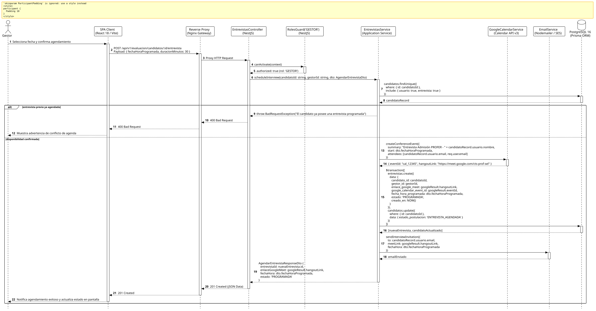

<div align="center">

| [Inicio](/README.md) | [RUP Hub](/RUP/README.md) | [00 Dominio](/RUP/00-modelo-del-dominio/README.md) | [01 Requisitos](/RUP/01-requisitos/README.md) | [02 Análisis](/RUP/02-analisis/README.md) | [03 Diseño](/RUP/03-diseño/README.md) | [Catálogo Diseño](/RUP/03-diseño/casos-uso/README.md) |
|:---:|:---:|:---:|:---:|:---:|:---:|:---:|

<sub>**Fase 03 Diseño** › **Realización de Casos de Uso** › `agendarEntrevistaGoogleMeet()`</sub>

</div>

# Realización de Diseño: `agendarEntrevistaGoogleMeet()`

Esta especificación formaliza el diseño técnico y contrato de interfaz para el caso de uso `agendarEntrevistaGoogleMeet()`. Implementa la integración con la **Google Calendar API v3** para la generación automatizada de salas virtuales en Google Meet ([ADR-009](/RUP/BITACORA.md#adr-009-delimitaci%C3%B3n-de-actores-opacidad-de-tests-para-el-candidato-entrevistas-google-meet-en-el-perfil-por-el-gestor-y-aislamiento-del-tl)), la persistencia en `motor_evaluacion.entrevistas` y el despacho de invitaciones formales por correo electrónico.

---

<div align="center">

| Diagrama de Secuencia de Diseño UML |
| :---: |
|  |
| <sup><i>[Código fuente PlantUML](secuenciaDiseño.puml)</i></sup> |

</div>

---

## 1. Contrato de Interfaz REST (OpenAPI 3.1)

### 1.1 Definición del Endpoint

* **Ruta HTTP**: `POST /api/v1/evaluacion/candidatos/:id/entrevista`
* **Acceso / Seguridad**: Autenticado mediante `Bearer <accessToken>` con rol exclusivo `GESTOR`.
* **Parámetros de Ruta**:
  * `id` (`uuid`, obligatorio): Identificador del candidato a entrevistar.
* **Cabeceras de Petición**:
  * `Authorization: Bearer <accessToken>`
  * `Content-Type: application/json`

### 1.2 DTO de Entrada (`AgendarEntrevistaDto`)

```typescript
import { IsISO8601, IsInt, Min, Max, IsNotEmpty } from 'class-validator';

export class AgendarEntrevistaDto {
  @IsISO8601({}, { message: 'La fecha y hora deben ser una cadena ISO 8601 válida' })
  @IsNotEmpty()
  fechaHoraProgramada: string;

  @IsInt()
  @Min(15)
  @Max(120)
  duracionMinutos: number = 30;
}
```

### 1.3 Respuestas Canónicas (DTOs de Salida)

#### `201 Created` — Cita Virtual Programada

```json
{
  "statusCode": 201,
  "message": "Entrevista agendada exitosamente en Google Meet",
  "data": {
    "entrevistaId": "9b1deb4d-3b7d-4bad-9bdd-2b0d7b3dcb6d",
    "candidatoId": "c1f7a049-74d6-444a-97a6-8968987ecda8",
    "enlaceGoogleMeet": "https://meet.google.com/cts-prof-sel",
    "googleCalendarEventId": "cal_123456789abcdef",
    "fechaHoraProgramada": "2026-11-15T15:00:00.000Z",
    "estado": "PROGRAMADA"
  }
}
```

---

## 2. Componentes de Software y Servicios Cloud

* **`EntrevistasController`**: Endpoint `POST /candidatos/:id/entrevista` protegido con `@Roles('GESTOR')`.
* **`GoogleCalendarService`**: Servicio adaptador que autentica con Service Account en Google Workspace, invocando `calendar.events.insert` con `conferenceDataVersion=1`.
* **`EmailService`**: Despacho de plantilla HTML transaccional con detalles de la cita y botón de acceso a Google Meet.
* **`EntrevistasRepository`**: Inserción en `motor_evaluacion.entrevistas` con clave foránea `gestor_id -> motor_equipos.usuarios.id`.

---

## 3. Trazabilidad con Requisitos y Análisis

| Requisito / Análisis | Realización de Diseño |
| :--- | :--- |
| **Caso de Uso `agendarEntrevistaGoogleMeet()`** | Endpoint `POST /api/v1/evaluacion/candidatos/:id/entrevista`. |
| **Iniciativa Unilateral del Gestor (ADR-009)** | Convocatoria gestionada exclusivamente por el Gestor desde el perfil del aspirante. |
| **Integración Google Meet (ADR-009)** | Conexión con Google Calendar API v3 y generación de `hangoutLink`. |
| **Transición de Candidatura** | Actualización de `candidatos.estado_postulacion = 'ENTREVISTA_AGENDADA'`. |

---

<div align="center">

[Ver Análisis previo (Fase 02)](/RUP/02-analisis/casos-uso/agendarEntrevistaGoogleMeet/README.md) • [Catálogo de Casos de Uso (Diseño)](/RUP/03-diseño/casos-uso/README.md) • [Siguiente: `registrarAnotacionesEntrevista()`](../registrarAnotacionesEntrevista/README.md)

</div>
