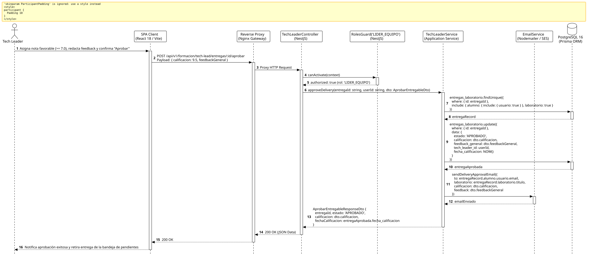

<div align="center">

| [Inicio](/README.md) | [RUP Hub](/RUP/README.md) | [00 Dominio](/RUP/00-modelo-del-dominio/README.md) | [01 Requisitos](/RUP/01-requisitos/README.md) | [02 Análisis](/RUP/02-analisis/README.md) | [03 Diseño](/RUP/03-diseño/README.md) | [Catálogo Diseño](/RUP/03-diseño/casos-uso/README.md) |
|:---:|:---:|:---:|:---:|:---:|:---:|:---:|

<sub>**Fase 03 Diseño** › **Realización de Casos de Uso** › `aprobarEntregable()`</sub>

</div>

# Realización de Diseño: `aprobarEntregable()`

Esta especificación formaliza el diseño técnico y contrato de interfaz para el caso de uso `aprobarEntregable()`. Modela el veredicto aprobatorio emitido por el Tech Leader titular ([ADR-004](/RUP/BITACORA.md#adr-004-embudo-en-2-fases-y-asignaci%C3%B3n-a-los-6-equipos-de-cts)), asignando la calificación sobre 10.0, persistiendo las observaciones en `motor_formacion.entregas_laboratorio.feedback_general` y vinculando al evaluador mediante `tech_leader_id` ([ADR-013](/RUP/BITACORA.md#adr-013-simplificaci%C3%B3n-pragm%C3%A1tica-del-modelo-de-datos-der-y-alineaci%C3%B3n-con-la-operativa-real-de-cts)).

---

<div align="center">

| Diagrama de Secuencia de Diseño UML |
| :---: |
|  |
| <sup><i>[Código fuente PlantUML](secuenciaDiseño.puml)</i></sup> |

</div>

---

## 1. Contrato de Interfaz REST (OpenAPI 3.1)

### 1.1 Definición del Endpoint

* **Ruta HTTP**: `POST /api/v1/formacion/tech-lead/entregas/:id/aprobar`
* **Acceso / Seguridad**: Autenticado mediante `Bearer <accessToken>` con rol exclusivo `LIDER_EQUIPO`.
* **Parámetros de Ruta**:
  * `id` (`uuid`, obligatorio): Identificador de la entrega.
* **Cabeceras de Petición**:
  * `Authorization: Bearer <accessToken>`
  * `Content-Type: application/json`

### 1.2 DTO de Entrada (`AprobarEntregableDto`)

```typescript
import { IsNumber, Min, Max, IsString, IsNotEmpty } from 'class-validator';

export class AprobarEntregableDto {
  @IsNumber({ maxDecimalPlaces: 2 }, { message: 'La calificación debe ser un valor numérico' })
  @Min(7.0, { message: 'La nota mínima aprobatoria es 7.00' })
  @Max(10.0, { message: 'La nota máxima es 10.00' })
  calificacion: number;

  @IsString()
  @IsNotEmpty({ message: 'El feedback técnico es obligatorio para justificar la aprobación' })
  feedbackGeneral: string;
}
```

### 1.3 Respuestas Canónicas (DTOs de Salida)

#### `200 OK` — Laboratorio Aprobado

```json
{
  "statusCode": 200,
  "message": "Laboratorio calificado y aprobado exitosamente",
  "data": {
    "entregaId": "e1f2a3b4-c5d6-7e8f-9a0b-1c2d3e4f5a6b",
    "estado": "APROBADO",
    "calificacion": 9.5,
    "fechaCalificacion": "2026-11-02T14:30:00.000Z"
  }
}
```

---

## 2. Componentes de Software de Diseño (NestJS)

* **`TechLeaderController`**: Endpoint `POST /tech-lead/entregas/:id/aprobar` protegido con `@Roles('LIDER_EQUIPO')`.
* **`TechLeaderService.approveDelivery`**: Actualización atómica en `motor_formacion.entregas_laboratorio` con `tech_leader_id = req.user.id`.
* **`EmailService`**: Despacho de correo transaccional informando al estudiante de la aprobación de su entrega.

---

## 3. Trazabilidad con Requisitos y Análisis

| Requisito / Análisis | Realización de Diseño |
| :--- | :--- |
| **Caso de Uso `aprobarEntregable()`** | Endpoint `POST /api/v1/formacion/tech-lead/entregas/:id/aprobar`. |
| **Criterio de Aprobación** | Validación de calificación mínima $\ge 7.00$. |
| **RBAC y Trazabilidad (ADR-013)** | Asociación directa de `tech_leader_id` apuntando a `motor_equipos.usuarios.id`. |

---

<div align="center">

[Ver Análisis previo (Fase 02)](/RUP/02-analisis/casos-uso/aprobarEntregable/README.md) • [Catálogo de Casos de Uso (Diseño)](/RUP/03-diseño/casos-uso/README.md) • [Siguiente: `solicitarCambiosEntregable()`](../solicitarCambiosEntregable/README.md)

</div>
