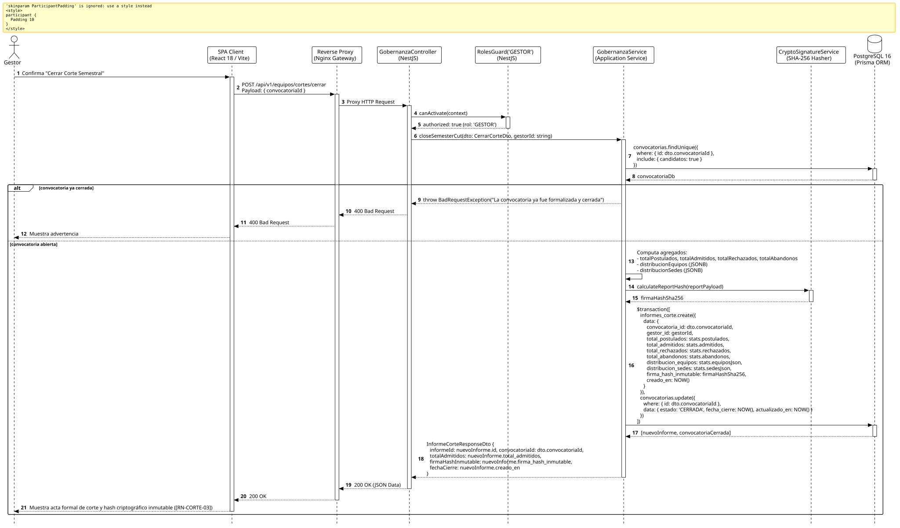

<div align="center">

| [Inicio](/README.md) | [RUP Hub](/RUP/README.md) | [00 Dominio](/RUP/00-modelo-del-dominio/README.md) | [01 Requisitos](/RUP/01-requisitos/README.md) | [02 Análisis](/RUP/02-analisis/README.md) | [03 Diseño](/RUP/03-diseño/README.md) | [Catálogo Diseño](/RUP/03-diseño/casos-uso/README.md) |
|:---:|:---:|:---:|:---:|:---:|:---:|:---:|

<sub>**Fase 03 Diseño** › **Realización de Casos de Uso** › `cerrarCorteSemestral()`</sub>

</div>

# Realización de Diseño: `cerrarCorteSemestral()`

Esta especificación formaliza el diseño técnico y contrato de interfaz para el caso de uso `cerrarCorteSemestral()`. Modela la formalización del hito de cierre semestral de admisiones ([RN-CORTE-03](/RUP/01-requisitos/03-detalle-casos-uso/cerrarCorteSemestral/README.md)), generando el acta consolidada inmutable en `motor_evaluacion.informes_corte` con distribución en campos JSONB y sellado mediante firma criptográfica SHA-256 (`firma_hash_inmutable`).

---

<div align="center">

| Diagrama de Secuencia de Diseño UML |
| :---: |
|  |
| <sup><i>[Código fuente PlantUML](secuenciaDiseño.puml)</i></sup> |

</div>

---

## 1. Contrato de Interfaz REST (OpenAPI 3.1)

### 1.1 Definición del Endpoint

* **Ruta HTTP**: `POST /api/v1/equipos/cortes/cerrar`
* **Acceso / Seguridad**: Autenticado mediante `Bearer <accessToken>` con rol exclusivo `GESTOR`.
* **Cabeceras de Petición**:
  * `Authorization: Bearer <accessToken>`
  * `Content-Type: application/json`

### 1.2 DTO de Entrada (`CerrarCorteDto`)

```typescript
import { IsUUID, IsNotEmpty } from 'class-validator';

export class CerrarCorteDto {
  @IsUUID('4', { message: 'El identificador de la convocatoria debe ser un UUID v4 válido' })
  @IsNotEmpty()
  convocatoriaId: string;
}
```

### 1.3 Respuestas Canónicas (DTOs de Salida)

#### `200 OK` — Corte Formalizado con Hash Inmutable

```json
{
  "statusCode": 200,
  "message": "Corte semestral formalizado y firmado criptográficamente",
  "data": {
    "informeId": "7a8b9c0d-1e2f-3a4b-5c6d-7e8f9a0b1c2d",
    "convocatoriaId": "e2a3b4c5-0011-2233-4455-66778899aabb",
    "totalPostulados": 120,
    "totalAdmitidos": 18,
    "totalRechazados": 7,
    "totalAbandonos": 2,
    "distribucionEquipos": {
      "TEAM-01": 12,
      "TEAM-02": 4,
      "TEAM-03": 1,
      "TEAM-04": 1
    },
    "distribucionSedes": {
      "El Salvador (SDR)": 10,
      "Colombia (BOG)": 5,
      "México (CDMX)": 3
    },
    "firmaHashInmutable": "d4735e3a265e16eee03f59718b9b5d03019c07d8b6c51f90da3a666eec13ab35",
    "fechaCierre": "2026-11-02T15:45:00.000Z"
  }
}
```

---

## 2. Componentes de Software de Diseño (NestJS)

* **`GobernanzaController`**: Endpoint `POST /cortes/cerrar` con `@Roles('GESTOR')`.
* **`GobernanzaService.closeSemesterCut`**: Agregación de postulaciones, cálculo de arrays JSONB y firma criptográfica.
* **`CryptoSignatureService`**: Generador de hash SHA-256 sobre la tupla canónica `{ convocatoriaId, totalAdmitidos, timestamp }`.

---

## 3. Trazabilidad con Requisitos y Análisis

| Requisito / Análisis | Realización de Diseño |
| :--- | :--- |
| **Caso de Uso `cerrarCorteSemestral()`** | Endpoint `POST /api/v1/equipos/cortes/cerrar`. |
| **Regla RN-CORTE-03 (Firma Inmutable)** | Custodia de `firma_hash_inmutable (varchar 64)` en `motor_evaluacion.informes_corte`. |
| **Distribución JSONB (ADR-013)** | Almacenamiento ágil de métricas de distribución de becarios y sedes. |

---

<div align="center">

[Ver Análisis previo (Fase 02)](/RUP/02-analisis/casos-uso/cerrarCorteSemestral/README.md) • [Catálogo de Casos de Uso (Diseño)](/RUP/03-diseño/casos-uso/README.md) • [Fase 03: Diseño Hub](/RUP/03-diseño/README.md)

</div>
