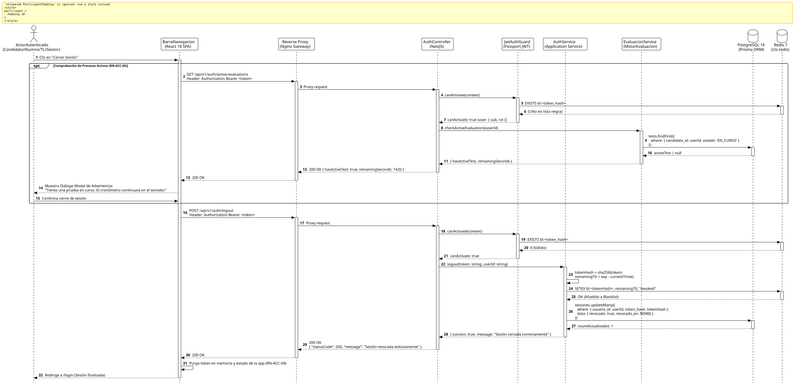

<div align="center">

| [Inicio](/README.md) | [RUP Hub](/RUP/README.md) | [00 Dominio](/RUP/00-modelo-del-dominio/README.md) | [01 Requisitos](/RUP/01-requisitos/README.md) | [02 Análisis](/RUP/02-analisis/README.md) | [03 Diseño](/RUP/03-diseño/README.md) | [Catálogo Diseño](/RUP/03-diseño/casos-uso/README.md) |
|:---:|:---:|:---:|:---:|:---:|:---:|:---:|

<sub>**Fase 03 Diseño** › **Realización de Casos de Uso** › `cerrarSesion()`</sub>

</div>

# Realización de Diseño: `cerrarSesion()`

Esta especificación formaliza el diseño técnico y contrato de interfaz para el caso de uso `cerrarSesion()`, concretando la invalidación server-side de credenciales JWT mediante una lista negra distribuida en **Redis 7**, revocación de persistencia en **PostgreSQL 16** (`motor_equipos.sesiones`) y purga fail-secure en el cliente **React 18 SPA**.

---

<div align="center">

| Diagrama de Secuencia de Diseño UML |
| :---: |
|  |
| <sup><i>[Código fuente PlantUML](secuenciaDiseño.puml)</i></sup> |

</div>

---

## 1. Contratos de Interfaz REST (OpenAPI 3.1)

El cierre de sesión implementa dos endpoints coordinados para dar soporte a la advertencia previa de pruebas en curso ([RN-ACC-05](/RUP/01-requisitos/03-detalle-casos-uso/cerrarSesion/README.md)) y la revocación definitiva del token ([RN-ACC-03](/RUP/01-requisitos/03-detalle-casos-uso/cerrarSesion/README.md)).

### 1.1 Endpoint de Inspección: `GET /api/v1/auth/active-evaluations`

Verifica si el usuario autenticado tiene exámenes activos cuyo cronómetro se vería afectado al salir.

* **Seguridad**: `Bearer <accessToken>` (Roles: `CANDIDATO`, `ALUMNO`, `LIDER_EQUIPO`, `GESTOR`).
* **Respuesta `200 OK`**:

```json
{
  "statusCode": 200,
  "data": {
    "hasActiveEvaluation": true,
    "testId": "f47ac10b-58cc-4372-a567-0e02b2c3d479",
    "tipoBateria": "TECNICO",
    "remainingSeconds": 1420,
    "warningMessage": "Tienes una evaluación técnica activa. El cronómetro continuará en el servidor y consumirá tu tiempo disponible."
  }
}
```

---

### 1.2 Endpoint de Revocación: `POST /api/v1/auth/logout`

* **Ruta HTTP**: `POST /api/v1/auth/logout`
* **Cabeceras de Petición**:
  * `Authorization: Bearer <accessToken>`
  * `Content-Type: application/json`
* **Cuerpo de Petición (Opcional)**:

```json
{
  "confirmForce": true
}
```

### 1.3 Respuestas Canónicas (DTOs de Salida)

#### `200 OK` — Sesión Revocada Exitosamente

```json
{
  "statusCode": 200,
  "message": "Sesión revocada exitosamente"
}
```

#### `401 Unauthorized` — Token Inválido o Previamente Revocado

Emitido si el token ya expiró o fue agregado previamente a la lista negra de Redis.

```json
{
  "statusCode": 401,
  "error": "Unauthorized",
  "message": "Token de autenticación no válido o revocado"
}
```

---

## 2. Componentes de Software de Diseño (NestJS)

```text
src/modules/auth/
├── controllers/
│   └── auth.controller.ts            ──► Endpoint POST /api/v1/auth/logout y GET /active-evaluations.
├── services/
│   ├── auth.service.ts               ──► Orquestación de revocación DB y registro en lista negra.
│   └── redis-token-blacklist.service.ts ──► Gestión de TTL y presencia de hash en Redis.
├── guards/
│   └── jwt-auth.guard.ts             ──► Intercepta la petición y valida contra lista negra en Redis.
└── repositories/
    └── sesiones.repository.ts        ──► Actualización en PostgreSQL: revocado = true, revocado_en = NOW().
```

### 2.1 Mecanismo de Revocación en Lista Negra (Redis Blacklist)

Dado que los tokens JWT son autocontenidos y no mantienen estado por defecto, la revocación server-side instantánea ([RN-ACC-03](/RUP/01-requisitos/03-detalle-casos-uso/cerrarSesion/README.md)) se implementa mediante el patrón **Redis Sliding Blacklist**:

1. El servicio calcula el hash SHA-256 del token: `tokenHash = crypto.createHash('sha256').update(token).digest('hex')`.
2. Se extrae el tiempo remanente de vida del token a partir de su claim `exp`:
   $$\text{remainingTtl} = \text{payload.exp} - \lfloor\text{Date.now()} / 1000\rfloor$$
3. Si $\text{remainingTtl} > 0$, se almacena en Redis con auto-expiración:
   ```text
   SETEX bl:<tokenHash> <remainingTtl> "revoked"
   ```
4. Todo guard de autenticación (`JwtAuthGuard`) comprueba `EXISTS bl:<tokenHash>` en Redis (operación $O(1)$, $< 1\text{ ms}$). Si la clave existe, la petición se rechaza de inmediato con `401 Unauthorized`.
5. Al expirar el tiempo de vida natural del token, la clave es purgada automáticamente de Redis, evitando el crecimiento indefinido de la memoria.

### 2.2 Política *Fail-Secure Client-Side* ([RN-ACC-04](/RUP/01-requisitos/03-detalle-casos-uso/cerrarSesion/README.md))

En el cliente React SPA (`BarraNavegacion`), la rutina de cierre garantiza la destrucción de credenciales locales bajo cualquier circunstancia:

```typescript
async function handleLogout(confirmForce = false) {
  try {
    await apiClient.post('/api/v1/auth/logout', { confirmForce });
  } catch (error) {
    // Si la red falla o el servidor no responde, se procede igualmente con la purga local (Fail-Secure)
    console.warn('Error revocando sesión en servidor; forzando purga local:', error);
  } finally {
    tokenStorage.clear();
    apiClient.defaults.headers.common['Authorization'] = '';
    window.location.href = '/login?status=logged_out';
  }
}
```

---

## 3. Trazabilidad con Requisitos y Análisis

| Requisito / Análisis | Realización de Diseño |
| :--- | :--- |
| **Caso de Uso `cerrarSesion()`** | Endpoint `POST /api/v1/auth/logout` en `AuthController`. |
| **Actores Autenticados (ADR-011)** | Acceso transversal restringido por `JwtAuthGuard` a roles `CANDIDATO`, `ALUMNO`, `LIDER_EQUIPO` y `GESTOR`. |
| **Regla RN-ACC-03 (Revocación Server-Side)** | Lista negra distribuida en Redis (`SETEX bl:<hash>`) y actualización de `motor_equipos.sesiones` (`revocado = true`). |
| **Regla RN-ACC-04 (Fail-Secure Client-Side)** | Bloque `finally` en el cliente React SPA que garantiza borrado de memoria y cookies ante fallos de conectividad. |
| **Regla RN-ACC-05 (Advertencia Exámenes)** | Endpoint previo `GET /api/v1/auth/active-evaluations` y modal reactivo de confirmación consciente. |

---

<div align="center">

[Ver Análisis previo (Fase 02)](/RUP/02-analisis/casos-uso/cerrarSesion/README.md) • [Catálogo de Casos de Uso (Diseño)](/RUP/03-diseño/casos-uso/README.md) • [Anterior: `iniciarSesion()`](../iniciarSesion/README.md)

</div>
