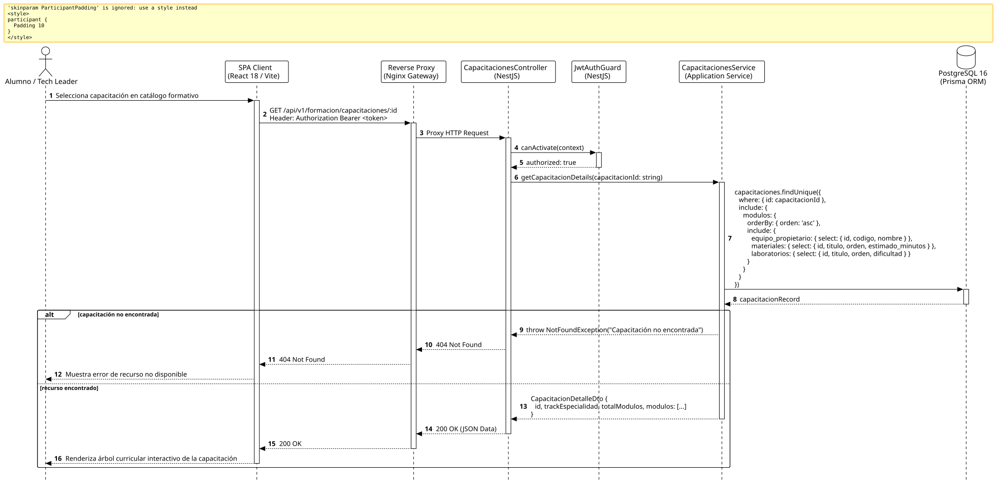

<div align="center">

| [Inicio](/README.md) | [RUP Hub](/RUP/README.md) | [00 Dominio](/RUP/00-modelo-del-dominio/README.md) | [01 Requisitos](/RUP/01-requisitos/README.md) | [02 Análisis](/RUP/02-analisis/README.md) | [03 Diseño](/RUP/03-diseño/README.md) | [Catálogo Diseño](/RUP/03-diseño/casos-uso/README.md) |
|:---:|:---:|:---:|:---:|:---:|:---:|:---:|

<sub>**Fase 03 Diseño** › **Realización de Casos de Uso** › `consultarCapacitacion()`</sub>

</div>

# Realización de Diseño: `consultarCapacitacion()`

Esta especificación formaliza el diseño técnico y contrato de interfaz para el caso de uso `consultarCapacitacion()`. Modela la visualización jerárquica del plan de estudios y track técnico ([ADR-006](/RUP/BITACORA.md#adr-006-descomposici%C3%B3n-arquitect%C3%B3nica-en-3-microservicios), [ADR-010](/RUP/BITACORA.md#adr-010-refinamiento-estructural-del-dominio-top-to-bottom-transici%C3%B3n-candidato-alumno-y-redise%C3%B1o-pedag%C3%B3gico-de-materiales)), permitiendo al becario y a su Tech Leader explorar los módulos, guías y retos prácticos asociados.

---

<div align="center">

| Diagrama de Secuencia de Diseño UML |
| :---: |
|  |
| <sup><i>[Código fuente PlantUML](secuenciaDiseño.puml)</i></sup> |

</div>

---

## 1. Contrato de Interfaz REST (OpenAPI 3.1)

### 1.1 Definición del Endpoint

* **Ruta HTTP**: `GET /api/v1/formacion/capacitaciones/:id`
* **Acceso / Seguridad**: Autenticado mediante `Bearer <accessToken>` con rol `ALUMNO`, `LIDER_EQUIPO` o `GESTOR`.
* **Parámetros de Ruta**:
  * `id` (`uuid`, obligatorio): Identificador de la capacitación.
* **Cabeceras de Petición**:
  * `Authorization: Bearer <accessToken>`
  * `Accept: application/json`

### 1.2 Respuestas Canónicas (DTOs de Salida)

#### `200 OK` — Árbol Curricular de Capacitación

```json
{
  "statusCode": 200,
  "data": {
    "id": "c9a8b7c6-d5e4-3f2a-1b0c-9d8e7f6a5b4c",
    "trackEspecialidad": "Backend & Cloud Architecture",
    "totalModulos": 3,
    "modulos": [
      {
        "id": "m1a2b3c4-d5e6-7f8a-9b0c-1d2e3f4a5b6c",
        "orden": 1,
        "titulo": "Clean Architecture & Principios SOLID",
        "equipoPropietario": {
          "id": "77777777-8888-9999-aaaa-bbbbbbbbbbbb",
          "codigo": "TEAM-01",
          "nombre": "Squad Fénix"
        },
        "materiales": [
          { "id": "mat-1", "titulo": "Guía de Inversión de Dependencias", "orden": 1, "estimadoMinutos": 25 }
        ],
        "laboratorios": [
          { "id": "lab-1", "titulo": "Refactor de Repositorio Desacoplado", "orden": 1, "dificultad": "INTERMEDIA" }
        ]
      }
    ]
  }
}
```

---

## 2. Componentes de Software de Diseño (NestJS)

* **`CapacitacionesController`**: Endpoint `GET /capacitaciones/:id`.
* **`CapacitacionesService.getCapacitacionDetails`**: Consulta jerárquica con Prisma ORM sobre `motor_formacion.capacitaciones` y relaciones hijas.

---

## 3. Trazabilidad con Requisitos y Análisis

| Requisito / Análisis | Realización de Diseño |
| :--- | :--- |
| **Caso de Uso `consultarCapacitacion()`** | Endpoint `GET /api/v1/formacion/capacitaciones/:id`. |
| **Track por Especialidad (ADR-006)** | Segmentación curricular acorde a los requerimientos técnicos del squad. |
| **Estructura Didáctica (ADR-010)** | Composición `Capacitacion o-- Modulo o-- Material/Laboratorio`. |

---

<div align="center">

[Ver Análisis previo (Fase 02)](/RUP/02-analisis/casos-uso/consultarCapacitacion/README.md) • [Catálogo de Casos de Uso (Diseño)](/RUP/03-diseño/casos-uso/README.md) • [Siguiente: `consultarModulo()`](../consultarModulo/README.md)

</div>
