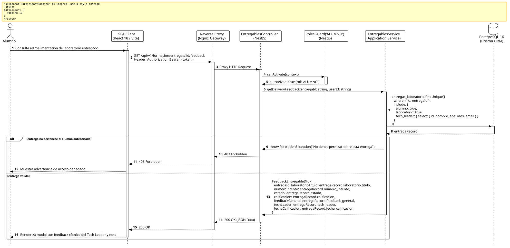

<div align="center">

| [Inicio](/README.md) | [RUP Hub](/RUP/README.md) | [00 Dominio](/RUP/00-modelo-del-dominio/README.md) | [01 Requisitos](/RUP/01-requisitos/README.md) | [02 Análisis](/RUP/02-analisis/README.md) | [03 Diseño](/RUP/03-diseño/README.md) | [Catálogo Diseño](/RUP/03-diseño/casos-uso/README.md) |
|:---:|:---:|:---:|:---:|:---:|:---:|:---:|

<sub>**Fase 03 Diseño** › **Realización de Casos de Uso** › `consultarFeedbackEntregable()`</sub>

</div>

# Realización de Diseño: `consultarFeedbackEntregable()`

Esta especificación formaliza el diseño técnico y contrato de interfaz para el caso de uso `consultarFeedbackEntregable()`. Expone las notas de revisión técnica emitidas por el Tech Leader titular ([ADR-013](/RUP/BITACORA.md#adr-013-simplificaci%C3%B3n-pragm%C3%A1tica-del-modelo-de-datos-der-y-alineaci%C3%B3n-con-la-operativa-real-de-cts)), incluyendo la calificación numérica, el dictamen de estado (`APROBADO` o `CAMBIOS_SOLICITADOS`) y la retroalimentación cualitativa.

---

<div align="center">

| Diagrama de Secuencia de Diseño UML |
| :---: |
|  |
| <sup><i>[Código fuente PlantUML](secuenciaDiseño.puml)</i></sup> |

</div>

---

## 1. Contrato de Interfaz REST (OpenAPI 3.1)

### 1.1 Definición del Endpoint

* **Ruta HTTP**: `GET /api/v1/formacion/entregas/:id/feedback`
* **Acceso / Seguridad**: Autenticado mediante `Bearer <accessToken>` con rol exclusivo `ALUMNO`.
* **Parámetros de Ruta**:
  * `id` (`uuid`, obligatorio): Identificador de la entrega de laboratorio.
* **Cabeceras de Petición**:
  * `Authorization: Bearer <accessToken>`
  * `Accept: application/json`

### 1.2 Respuestas Canónicas (DTOs de Salida)

#### `200 OK` — Retroalimentación del Tech Leader

```json
{
  "statusCode": 200,
  "data": {
    "entregaId": "e1f2a3b4-c5d6-7e8f-9a0b-1c2d3e4f5a6b",
    "laboratorioTitulo": "Refactor de Repositorio Desacoplado",
    "numeroIntento": 1,
    "estado": "CAMBIOS_SOLICITADOS",
    "calificacion": 6.5,
    "feedbackGeneral": "Buen enfoque en el desacoplamiento de la interfaz. Sin embargo, falta manejar la excepción NotFoundException en el repositorio mock. Por favor actualiza el commit en el mismo PR.",
    "techLeader": {
      "nombre": "Diego Moys",
      "email": "diego.moys@ctdesarrollo-sdr.org"
    },
    "fechaCalificacion": "2026-11-02T14:20:00.000Z"
  }
}
```

---

## 2. Componentes de Software de Diseño (NestJS)

* **`EntregablesController`**: Endpoint `GET /entregas/:id/feedback` con `@Roles('ALUMNO')`.
* **`EntregablesService.getDeliveryFeedback`**: Validación de pertenencia del recurso y mapeo desde `motor_formacion.entregas_laboratorio`.

---

## 3. Trazabilidad con Requisitos y Análisis

| Requisito / Análisis | Realización de Diseño |
| :--- | :--- |
| **Caso de Uso `consultarFeedbackEntregable()`** | Endpoint `GET /api/v1/formacion/entregas/:id/feedback`. |
| **Tutoría del Tech Leader (ADR-004)** | Retorno de la identidad y observaciones del TL asignado al squad. |
| **Feedback Centralizado (ADR-013)** | Persistencia directa en `entregas_laboratorio.feedback_general` sin tablas intermedias. |

---

<div align="center">

[Ver Análisis previo (Fase 02)](/RUP/02-analisis/casos-uso/consultarFeedbackEntregable/README.md) • [Catálogo de Casos de Uso (Diseño)](/RUP/03-diseño/casos-uso/README.md) • [Siguiente: `abrirEntregablesPendientes()`](../abrirEntregablesPendientes/README.md)

</div>
