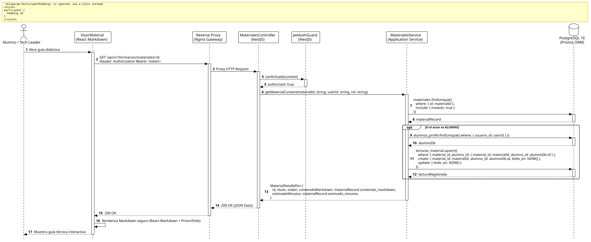

<div align="center">

| [Inicio](/README.md) | [RUP Hub](/RUP/README.md) | [00 Dominio](/RUP/00-modelo-del-dominio/README.md) | [01 Requisitos](/RUP/01-requisitos/README.md) | [02 Análisis](/RUP/02-analisis/README.md) | [03 Diseño](/RUP/03-diseño/README.md) | [Catálogo Diseño](/RUP/03-diseño/casos-uso/README.md) |
|:---:|:---:|:---:|:---:|:---:|:---:|:---:|

<sub>**Fase 03 Diseño** › **Realización de Casos de Uso** › `consultarMaterial()`</sub>

</div>

# Realización de Diseño: `consultarMaterial()`

Esta especificación formaliza el diseño técnico y contrato de interfaz para el caso de uso `consultarMaterial()`. Modela la entrega segura de guías técnicas en formato **Markdown** ([ADR-013](/RUP/BITACORA.md#adr-013-simplificaci%C3%B3n-pragm%C3%A1tica-del-modelo-de-datos-der-y-alineaci%C3%B3n-con-la-operativa-real-de-cts)) y el registro automático de lectura formativa en `motor_formacion.lecturas_material`.

---

<div align="center">

| Diagrama de Secuencia de Diseño UML |
| :---: |
|  |
| <sup><i>[Código fuente PlantUML](secuenciaDiseño.puml)</i></sup> |

</div>

---

## 1. Contrato de Interfaz REST (OpenAPI 3.1)

### 1.1 Definición del Endpoint

* **Ruta HTTP**: `GET /api/v1/formacion/materiales/:id`
* **Acceso / Seguridad**: Autenticado mediante `Bearer <accessToken>` con rol `ALUMNO`, `LIDER_EQUIPO` o `GESTOR`.
* **Parámetros de Ruta**:
  * `id` (`uuid`, obligatorio): Identificador del material formativo.
* **Cabeceras de Petición**:
  * `Authorization: Bearer <accessToken>`
  * `Accept: application/json`

### 1.2 Respuestas Canónicas (DTOs de Salida)

#### `200 OK` — Contenido Didáctico en Markdown

```json
{
  "statusCode": 200,
  "data": {
    "id": "b3c4d5e6-f7a8-9b0c-1d2e-3f4a5b6c7d8e",
    "moduloId": "m1a2b3c4-d5e6-7f8a-9b0c-1d2e3f4a5b6c",
    "titulo": "Guía de Inversión de Dependencias (DIP)",
    "orden": 1,
    "estimadoMinutos": 25,
    "contenidoMarkdown": "# Principio de Inversión de Dependencias\n\nLos módulos de alto nivel no deben depender de los módulos de bajo nivel. Ambos deben depender de abstracciones...\n\n```typescript\nexport interface IUsuariosRepository {\n  findById(id: string): Promise<Usuario | null>;\n}\n```",
    "registradoComoLeido": true
  }
}
```

---

## 2. Componentes de Software de Diseño (NestJS)

* **`MaterialesController`**: Endpoint `GET /materiales/:id`.
* **`MaterialesService.getMaterialContent`**: Recupera el contenido Markdown y ejecuta `upsert` en `motor_formacion.lecturas_material` si el actor es `ALUMNO`.
* **Frontend SPA (`VisorMaterial`)**: Renderizado dinámico con `react-markdown`, `remark-gfm` y syntax highlighter (`shiki` / `prismjs`), previniendo inyección de scripts HTML inseguros.

---

## 3. Trazabilidad con Requisitos y Análisis

| Requisito / Análisis | Realización de Diseño |
| :--- | :--- |
| **Caso de Uso `consultarMaterial()`** | Endpoint `GET /api/v1/formacion/materiales/:id`. |
| **Markdown Transversal (ADR-013)** | Almacenamiento directo de `contenido_markdown text` en base de datos. |
| **Tracking de Lectura** | Persistencia atómica en `motor_formacion.lecturas_material`. |

---

<div align="center">

[Ver Análisis previo (Fase 02)](/RUP/02-analisis/casos-uso/consultarMaterial/README.md) • [Catálogo de Casos de Uso (Diseño)](/RUP/03-diseño/casos-uso/README.md) • [Siguiente: `enviarEntregable()`](../enviarEntregable/README.md)

</div>
