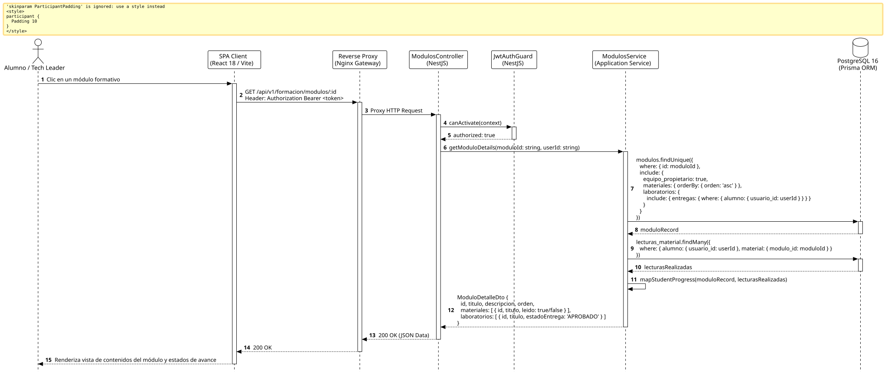

<div align="center">

| [Inicio](/README.md) | [RUP Hub](/RUP/README.md) | [00 Dominio](/RUP/00-modelo-del-dominio/README.md) | [01 Requisitos](/RUP/01-requisitos/README.md) | [02 Análisis](/RUP/02-analisis/README.md) | [03 Diseño](/RUP/03-diseño/README.md) | [Catálogo Diseño](/RUP/03-diseño/casos-uso/README.md) |
|:---:|:---:|:---:|:---:|:---:|:---:|:---:|

<sub>**Fase 03 Diseño** › **Realización de Casos de Uso** › `consultarModulo()`</sub>

</div>

# Realización de Diseño: `consultarModulo()`

Esta especificación formaliza el diseño técnico y contrato de interfaz para el caso de uso `consultarModulo()`. Modela la visualización atómica de los activos de un módulo: guías didácticas, estado de lectura individual y el ciclo de vida de los laboratorios de código asociados.

---

<div align="center">

| Diagrama de Secuencia de Diseño UML |
| :---: |
|  |
| <sup><i>[Código fuente PlantUML](secuenciaDiseño.puml)</i></sup> |

</div>

---

## 1. Contrato de Interfaz REST (OpenAPI 3.1)

### 1.1 Definición del Endpoint

* **Ruta HTTP**: `GET /api/v1/formacion/modulos/:id`
* **Acceso / Seguridad**: Autenticado mediante `Bearer <accessToken>` con rol `ALUMNO`, `LIDER_EQUIPO` o `GESTOR`.
* **Parámetros de Ruta**:
  * `id` (`uuid`, obligatorio): Identificador del módulo.
* **Cabeceras de Petición**:
  * `Authorization: Bearer <accessToken>`
  * `Accept: application/json`

### 1.2 Respuestas Canónicas (DTOs de Salida)

#### `200 OK` — Contenidos del Módulo

```json
{
  "statusCode": 200,
  "data": {
    "id": "m1a2b3c4-d5e6-7f8a-9b0c-1d2e3f4a5b6c",
    "titulo": "Clean Architecture & Principios SOLID",
    "descripcion": "Fundamentos y aplicación de arquitectura limpia en entornos TypeScript/Node.js.",
    "orden": 1,
    "materiales": [
      {
        "id": "mat-1",
        "titulo": "Guía de Inversión de Dependencias",
        "orden": 1,
        "estimadoMinutos": 25,
        "leido": true
      }
    ],
    "laboratorios": [
      {
        "id": "lab-1",
        "titulo": "Refactor de Repositorio Desacoplado",
        "dificultad": "INTERMEDIA",
        "estadoEntrega": "APROBADO",
        "calificacion": 9.5
      }
    ]
  }
}
```

---

## 2. Componentes de Software de Diseño (NestJS)

* **`ModulosController`**: Endpoint `GET /modulos/:id`.
* **`ModulosService.getModuloDetails`**: Agregación de materiales, laboratorios y estado de tracking cruzando `motor_formacion.lecturas_material` y `motor_formacion.entregas_laboratorio`.

---

## 3. Trazabilidad con Requisitos y Análisis

| Requisito / Análisis | Realización de Diseño |
| :--- | :--- |
| **Caso de Uso `consultarModulo()`** | Endpoint `GET /api/v1/formacion/modulos/:id`. |
| **Tracking Formativo** | Cruce relacional con `lecturas_material` y `entregas_laboratorio`. |
| **Propiedad del Squad** | Asociación con `equipo_propietario_id` ([RN-LEAD-01](/RUP/01-requisitos/03-detalle-casos-uso/abrirPanelLider/README.md)). |

---

<div align="center">

[Ver Análisis previo (Fase 02)](/RUP/02-analisis/casos-uso/consultarModulo/README.md) • [Catálogo de Casos de Uso (Diseño)](/RUP/03-diseño/casos-uso/README.md) • [Siguiente: `consultarMaterial()`](../consultarMaterial/README.md)

</div>
