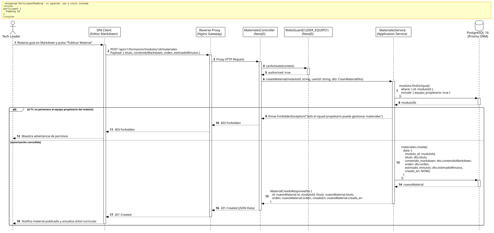

<div align="center">

| [Inicio](/README.md) | [RUP Hub](/RUP/README.md) | [00 Dominio](/RUP/00-modelo-del-dominio/README.md) | [01 Requisitos](/RUP/01-requisitos/README.md) | [02 Análisis](/RUP/02-analisis/README.md) | [03 Diseño](/RUP/03-diseño/README.md) | [Catálogo Diseño](/RUP/03-diseño/casos-uso/README.md) |
|:---:|:---:|:---:|:---:|:---:|:---:|:---:|

<sub>**Fase 03 Diseño** › **Realización de Casos de Uso** › `crearMaterial()`</sub>

</div>

# Realización de Diseño: `crearMaterial()`

Esta especificación formaliza el diseño técnico y contrato de interfaz para el caso de uso `crearMaterial()`. Modela la creación de recursos didácticos en formato **Markdown** ([ADR-013](/RUP/BITACORA.md#adr-013-simplificaci%C3%B3n-pragm%C3%A1tica-del-modelo-de-datos-der-y-alineaci%C3%B3n-con-la-operativa-real-de-cts)) bajo el principio de propiedad técnica del módulo ([RN-LEAD-01](/RUP/01-requisitos/03-detalle-casos-uso/abrirPanelLider/README.md)) ejercido por el Tech Leader.

---

<div align="center">

| Diagrama de Secuencia de Diseño UML |
| :---: |
|  |
| <sup><i>[Código fuente PlantUML](secuenciaDiseño.puml)</i></sup> |

</div>

---

## 1. Contrato de Interfaz REST (OpenAPI 3.1)

### 1.1 Definición del Endpoint

* **Ruta HTTP**: `POST /api/v1/formacion/modulos/:id/materiales`
* **Acceso / Seguridad**: Autenticado con `Bearer <accessToken>` y rol `LIDER_EQUIPO` o `GESTOR`.
* **Parámetros de Ruta**:
  * `id` (`uuid`, obligatorio): Identificador del módulo padre.
* **Cabeceras de Petición**:
  * `Authorization: Bearer <accessToken>`
  * `Content-Type: application/json`

### 1.2 DTO de Entrada (`CrearMaterialDto`)

```typescript
import { IsString, IsNotEmpty, IsInt, Min } from 'class-validator';

export class CrearMaterialDto {
  @IsString()
  @IsNotEmpty()
  titulo: string;

  @IsString()
  @IsNotEmpty()
  contenidoMarkdown: string;

  @IsInt()
  @Min(1)
  orden: number;

  @IsInt()
  @Min(5)
  estimadoMinutos: number;
}
```

### 1.3 Respuestas Canónicas (DTOs de Salida)

#### `201 Created` — Material Creado

```json
{
  "statusCode": 201,
  "message": "Guía didáctica en Markdown publicada exitosamente",
  "data": {
    "id": "b3c4d5e6-f7a8-9b0c-1d2e-3f4a5b6c7d8e",
    "moduloId": "m1a2b3c4-d5e6-7f8a-9b0c-1d2e3f4a5b6c",
    "titulo": "Guía de Inversión de Dependencias (DIP)",
    "orden": 2,
    "creadoEn": "2026-11-02T14:45:00.000Z"
  }
}
```

---

## 2. Componentes de Software de Diseño (NestJS)

* **`MaterialesController`**: Endpoint `POST /modulos/:id/materiales`.
* **`MaterialesService.createMaterial`**: Verificación de gobernanza (`modulo.equipo_propietario_id == tl.equipo_id`) e inserción en `motor_formacion.materiales`.

---

## 3. Trazabilidad con Requisitos y Análisis

| Requisito / Análisis | Realización de Diseño |
| :--- | :--- |
| **Caso de Uso `crearMaterial()`** | Endpoint `POST /api/v1/formacion/modulos/:id/materiales`. |
| **Propiedad Técnica (RN-LEAD-01)** | Restricción al Squad propietario del módulo. |
| **Markdown Directo (ADR-013)** | Almacenamiento seguro en base de datos sin renderizado HTML server-side inseguro. |

---

<div align="center">

[Ver Análisis previo (Fase 02)](/RUP/02-analisis/casos-uso/crearMaterial/README.md) • [Catálogo de Casos de Uso (Diseño)](/RUP/03-diseño/casos-uso/README.md) • [Siguiente: `editarMaterial()`](../editarMaterial/README.md)

</div>
