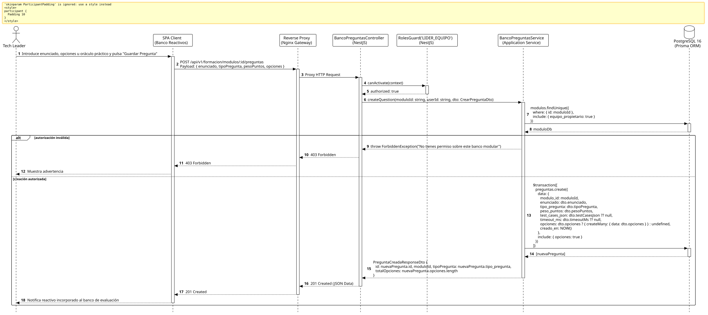

<div align="center">

| [Inicio](/README.md) | [RUP Hub](/RUP/README.md) | [00 Dominio](/RUP/00-modelo-del-dominio/README.md) | [01 Requisitos](/RUP/01-requisitos/README.md) | [02 Análisis](/RUP/02-analisis/README.md) | [03 Diseño](/RUP/03-diseño/README.md) | [Catálogo Diseño](/RUP/03-diseño/casos-uso/README.md) |
|:---:|:---:|:---:|:---:|:---:|:---:|:---:|

<sub>**Fase 03 Diseño** › **Realización de Casos de Uso** › `crearPregunta()`</sub>

</div>

# Realización de Diseño: `crearPregunta()`

Esta especificación formaliza el diseño técnico y contrato de interfaz para el caso de uso `crearPregunta()`. Modela la creación de reactivos de evaluación para el banco transversal de preguntas ([ADR-006](/RUP/BITACORA.md#adr-006-descomposici%C3%B3n-arquitect%C3%B3nica-en-3-microservicios), [ADR-010](/RUP/BITACORA.md#adr-010-refinamiento-estructural-del-dominio-top-to-bottom-transici%C3%B3n-candidato-alumno-y-redise%C3%B1o-pedag%C3%B3gico-de-materiales)), admitiendo preguntas teóricas con opciones de opción múltiple y retos prácticos de código evaluables en runner sandbox.

---

<div align="center">

| Diagrama de Secuencia de Diseño UML |
| :---: |
|  |
| <sup><i>[Código fuente PlantUML](secuenciaDiseño.puml)</i></sup> |

</div>

---

## 1. Contrato de Interfaz REST (OpenAPI 3.1)

### 1.1 Definición del Endpoint

* **Ruta HTTP**: `POST /api/v1/formacion/modulos/:id/preguntas`
* **Acceso / Seguridad**: Autenticado mediante `Bearer <accessToken>` con rol `LIDER_EQUIPO` o `GESTOR`.
* **Parámetros de Ruta**:
  * `id` (`uuid`, obligatorio): Identificador del módulo al que se adscribe el reactivo.
* **Cabeceras de Petición**:
  * `Authorization: Bearer <accessToken>`
  * `Content-Type: application/json`

### 1.2 DTO de Entrada (`CrearPreguntaDto`)

```typescript
import { IsString, IsNotEmpty, IsIn, IsNumber, Min, IsArray, ValidateNested, IsOptional } from 'class-validator';
import { Type } from 'class-transformer';

class OpcionPreguntaDto {
  @IsString()
  @IsNotEmpty()
  texto: string;

  @IsNotEmpty()
  esCorrecta: boolean;
}

export class CrearPreguntaDto {
  @IsString()
  @IsNotEmpty()
  enunciado: string;

  @IsIn(['TEORICA', 'PRACTICA'])
  tipoPregunta: 'TEORICA' | 'PRACTICA';

  @IsNumber()
  @Min(1.0)
  pesoPuntos: number;

  @IsOptional()
  @IsArray()
  @ValidateNested({ each: true })
  @Type(() => OpcionPreguntaDto)
  opciones?: OpcionPreguntaDto[];

  @IsOptional()
  testCasesJson?: any;

  @IsOptional()
  @IsNumber()
  timeoutMs?: number;
}
```

### 1.3 Respuestas Canónicas (DTOs de Salida)

#### `201 Created` — Pregunta Registrada en el Banco

```json
{
  "statusCode": 201,
  "message": "Pregunta incorporada al banco de reactivos exitosamente",
  "data": {
    "id": "7f8a9b0c-1d2e-3f4a-5b6c-7d8e9f0a1b2c",
    "moduloId": "m1a2b3c4-d5e6-7f8a-9b0c-1d2e3f4a5b6c",
    "tipoPregunta": "TEORICA",
    "pesoPuntos": 1.0,
    "totalOpciones": 4,
    "creadaEn": "2026-11-02T14:55:00.000Z"
  }
}
```

---

## 2. Componentes de Software de Diseño (NestJS)

* **`BancoPreguntasController`**: Endpoint `POST /modulos/:id/preguntas`.
* **`BancoPreguntasService.createQuestion`**: Inserción jerárquica en `motor_formacion.preguntas` y `motor_formacion.opciones_pregunta`.

---

## 3. Trazabilidad con Requisitos y Análisis

| Requisito / Análisis | Realización de Diseño |
| :--- | :--- |
| **Caso de Uso `crearPregunta()`** | Endpoint `POST /api/v1/formacion/modulos/:id/preguntas`. |
| **Banco Transversal (ADR-006)** | Reactivos utilizables tanto en admisión (`MotorEvaluacion`) como en nivelación formativa. |
| **Integridad Transaccional** | Alta atómica de la pregunta y sus opciones en PostgreSQL 16. |

---

<div align="center">

[Ver Análisis previo (Fase 02)](/RUP/02-analisis/casos-uso/crearPregunta/README.md) • [Catálogo de Casos de Uso (Diseño)](/RUP/03-diseño/casos-uso/README.md) • [Siguiente: `editarPregunta()`](../editarPregunta/README.md)

</div>
