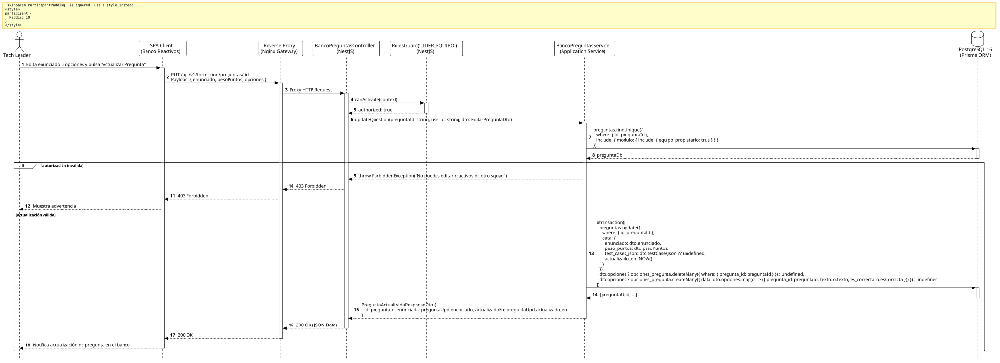

<div align="center">

| [Inicio](/README.md) | [RUP Hub](/RUP/README.md) | [00 Dominio](/RUP/00-modelo-del-dominio/README.md) | [01 Requisitos](/RUP/01-requisitos/README.md) | [02 Análisis](/RUP/02-analisis/README.md) | [03 Diseño](/RUP/03-diseño/README.md) | [Catálogo Diseño](/RUP/03-diseño/casos-uso/README.md) |
|:---:|:---:|:---:|:---:|:---:|:---:|:---:|

<sub>**Fase 03 Diseño** › **Realización de Casos de Uso** › `editarPregunta()`</sub>

</div>

# Realización de Diseño: `editarPregunta()`

Esta especificación formaliza el diseño técnico y contrato de interfaz para el caso de uso `editarPregunta()`. Modela la actualización de reactivos y opciones de respuesta en el banco curricular modular, preservando la coherencia relacional en `motor_formacion.preguntas` y `motor_formacion.opciones_pregunta`.

---

<div align="center">

| Diagrama de Secuencia de Diseño UML |
| :---: |
|  |
| <sup><i>[Código fuente PlantUML](secuenciaDiseño.puml)</i></sup> |

</div>

---

## 1. Contrato de Interfaz REST (OpenAPI 3.1)

### 1.1 Definición del Endpoint

* **Ruta HTTP**: `PUT /api/v1/formacion/preguntas/:id`
* **Acceso / Seguridad**: Autenticado mediante `Bearer <accessToken>` con rol `LIDER_EQUIPO` o `GESTOR`.
* **Parámetros de Ruta**:
  * `id` (`uuid`, obligatorio): Identificador de la pregunta a modificar.
* **Cabeceras de Petición**:
  * `Authorization: Bearer <accessToken>`
  * `Content-Type: application/json`

### 1.2 DTO de Entrada (`EditarPreguntaDto`)

```typescript
import { IsString, IsOptional, IsNumber, Min, IsArray, ValidateNested } from 'class-validator';
import { Type } from 'class-transformer';

class OpcionEdicionDto {
  @IsString()
  texto: string;

  esCorrecta: boolean;
}

export class EditarPreguntaDto {
  @IsOptional()
  @IsString()
  enunciado?: string;

  @IsOptional()
  @IsNumber()
  @Min(1.0)
  pesoPuntos?: number;

  @IsOptional()
  @IsArray()
  @ValidateNested({ each: true })
  @Type(() => OpcionEdicionDto)
  opciones?: OpcionEdicionDto[];

  @IsOptional()
  testCasesJson?: any;
}
```

### 1.3 Respuestas Canónicas (DTOs de Salida)

#### `200 OK` — Pregunta Actualizada

```json
{
  "statusCode": 200,
  "message": "Reactivo de evaluación actualizado exitosamente",
  "data": {
    "id": "7f8a9b0c-1d2e-3f4a-5b6c-7d8e9f0a1b2c",
    "enunciado": "¿Cuál de los siguientes tipos no es un primitivo en TypeScript?",
    "actualizadoEn": "2026-11-02T14:58:00.000Z"
  }
}
```

---

## 2. Componentes de Software de Diseño (NestJS)

* **`BancoPreguntasController`**: Endpoint `PUT /preguntas/:id`.
* **`BancoPreguntasService.updateQuestion`**: Transacción de actualización que reemplaza atómicamente el set de opciones en `opciones_pregunta`.

---

## 3. Trazabilidad con Requisitos y Análisis

| Requisito / Análisis | Realización de Diseño |
| :--- | :--- |
| **Caso de Uso `editarPregunta()`** | Endpoint `PUT /api/v1/formacion/preguntas/:id`. |
| **Gobernanza Modular** | Comprobación de que el solicitante lidera el squad titular del módulo. |
| **Atomicidad de Opciones** | Reemplazo transaccional de reactivos hijos. |

---

<div align="center">

[Ver Análisis previo (Fase 02)](/RUP/02-analisis/casos-uso/editarPregunta/README.md) • [Catálogo de Casos de Uso (Diseño)](/RUP/03-diseño/casos-uso/README.md) • [Siguiente: `eliminarPregunta()`](../eliminarPregunta/README.md)

</div>
