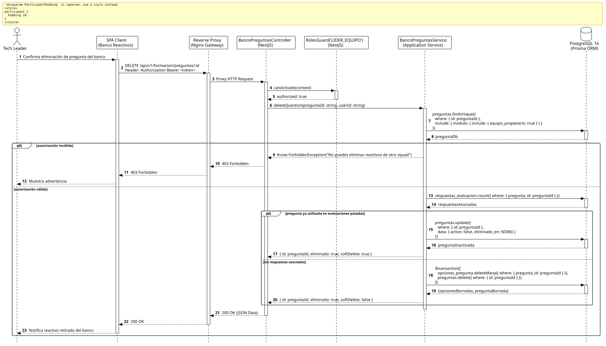

<div align="center">

| [Inicio](/README.md) | [RUP Hub](/RUP/README.md) | [00 Dominio](/RUP/00-modelo-del-dominio/README.md) | [01 Requisitos](/RUP/01-requisitos/README.md) | [02 Análisis](/RUP/02-analisis/README.md) | [03 Diseño](/RUP/03-diseño/README.md) | [Catálogo Diseño](/RUP/03-diseño/casos-uso/README.md) |
|:---:|:---:|:---:|:---:|:---:|:---:|:---:|

<sub>**Fase 03 Diseño** › **Realización de Casos de Uso** › `eliminarPregunta()`</sub>

</div>

# Realización de Diseño: `eliminarPregunta()`

Esta especificación formaliza el diseño técnico y contrato de interfaz para el caso de uso `eliminarPregunta()`. Modela la eliminación segura de reactivos del banco modular de evaluación, aplicando la política de **soft-delete** si la pregunta ya cuenta con respuestas históricas en `motor_evaluacion.respuestas_evaluacion` para salvaguardar la inmutabilidad de los expedientes.

---

<div align="center">

| Diagrama de Secuencia de Diseño UML |
| :---: |
|  |
| <sup><i>[Código fuente PlantUML](secuenciaDiseño.puml)</i></sup> |

</div>

---

## 1. Contrato de Interfaz REST (OpenAPI 3.1)

### 1.1 Definición del Endpoint

* **Ruta HTTP**: `DELETE /api/v1/formacion/preguntas/:id`
* **Acceso / Seguridad**: Autenticado mediante `Bearer <accessToken>` con rol `LIDER_EQUIPO` o `GESTOR`.
* **Parámetros de Ruta**:
  * `id` (`uuid`, obligatorio): Identificador de la pregunta.
* **Cabeceras de Petición**:
  * `Authorization: Bearer <accessToken>`

### 1.2 Respuestas Canónicas (DTOs de Salida)

#### `200 OK` — Pregunta Retirada del Banco

```json
{
  "statusCode": 200,
  "message": "Pregunta retirada del banco de evaluación",
  "data": {
    "id": "7f8a9b0c-1d2e-3f4a-5b6c-7d8e9f0a1b2c",
    "eliminado": true,
    "softDelete": true
  }
}
```

---

## 2. Componentes de Software de Diseño (NestJS)

* **`BancoPreguntasController`**: Endpoint `DELETE /preguntas/:id`.
* **`BancoPreguntasService.deleteQuestion`**: Comprobación de histórico en `motor_evaluacion.respuestas_evaluacion` y ejecución de borrado lógico (`eliminado_en = NOW()`) o físico.

---

## 3. Trazabilidad con Requisitos y Análisis

| Requisito / Análisis | Realización de Diseño |
| :--- | :--- |
| **Caso de Uso `eliminarPregunta()`** | Endpoint `DELETE /api/v1/formacion/preguntas/:id`. |
| **Integridad Histórica** | Soft-delete preventivo para no romper exámenes cerrados previos. |
| **Gobernanza del Squad** | Verificación de titularidad sobre el módulo propietario. |

---

<div align="center">

[Ver Análisis previo (Fase 02)](/RUP/02-analisis/casos-uso/eliminarPregunta/README.md) • [Catálogo de Casos de Uso (Diseño)](/RUP/03-diseño/casos-uso/README.md) • [Siguiente: PK04 — MotorEquipos](../abrirPanelLider/README.md)

</div>
