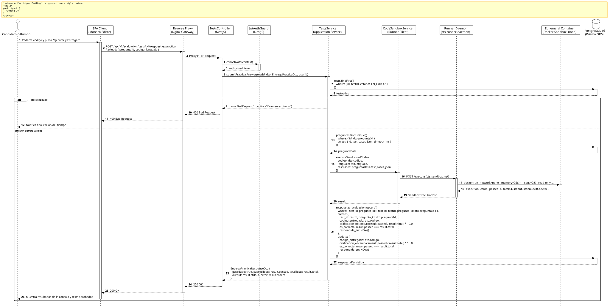

<div align="center">

| [Inicio](/README.md) | [RUP Hub](/RUP/README.md) | [00 Dominio](/RUP/00-modelo-del-dominio/README.md) | [01 Requisitos](/RUP/01-requisitos/README.md) | [02 Análisis](/RUP/02-analisis/README.md) | [03 Diseño](/RUP/03-diseño/README.md) | [Catálogo Diseño](/RUP/03-diseño/casos-uso/README.md) |
|:---:|:---:|:---:|:---:|:---:|:---:|:---:|

<sub>**Fase 03 Diseño** › **Realización de Casos de Uso** › `entregarPreguntaPractica()`</sub>

</div>

# Realización de Diseño: `entregarPreguntaPractica()`

Esta especificación formaliza el diseño técnico y contrato de interfaz para el caso de uso `entregarPreguntaPractica()`. Modela la ejecución segura y aislada de código fuente en un runner efímero Docker (`network_mode: none`, 256MB RAM, timeout 10s) a través de la red privada `cts_sandbox_net`, calificando automáticamente la suite de tests unitarios y persistiendo el código en `motor_evaluacion.respuestas_evaluacion`.

---

<div align="center">

| Diagrama de Secuencia de Diseño UML |
| :---: |
|  |
| <sup><i>[Código fuente PlantUML](secuenciaDiseño.puml)</i></sup> |

</div>

---

## 1. Contrato de Interfaz REST (OpenAPI 3.1)

### 1.1 Definición del Endpoint

* **Ruta HTTP**: `POST /api/v1/evaluacion/tests/:id/respuestas/practica`
* **Acceso / Seguridad**: Autenticado mediante `Bearer <accessToken>` con rol `CANDIDATO` o `ALUMNO`.
* **Parámetros de Ruta**:
  * `id` (`uuid`, obligatorio): Identificador de la prueba `Test`.
* **Cabeceras de Petición**:
  * `Authorization: Bearer <accessToken>`
  * `Content-Type: application/json`

### 1.2 DTO de Entrada (`EntregaPracticaDto`)

```typescript
import { IsUUID, IsNotEmpty, IsString, IsIn } from 'class-validator';

export class EntregaPracticaDto {
  @IsUUID('4')
  @IsNotEmpty()
  preguntaId: string;

  @IsString()
  @IsNotEmpty()
  codigo: string;

  @IsIn(['javascript', 'python'])
  lenguaje: 'javascript' | 'python';
}
```

### 1.3 Respuestas Canónicas (DTOs de Salida)

#### `200 OK` — Código Evaluado y Persistido

```json
{
  "statusCode": 200,
  "message": "Código ejecutado y evaluado exitosamente",
  "data": {
    "guardado": true,
    "passedTests": 4,
    "totalTests": 4,
    "output": "Test Suite: Algoritmo de Ordenamiento\n✓ Caso 1: Array ordenado (2ms)\n✓ Caso 2: Array inverso (1ms)\n✓ Caso 3: Array vacío (1ms)\n✓ Caso 4: Valores duplicados (1ms)\n4 tests passed, 0 failed.",
    "error": null
  }
}
```

---

## 2. Componentes de Software y Aislamiento Físico

* **`TestsController`**: Endpoint `POST /tests/:id/respuestas/practica`.
* **`CodeSandboxService`**: Cliente HTTP interno en NestJS conectado a `http://cts-runner-daemon:8080` vía la red aislada `cts_sandbox_net`.
* **`cts-runner-daemon`**: Proceso Go/Node que orquesta contenedores efímeros mediante la Docker Engine API:
  * Flags: `--network=none --memory=256m --cpus=0.5 --read-only --tmpfs /tmp:rw,noexec,nosuid,size=64m`.
  * Timeout duro de 10 segundos para prevenir bucles infinitos.
* **`RespuestasRepository`**: Almacenamiento del código entregado y cómputo de la nota proporcional en `motor_evaluacion.respuestas_evaluacion`.

---

## 3. Trazabilidad con Requisitos y Análisis

| Requisito / Análisis | Realización de Diseño |
| :--- | :--- |
| **Caso de Uso `entregarPreguntaPractica()`** | Endpoint `POST /api/v1/evaluacion/tests/:id/respuestas/practica`. |
| **Ejecución Aislada Zero-Trust (Despliegue)** | Red sellada `cts_sandbox_net` y contenedor efímero sin red externa (`network_mode: none`). |
| **Idempotencia y Calificación Proporcional** | Registro de `codigo_entregado` y cálculo automático de `calificacion_obtenida = (passed / total) * peso`. |

---

<div align="center">

[Ver Análisis previo (Fase 02)](/RUP/02-analisis/casos-uso/entregarPreguntaPractica/README.md) • [Catálogo de Casos de Uso (Diseño)](/RUP/03-diseño/casos-uso/README.md) • [Siguiente: `finalizarTest()`](../finalizarTest/README.md)

</div>
