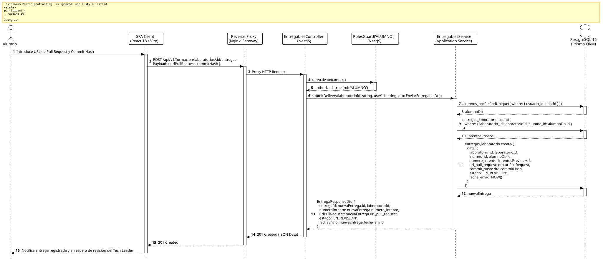

<div align="center">

| [Inicio](/README.md) | [RUP Hub](/RUP/README.md) | [00 Dominio](/RUP/00-modelo-del-dominio/README.md) | [01 Requisitos](/RUP/01-requisitos/README.md) | [02 Análisis](/RUP/02-analisis/README.md) | [03 Diseño](/RUP/03-diseño/README.md) | [Catálogo Diseño](/RUP/03-diseño/casos-uso/README.md) |
|:---:|:---:|:---:|:---:|:---:|:---:|:---:|

<sub>**Fase 03 Diseño** › **Realización de Casos de Uso** › `enviarEntregable()`</sub>

</div>

# Realización de Diseño: `enviarEntregable()`

Esta especificación formaliza el diseño técnico y contrato de interfaz para el caso de uso `enviarEntregable()`. Modela la remisión formal de entregas prácticas de código mediante **Pull Requests en GitHub / GitLab** ([ADR-013](/RUP/BITACORA.md#adr-013-simplificaci%C3%B3n-pragm%C3%A1tica-del-modelo-de-datos-der-y-alineaci%C3%B3n-con-la-operativa-real-de-cts)), prescindiendo de tablas redundantes de comentarios línea a línea y custodiando el hash del commit y el número de intento en `motor_formacion.entregas_laboratorio`.

---

<div align="center">

| Diagrama de Secuencia de Diseño UML |
| :---: |
|  |
| <sup><i>[Código fuente PlantUML](secuenciaDiseño.puml)</i></sup> |

</div>

---

## 1. Contrato de Interfaz REST (OpenAPI 3.1)

### 1.1 Definición del Endpoint

* **Ruta HTTP**: `POST /api/v1/formacion/laboratorios/:id/entregas`
* **Acceso / Seguridad**: Autenticado mediante `Bearer <accessToken>` con rol exclusivo `ALUMNO`.
* **Parámetros de Ruta**:
  * `id` (`uuid`, obligatorio): Identificador del laboratorio de código.
* **Cabeceras de Petición**:
  * `Authorization: Bearer <accessToken>`
  * `Content-Type: application/json`

### 1.2 DTO de Entrada (`EnviarEntregableDto`)

```typescript
import { IsUrl, IsNotEmpty, IsString, Length } from 'class-validator';

export class EnviarEntregableDto {
  @IsUrl({ require_protocol: true }, { message: 'Debe ser una URL válida de GitHub/GitLab' })
  @IsNotEmpty()
  urlPullRequest: string;

  @IsString()
  @Length(40, 40, { message: 'El hash de commit debe contener exactamente 40 caracteres SHA-1' })
  @IsNotEmpty()
  commitHash: string;
}
```

### 1.3 Respuestas Canónicas (DTOs de Salida)

#### `201 Created` — Entrega Registrada para Revisión

```json
{
  "statusCode": 201,
  "message": "Laboratorio enviado exitosamente. En espera de revisión por el Tech Leader.",
  "data": {
    "entregaId": "e1f2a3b4-c5d6-7e8f-9a0b-1c2d3e4f5a6b",
    "laboratorioId": "lab-1",
    "numeroIntento": 1,
    "urlPullRequest": "https://github.com/CTS-PROFER/proyecto-base/pull/12",
    "commitHash": "9f8379f71e832e3a5f423abac32f19523f009249",
    "estado": "EN_REVISION",
    "fechaEnvio": "2026-11-02T14:26:00.000Z"
  }
}
```

---

## 2. Componentes de Software de Diseño (NestJS)

* **`EntregablesController`**: Endpoint `POST /laboratorios/:id/entregas` protegido con `@Roles('ALUMNO')`.
* **`EntregablesService.submitDelivery`**: Cálculo incremental de `numero_intento` e inserción en `motor_formacion.entregas_laboratorio`.

---

## 3. Trazabilidad con Requisitos y Análisis

| Requisito / Análisis | Realización de Diseño |
| :--- | :--- |
| **Caso de Uso `enviarEntregable()`** | Endpoint `POST /api/v1/formacion/laboratorios/:id/entregas`. |
| **Operativa Real de Código (ADR-013)** | Enlace directo al Pull Request de GitHub/GitLab. |
| **Histórico de Intentos** | Incremento atómico en `numero_intento` en PostgreSQL. |

---

<div align="center">

[Ver Análisis previo (Fase 02)](/RUP/02-analisis/casos-uso/enviarEntregable/README.md) • [Catálogo de Casos de Uso (Diseño)](/RUP/03-diseño/casos-uso/README.md) • [Siguiente: `consultarFeedbackEntregable()`](../consultarFeedbackEntregable/README.md)

</div>
