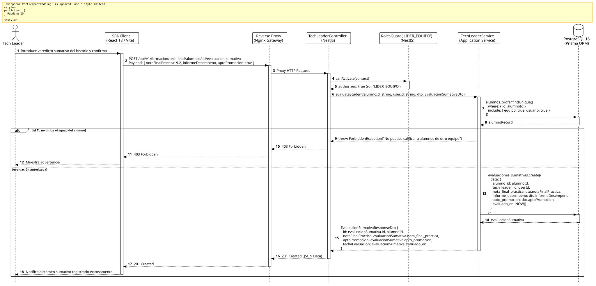

<div align="center">

| [Inicio](/README.md) | [RUP Hub](/RUP/README.md) | [00 Dominio](/RUP/00-modelo-del-dominio/README.md) | [01 Requisitos](/RUP/01-requisitos/README.md) | [02 Análisis](/RUP/02-analisis/README.md) | [03 Diseño](/RUP/03-diseño/README.md) | [Catálogo Diseño](/RUP/03-diseño/casos-uso/README.md) |
|:---:|:---:|:---:|:---:|:---:|:---:|:---:|

<sub>**Fase 03 Diseño** › **Realización de Casos de Uso** › `evaluarCapacitacionAlumno()`</sub>

</div>

# Realización de Diseño: `evaluarCapacitacionAlumno()`

Esta especificación formaliza el diseño técnico y contrato de interfaz para el caso de uso `evaluarCapacitacionAlumno()`. Concreta el dictamen formativo final emitido por el Tech Leader titular del Squad ([ADR-004](/RUP/BITACORA.md#adr-004-embudo-en-2-fases-y-asignaci%C3%B3n-a-los-6-equipos-de-cts), [ADR-006](/RUP/BITACORA.md#adr-006-descomposici%C3%B3n-arquitect%C3%B3nica-en-3-microservicios)), consolidando el informe de desempeño, la nota práctica global y la aptitud de promoción en `motor_formacion.evaluaciones_sumativas`.

---

<div align="center">

| Diagrama de Secuencia de Diseño UML |
| :---: |
|  |
| <sup><i>[Código fuente PlantUML](secuenciaDiseño.puml)</i></sup> |

</div>

---

## 1. Contrato de Interfaz REST (OpenAPI 3.1)

### 1.1 Definición del Endpoint

* **Ruta HTTP**: `POST /api/v1/formacion/tech-lead/alumnos/:id/evaluacion-sumativa`
* **Acceso / Seguridad**: Autenticado mediante `Bearer <accessToken>` con rol exclusivo `LIDER_EQUIPO`.
* **Parámetros de Ruta**:
  * `id` (`uuid`, obligatorio): Identificador del `Alumno` a evaluar.
* **Cabeceras de Petición**:
  * `Authorization: Bearer <accessToken>`
  * `Content-Type: application/json`

### 1.2 DTO de Entrada (`EvaluacionSumativaDto`)

```typescript
import { IsNumber, Min, Max, IsString, IsNotEmpty, IsBoolean } from 'class-validator';

export class EvaluacionSumativaDto {
  @IsNumber({ maxDecimalPlaces: 2 })
  @Min(0.0)
  @Max(10.0)
  notaFinalPractica: number;

  @IsString()
  @IsNotEmpty()
  informeDesempeno: string;

  @IsBoolean()
  aptoPromocion: boolean;
}
```

### 1.3 Respuestas Canónicas (DTOs de Salida)

#### `201 Created` — Evaluación Sumativa Registrada

```json
{
  "statusCode": 201,
  "message": "Evaluación sumativa de fin de ciclo registrada exitosamente",
  "data": {
    "id": "e9f8a7b6-c5d4-3a2b-1c0d-e9f8a7b6c5d4",
    "alumnoId": "3b2c1a09-87d6-454a-12a6-9998987ecda1",
    "notaFinalPractica": 9.2,
    "aptoPromocion": true,
    "fechaEvaluacion": "2026-11-02T14:40:00.000Z"
  }
}
```

---

## 2. Componentes de Software de Diseño (NestJS)

* **`TechLeaderController`**: Endpoint `POST /tech-lead/alumnos/:id/evaluacion-sumativa`.
* **`TechLeaderService.evaluateStudent`**: Comprobación de que el TL autenticado lidera el equipo al que está adscrito el alumno ([ADR-009](/RUP/BITACORA.md#adr-009-delimitaci%C3%B3n-de-actores-opacidad-de-tests-para-el-candidato-entrevistas-google-meet-en-el-perfil-por-el-gestor-y-aislamiento-del-tl)) e inserción en `motor_formacion.evaluaciones_sumativas`.

---

## 3. Trazabilidad con Requisitos y Análisis

| Requisito / Análisis | Realización de Diseño |
| :--- | :--- |
| **Caso de Uso `evaluarCapacitacionAlumno()`** | Endpoint `POST /api/v1/formacion/tech-lead/alumnos/:id/evaluacion-sumativa`. |
| **Responsabilidad del TL (ADR-006)** | `LiderEquipo --> Capacitacion : evalua`, formalizado en la entidad `evaluaciones_sumativas`. |
| **Vínculo Trans-Esquema (ADR-013)** | Clave foránea `tech_leader_id` apuntando directamente a `motor_equipos.usuarios.id`. |

---

<div align="center">

[Ver Análisis previo (Fase 02)](/RUP/02-analisis/casos-uso/evaluarCapacitacionAlumno/README.md) • [Catálogo de Casos de Uso (Diseño)](/RUP/03-diseño/casos-uso/README.md) • [Siguiente: `crearMaterial()`](../crearMaterial/README.md)

</div>
