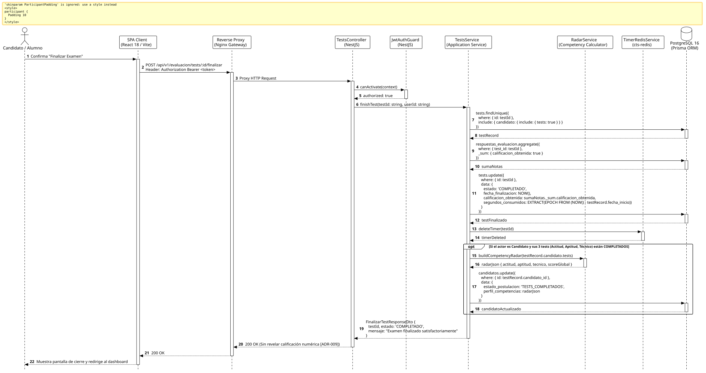

<div align="center">

| [Inicio](/README.md) | [RUP Hub](/RUP/README.md) | [00 Dominio](/RUP/00-modelo-del-dominio/README.md) | [01 Requisitos](/RUP/01-requisitos/README.md) | [02 Análisis](/RUP/02-analisis/README.md) | [03 Diseño](/RUP/03-diseño/README.md) | [Catálogo Diseño](/RUP/03-diseño/casos-uso/README.md) |
|:---:|:---:|:---:|:---:|:---:|:---:|:---:|

<sub>**Fase 03 Diseño** › **Realización de Casos de Uso** › `finalizarTest()`</sub>

</div>

# Realización de Diseño: `finalizarTest()`

Esta especificación formaliza el diseño técnico y contrato de interfaz para el caso de uso `finalizarTest()`. Ejecuta la consolidación transaccional del examen en **PostgreSQL 16**, calcula la sumatoria de calificaciones en `motor_evaluacion.tests`, elimina la llave temporal en **Redis 7** y, en caso de haber completado la batería de 3 tests ([ADR-007](/RUP/BITACORA.md#adr-007-admisi%C3%B3n-continua-por-ciclos-acad%C3%A9micos-bater%C3%ADa-de-3-tests-e-inclusi%C3%B3n-de-entrevista)), consolida el **gráfico de radar de competencias multidimensional** en `motor_evaluacion.candidatos.perfil_competencias` ([ADR-013](/RUP/BITACORA.md#adr-013-simplificaci%C3%B3n-pragm%C3%A1tica-del-modelo-de-datos-der-y-alineaci%C3%B3n-con-la-operativa-real-de-cts)).

---

<div align="center">

| Diagrama de Secuencia de Diseño UML |
| :---: |
|  |
| <sup><i>[Código fuente PlantUML](secuenciaDiseño.puml)</i></sup> |

</div>

---

## 1. Contrato de Interfaz REST (OpenAPI 3.1)

### 1.1 Definición del Endpoint

* **Ruta HTTP**: `POST /api/v1/evaluacion/tests/:id/finalizar`
* **Acceso / Seguridad**: Autenticado mediante `Bearer <accessToken>` con rol `CANDIDATO` o `ALUMNO`.
* **Parámetros de Ruta**:
  * `id` (`uuid`, obligatorio): Identificador único del test a cerrar.
* **Cabeceras de Petición**:
  * `Authorization: Bearer <accessToken>`
  * `Content-Type: application/json`

### 1.2 Respuestas Canónicas (DTOs de Salida)

#### `200 OK` — Examen Finalizado con Éxito

Retorna confirmación del estado completado sin revelar la calificación numérica obtenida ([ADR-009](/RUP/BITACORA.md#adr-009-delimitaci%C3%B3n-de-actores-opacidad-de-tests-para-el-candidato-entrevistas-google-meet-en-el-perfil-por-el-gestor-y-aislamiento-del-tl)).

```json
{
  "statusCode": 200,
  "message": "Evaluación finalizada satisfactoriamente",
  "data": {
    "testId": "a1b2c3d4-e5f6-7a8b-9c0d-1e2f3a4b5c6d",
    "estado": "COMPLETADO",
    "bateriaCompleta": true,
    "mensaje": "Has completado la totalidad de las pruebas diagnósticas. El equipo de admisiones revisará tu perfil."
  }
}
```

---

## 2. Consolidación del Radar de Competencias JSONB ([ADR-013](/RUP/BITACORA.md#adr-013-simplificaci%C3%B3n-pragm%C3%A1tica-del-modelo-de-datos-der-y-alineaci%C3%B3n-con-la-operativa-real-de-cts))

Al completarse el tercer test de la batería (`ACTITUD`, `APTITUD`, `TECNICO`), `RadarService` computa la estructura JSONB persistida en `motor_evaluacion.candidatos.perfil_competencias`:

```json
{
  "dimensiones": {
    "actitud": {
      "puntaje": 88.5,
      "factores": { "compromiso": 90, "trabajoEquipo": 85, "proactividad": 90 }
    },
    "aptitud": {
      "puntaje": 82.0,
      "factores": { "razonamientoLogico": 80, "resolucionProblemas": 84 }
    },
    "tecnico": {
      "puntaje": 85.0,
      "factores": { "javascript": 90, "sql": 75, "algoritmos": 90 }
    }
  },
  "indiceAfinidadGlobal": 85.16,
  "fechaCalculo": "2026-11-02T13:17:45.000Z"
}
```

Este objeto alimenta el gráfico de araña en el panel del Gestor (`abrirPerfilCandidato`).

---

## 3. Trazabilidad con Requisitos y Análisis

| Requisito / Análisis | Realización de Diseño |
| :--- | :--- |
| **Caso de Uso `finalizarTest()`** | Endpoint `POST /api/v1/evaluacion/tests/:id/finalizar`. |
| **Radar de Competencias (ADR-013)** | Generación automática y almacenamiento en `candidatos.perfil_competencias (jsonb)`. |
| **Transición de Candidatura (ADR-007)** | Actualización de `candidatos.estado_postulacion = 'TESTS_COMPLETADOS'`. |
| **Limpieza de Recursos** | Invocación de `DEL test:timer:<id>` en Redis 7. |

---

<div align="center">

[Ver Análisis previo (Fase 02)](/RUP/02-analisis/casos-uso/finalizarTest/README.md) • [Catálogo de Casos de Uso (Diseño)](/RUP/03-diseño/casos-uso/README.md) • [Siguiente: `abrirPerfilCandidato()`](../abrirPerfilCandidato/README.md)

</div>
