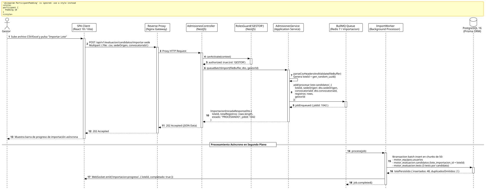

<div align="center">

| [Inicio](/README.md) | [RUP Hub](/RUP/README.md) | [00 Dominio](/RUP/00-modelo-del-dominio/README.md) | [01 Requisitos](/RUP/01-requisitos/README.md) | [02 Análisis](/RUP/02-analisis/README.md) | [03 Diseño](/RUP/03-diseño/README.md) | [Catálogo Diseño](/RUP/03-diseño/casos-uso/README.md) |
|:---:|:---:|:---:|:---:|:---:|:---:|:---:|

<sub>**Fase 03 Diseño** › **Realización de Casos de Uso** › `importarCandidatosSede()`</sub>

</div>

# Realización de Diseño: `importarCandidatosSede()`

Esta especificación formaliza el diseño técnico y contrato de interfaz para el caso de uso `importarCandidatosSede()`. Modela la carga masiva y asíncrona de lotes de aspirantes enviados por sedes internacionales ([ADR-008](/RUP/BITACORA.md#adr-008-canalizaci%C3%B3n-de-candidatos-por-sedes-internacionales-y-eliminaci%C3%B3n-de-usuarionologueado)), orquestando el procesamiento mediante colas **BullMQ sobre Redis 7**, persistencia transaccional por bloques en **PostgreSQL 16** (`motor_evaluacion.candidatos.lote_importacion_id`) y retroalimentación reactiva mediante WebSockets.

---

<div align="center">

| Diagrama de Secuencia de Diseño UML |
| :---: |
|  |
| <sup><i>[Código fuente PlantUML](secuenciaDiseño.puml)</i></sup> |

</div>

---

## 1. Contrato de Interfaz REST (OpenAPI 3.1)

### 1.1 Definición del Endpoint

* **Ruta HTTP**: `POST /api/v1/evaluacion/candidatos/importar-sede`
* **Acceso / Seguridad**: Autenticado mediante `Bearer <accessToken>` con rol exclusivo `GESTOR`.
* **Content-Type**: `multipart/form-data`
* **Campos del Formulario**:
  * `file` (archivo `.csv` o `.xlsx`, obligatorio): Archivo tabular con columnas `email`, `nombre`, `apellidos`, `telefono`.
  * `sedeOrigen` (`string`, obligatorio): Nombre de la sede internacional remitente.
  * `convocatoriaId` (`uuid`, obligatorio): Convocatoria académica destino.

### 1.2 Respuestas Canónicas (DTOs de Salida)

#### `202 Accepted` — Lote Encolado para Procesamiento Asíncrono

```json
{
  "statusCode": 202,
  "message": "Archivo recibido. Lote de candidatos encolado para importación asíncrona.",
  "data": {
    "loteId": "4a3b2c1d-0e9f-8a7b-6c5d-4e3f2a1b0c9d",
    "totalRegistros": 50,
    "sedeOrigen": "El Salvador (SDR)",
    "estado": "PROCESANDO",
    "jobId": 1042
  }
}
```

---

## 2. Componentes de Software y Procesamiento Asíncrono

* **`AdmisionesController`**: Endpoint `POST /candidatos/importar-sede` con interceptor `FileInterceptor('file')`.
* **`AdmisionesService.queueBatchImport`**: Validación estructural rápida y encolado en cola BullMQ `importacion-candidatos`.
* **`ImportWorker`**: Consumidor BullMQ que procesa los registros en chunks de 50:
  * Inserta identidades en `motor_equipos.usuarios`.
  * Inserta registros en `motor_evaluacion.candidatos` asociando `lote_importacion_id = loteId`.
  * Crea las 3 instancias de `motor_evaluacion.tests` por cada candidato.
  * Notifica por WebSocket (`importacion:progreso`) el avance al panel del Gestor.

---

## 3. Trazabilidad con Requisitos y Análisis

| Requisito / Análisis | Realización de Diseño |
| :--- | :--- |
| **Caso de Uso `importarCandidatosSede()`** | Endpoint `POST /api/v1/evaluacion/candidatos/importar-sede`. |
| **Lotes por Sedes (ADR-008)** | Agrupación bajo `motor_evaluacion.candidatos.lote_importacion_id`. |
| **Escalabilidad y Rendimiento** | Respuesta inmediata `202 Accepted` y worker en background BullMQ / Redis. |

---

<div align="center">

[Ver Análisis previo (Fase 02)](/RUP/02-analisis/casos-uso/importarCandidatosSede/README.md) • [Catálogo de Casos de Uso (Diseño)](/RUP/03-diseño/casos-uso/README.md) • [Siguiente: PK03 — MotorFormacion](../consultarCapacitacion/README.md)

</div>
