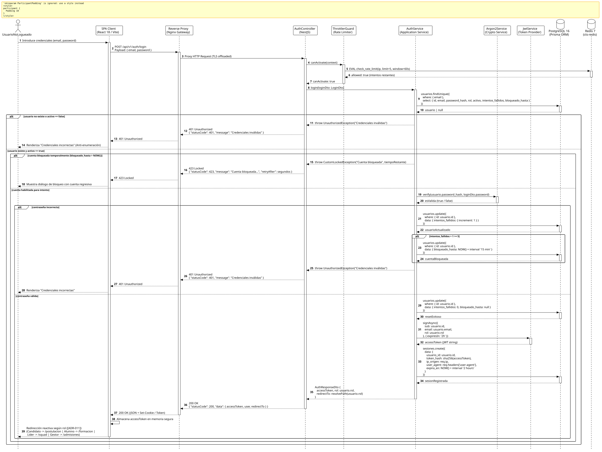

<div align="center">

| [Inicio](/README.md) | [RUP Hub](/RUP/README.md) | [00 Dominio](/RUP/00-modelo-del-dominio/README.md) | [01 Requisitos](/RUP/01-requisitos/README.md) | [02 Análisis](/RUP/02-analisis/README.md) | [03 Diseño](/RUP/03-diseño/README.md) | [Catálogo Diseño](/RUP/03-diseño/casos-uso/README.md) |
|:---:|:---:|:---:|:---:|:---:|:---:|:---:|

<sub>**Fase 03 Diseño** › **Realización de Casos de Uso** › `iniciarSesion()`</sub>

</div>

# Realización de Diseño: `iniciarSesion()`

Esta especificación formaliza el diseño técnico y contrato de interfaz para el caso de uso `iniciarSesion()`, concretando la realización de análisis previa en una arquitectura basada en **NestJS**, persistencia en **PostgreSQL 16** (vía Prisma ORM), control de tasa en **Redis 7** y verificación de credenciales con **Argon2id**.

---

<div align="center">

| Diagrama de Secuencia de Diseño UML |
| :---: |
|  |
| <sup><i>[Código fuente PlantUML](secuenciaDiseño.puml)</i></sup> |

</div>

---

## 1. Contrato de Interfaz REST (OpenAPI 3.1)

### 1.1 Definición del Endpoint

* **Ruta HTTP**: `POST /api/v1/auth/login`
* **Acceso / Seguridad**: Público (sin Bearer Token previo). Protegido por rate-limiting estricto.
* **Control de Tasa (Anti-Brute Force)**: Máximo 5 peticiones por minuto por IP (`@Throttle(5, 60)` coordinado con Redis y directiva `limit_req` en Nginx Gateway).
* **Cabeceras de Petición**:
  * `Content-Type: application/json`
  * `Accept: application/json`

### 1.2 DTO de Entrada (`LoginDto`)

```typescript
import { IsEmail, IsNotEmpty, IsString, MinLength } from 'class-validator';
import { ApiProperty } from '@nestjs/swagger';

export class LoginDto {
  @ApiProperty({
    example: 'candidato.demo@uneatlantico.es',
    description: 'Correo institucional registrado del usuario'
  })
  @IsEmail({}, { message: 'El correo debe tener un formato institucional válido' })
  @IsNotEmpty({ message: 'El email es obligatorio' })
  email: string;

  @ApiProperty({
    example: 'P@ssw0rdSecure2026',
    description: 'Contraseña en texto plano para validación criptográfica',
    minLength: 8
  })
  @IsString()
  @MinLength(8, { message: 'La contraseña debe contener al menos 8 caracteres' })
  password: string;
}
```

### 1.3 Respuestas Canónicas (DTOs de Salida)

#### `200 OK` — Autenticación Exitosa

Retorna el token Bearer JWT con tiempo de expiración (2 horas), perfil básico de identidad y ruta de redirección en el SPA acorde a su rol ([ADR-011](/RUP/BITACORA.md#adr-011-patr%C3%B3n-can%C3%B3nico-de-acceso-usuarionologueado-para-iniciarsesion-exclusividad-de-cerrarsesion-en-roles-y-extend-condicional)).

```json
{
  "statusCode": 200,
  "message": "Autenticación exitosa",
  "data": {
    "accessToken": "eyJhbGciOiJIUzI1NiIsInR5cCI6IkpXVCJ9.eyJzdWIiOiJjMWY3YTA0OS03NGQ2LTQ0NGEtOTdhNi04OTY4OTg3ZWNkYTgiLCJlbWFpbCI6ImNhbmRpZGF0by5kZW1vQHVuZWF0bGFudGljby5lcyIsInJvbCI6IkNBTkRJREFUTyIsImlhdCI6MTc2MjA4NDgwMCwiZXhwIjoxNzYyMDkyMDAwfQ.signature",
    "tokenType": "Bearer",
    "expiresIn": 7200,
    "usuario": {
      "id": "c1f7a049-74d6-444a-97a6-8968987ecda8",
      "email": "candidato.demo@uneatlantico.es",
      "nombre": "Carlos",
      "apellidos": "Gómez",
      "rol": "CANDIDATO"
    },
    "redirectTo": "/portal/postulacion"
  }
}
```

#### `401 Unauthorized` — Credenciales Inválidas

Mensaje genérico uniforme emitido tanto si el usuario no existe en la base de datos como si la contraseña es errónea, mitigando ataques de enumeración de cuentas (OWASP WSTG-IDNT-04).

```json
{
  "statusCode": 401,
  "error": "Unauthorized",
  "message": "Credenciales inválidas"
}
```

#### `423 Locked` — Bloqueo Temporal por Intentos Fallidos

Emitido cuando una cuenta ha alcanzado 5 intentos fallidos consecutivos. La cuenta queda inhabilitada durante 15 minutos ([RN-ACC-02](/RUP/01-requisitos/03-detalle-casos-uso/iniciarSesion/README.md)).

```json
{
  "statusCode": 423,
  "error": "Locked",
  "message": "Cuenta bloqueada temporalmente por exceso de intentos fallidos. Intente nuevamente en 14 minutos.",
  "retryAfter": 840
}
```

---

## 2. Componentes de Software de Diseño (NestJS)

```text
src/modules/auth/
├── controllers/
│   └── auth.controller.ts       ──► Exposición del endpoint POST /api/v1/auth/login.
├── services/
│   ├── auth.service.ts          ──► Orquestador de validación, sesiones e issue de JWT.
│   └── argon2.service.ts        ──► Verificación criptográfica (Argon2id).
├── guards/
│   └── throttler.guard.ts       ──► Control distribuido de peticiones en Redis.
├── dto/
│   ├── login.dto.ts             ──► DTO validado con class-validator.
│   └── auth-response.dto.ts     ──► Payload normalizado de salida.
└── repositories/
    ├── usuarios.repository.ts   ──► Consultas a PostgreSQL schema motor_equipos.usuarios.
    └── sesiones.repository.ts   ──► Alta de sesión en motor_equipos.sesiones.
```

### 2.1 Lógica de Orquestación (`AuthService.login`)

1. **Búsqueda del Usuario**: Consulta en `motor_equipos.usuarios` filtrando por `email` y `activo = true`.
2. **Evaluación de Bloqueo**: Si `bloqueado_hasta != null` y `bloqueado_hasta > NOW()`, calcula los segundos restantes y dispara `CustomLockedException`.
3. **Comprobación Criptográfica**: Ejecuta `argon2.verify(usuario.password_hash, dto.password)` con configuración estándar OWASP (paralelismo 4, memoria 64MB, tiempo 3 iteraciones).
4. **Manejo de Error (Fail Path)**:
   - Incrementa atómicamente `intentos_fallidos`.
   - Si `intentos_fallidos >= 5`, actualiza `bloqueado_hasta = NOW() + INTERVAL '15 MIN'`.
   - Retorna `UnauthorizedException("Credenciales inválidas")`.
5. **Manejo de Éxito (Success Path)**:
   - Reinicia `intentos_fallidos = 0` y `bloqueado_hasta = null`.
   - Emite el JWT con `sub = usuario.id`, `rol = usuario.rol` y expiración en 7200 segundos.
   - Inserta registro en `motor_equipos.sesiones` custodiando `token_hash = sha256(jwt)`, IP de origen y cabecera `User-Agent`.
   - Mapea `redirectTo` según el rol autenticado.

---

## 3. Matriz de Redirección Reactiva ([ADR-011](/RUP/BITACORA.md#adr-011-patr%C3%B3n-can%C3%B3nico-de-acceso-usuarionologueado-para-iniciarsesion-exclusividad-de-cerrarsesion-en-roles-y-extend-condicional))

| Rol Autenticado (`usuarios.rol`) | Caso de Uso Extendido (`<<extend>>`) | Ruta Destino SPA | Vista / Componente |
| :--- | :--- | :--- | :--- |
| **`CANDIDATO`** | `abrirPanelPostulacion()` | `/portal/postulacion` | `CandidatoDashboardView` |
| **`ALUMNO`** | `abrirPanelAlumno()` | `/portal/alumno` | `AlumnoDashboardView` |
| **`LIDER_EQUIPO`** | `abrirPanelLider()` | `/portal/lider` | `SquadLeaderDashboardView` |
| **`GESTOR`** | `abrirPanelAdmisiones()` | `/portal/admisiones` | `AdmissionsManagerDashboardView` |

---

## 4. Trazabilidad con Requisitos y Análisis

| Requisito / Análisis | Realización de Diseño |
| :--- | :--- |
| **Caso de Uso `iniciarSesion()`** | Endpoint `POST /api/v1/auth/login` implementado en `AuthController`. |
| **Actor `UsuarioNoLogueado`** | Acceso público sin JWT, filtrado exclusivamente por IP mediante `ThrottlerGuard`. |
| **Entidad `Usuario` (BCE)** | Tabla `motor_equipos.usuarios` en PostgreSQL 16 con hash Argon2id y columnas de bloqueo. |
| **Entidad `Sesion` (BCE)** | Tabla `motor_equipos.sesiones` con `token_hash` inmutable (SHA-256) para auditoría. |
| **Regla RN-ACC-02 (Bloqueo 5 intentos)** | Transición atómica de `intentos_fallidos` y `bloqueado_hasta` en base de datos; código HTTP `423 Locked`. |

---

<div align="center">

[Ver Análisis previo (Fase 02)](/RUP/02-analisis/casos-uso/iniciarSesion/README.md) • [Catálogo de Casos de Uso (Diseño)](/RUP/03-diseño/casos-uso/README.md) • [Siguiente: `cerrarSesion()`](../cerrarSesion/README.md)

</div>
