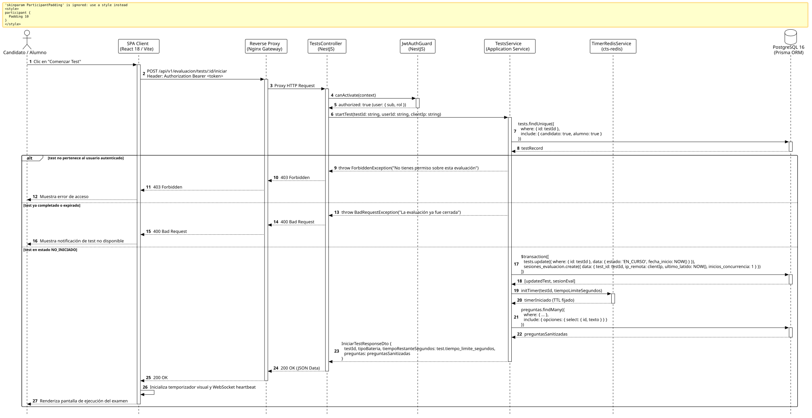

<div align="center">

| [Inicio](/README.md) | [RUP Hub](/RUP/README.md) | [00 Dominio](/RUP/00-modelo-del-dominio/README.md) | [01 Requisitos](/RUP/01-requisitos/README.md) | [02 Análisis](/RUP/02-analisis/README.md) | [03 Diseño](/RUP/03-diseño/README.md) | [Catálogo Diseño](/RUP/03-diseño/casos-uso/README.md) |
|:---:|:---:|:---:|:---:|:---:|:---:|:---:|

<sub>**Fase 03 Diseño** › **Realización de Casos de Uso** › `iniciarTest()`</sub>

</div>

# Realización de Diseño: `iniciarTest()`

Esta especificación formaliza el diseño técnico y contrato de interfaz para el caso de uso `iniciarTest()`. Garantiza la inmutabilidad temporal del examen ([RN-TEST-02](/RUP/01-requisitos/03-detalle-casos-uso/iniciarTest/README.md)), persistiendo el inicio en **PostgreSQL 16**, custodiando la sesión de evaluación con auditoría de IP (`motor_evaluacion.sesiones_evaluacion`) y sincronizando el cronómetro maestro mediante **Redis 7**.

---

<div align="center">

| Diagrama de Secuencia de Diseño UML |
| :---: |
|  |
| <sup><i>[Código fuente PlantUML](secuenciaDiseño.puml)</i></sup> |

</div>

---

## 1. Contrato de Interfaz REST (OpenAPI 3.1)

### 1.1 Definición del Endpoint

* **Ruta HTTP**: `POST /api/v1/evaluacion/tests/:id/iniciar`
* **Acceso / Seguridad**: Autenticado mediante `Bearer <accessToken>` con rol `CANDIDATO` o `ALUMNO`.
* **Parámetros de Ruta**:
  * `id` (`uuid`, obligatorio): Identificador único de la entidad `Test`.
* **Cabeceras de Petición**:
  * `Authorization: Bearer <accessToken>`
  * `Accept: application/json`

### 1.2 Respuestas Canónicas (DTOs de Salida)

#### `200 OK` — Examen Inicializado

Retorna los reactivos del examen con opciones de respuesta sanitizadas (omitiendo banderas de acierto) y el tiempo límite en segundos.

```json
{
  "statusCode": 200,
  "message": "Evaluación iniciada exitosamente",
  "data": {
    "testId": "a1b2c3d4-e5f6-7a8b-9c0d-1e2f3a4b5c6d",
    "tipoBateria": "TECNICO",
    "tiempoRestanteSegundos": 3600,
    "totalPreguntas": 20,
    "preguntas": [
      {
        "id": "7f8a9b0c-1d2e-3f4a-5b6c-7d8e9f0a1b2c",
        "numeroOrden": 1,
        "tipoPregunta": "TEORICA",
        "enunciado": "¿Cuál de los siguientes no es un tipo primitivo en TypeScript?",
        "opciones": [
          { "id": "11111111-2222-3333-4444-555555555555", "texto": "string" },
          { "id": "22222222-3333-4444-5555-666666666666", "texto": "boolean" },
          { "id": "33333333-4444-5555-6666-777777777777", "texto": "integer" },
          { "id": "44444444-5555-6666-7777-888888888888", "texto": "symbol" }
        ]
      }
    ]
  }
}
```

#### `400 Bad Request` — Estado Inválido

Emitido si el examen ya se encuentra finalizado o ha expirado.

```json
{
  "statusCode": 400,
  "error": "Bad Request",
  "message": "La evaluación seleccionada ya ha finalizado previamente o su tiempo ha expirado"
}
```

---

## 2. Componentes de Software de Diseño (NestJS)

```text
src/modules/evaluacion/
├── controllers/
│   └── tests.controller.ts          ──► Endpoint POST /tests/:id/iniciar.
├── services/
│   ├── tests.service.ts             ──► Transacción atómica de arranque e inyección de reactivos.
│   └── timer-redis.service.ts       ──► Registro de llave TTL en Redis test:timer:<id>.
└── repositories/
    ├── tests.repository.ts          ──► Persistencia en motor_evaluacion.tests.
    └── sesiones-eval.repository.ts  ──► Inserción en motor_evaluacion.sesiones_evaluacion (IP, heartbeat).
```

---

## 3. Trazabilidad con Requisitos y Análisis

| Requisito / Análisis | Realización de Diseño |
| :--- | :--- |
| **Caso de Uso `iniciarTest()`** | Endpoint `POST /api/v1/evaluacion/tests/:id/iniciar`. |
| **Regla RN-TEST-01 (Pertenencia)** | Verificación estricta de propiedad de la entidad `Test` vinculada al actor. |
| **Regla RN-TEST-02 (Cronómetro Inmutable)** | Fijación de `fecha_inicio = NOW()` en PostgreSQL y TTL en Redis (`SETEX test:timer:<id> 3600`). |
| **Auditoría Anti-Fraude (ADR-012)** | Almacenamiento de `ip_remota` tipo `inet` y conteo de `inicios_concurrencia` en `sesiones_evaluacion`. |

---

<div align="center">

[Ver Análisis previo (Fase 02)](/RUP/02-analisis/casos-uso/iniciarTest/README.md) • [Catálogo de Casos de Uso (Diseño)](/RUP/03-diseño/casos-uso/README.md) • [Siguiente: `responderPreguntaTeorica()`](../responderPreguntaTeorica/README.md)

</div>
