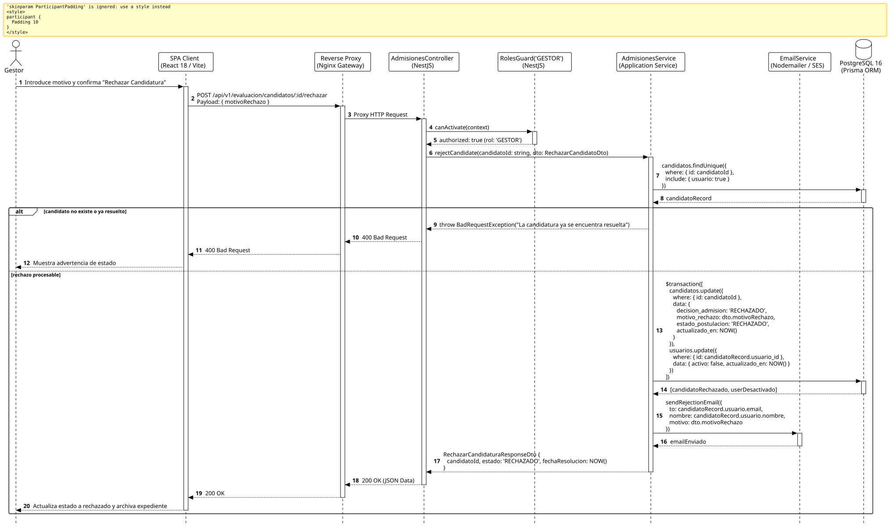

<div align="center">

| [Inicio](/README.md) | [RUP Hub](/RUP/README.md) | [00 Dominio](/RUP/00-modelo-del-dominio/README.md) | [01 Requisitos](/RUP/01-requisitos/README.md) | [02 Análisis](/RUP/02-analisis/README.md) | [03 Diseño](/RUP/03-diseño/README.md) | [Catálogo Diseño](/RUP/03-diseño/casos-uso/README.md) |
|:---:|:---:|:---:|:---:|:---:|:---:|:---:|

<sub>**Fase 03 Diseño** › **Realización de Casos de Uso** › `rechazarCandidatura()`</sub>

</div>

# Realización de Diseño: `rechazarCandidatura()`

Esta especificación formaliza el diseño técnico y contrato de interfaz para el caso de uso `rechazarCandidatura()`. Modela la resolución desestimatoria de la postulación por parte del Gestor de Admisiones, la persistencia del dictamen con auditoría de motivos (`motor_evaluacion.candidatos.motivo_rechazo`), la inhabilitación del acceso de evaluación en `motor_equipos.usuarios` y la emisión del correo institucional de agradecimiento.

---

<div align="center">

| Diagrama de Secuencia de Diseño UML |
| :---: |
|  |
| <sup><i>[Código fuente PlantUML](secuenciaDiseño.puml)</i></sup> |

</div>

---

## 1. Contrato de Interfaz REST (OpenAPI 3.1)

### 1.1 Definición del Endpoint

* **Ruta HTTP**: `POST /api/v1/evaluacion/candidatos/:id/rechazar`
* **Acceso / Seguridad**: Autenticado mediante `Bearer <accessToken>` con rol exclusivo `GESTOR`.
* **Parámetros de Ruta**:
  * `id` (`uuid`, obligatorio): Identificador del candidato.
* **Cabeceras de Petición**:
  * `Authorization: Bearer <accessToken>`
  * `Content-Type: application/json`

### 1.2 DTO de Entrada (`RechazarCandidatoDto`)

```typescript
import { IsString, IsNotEmpty, MinLength } from 'class-validator';

export class RechazarCandidatoDto {
  @IsString()
  @IsNotEmpty()
  @MinLength(10, { message: 'El motivo de rechazo debe contener una justificación clara' })
  motivoRechazo: string;
}
```

### 1.3 Respuestas Canónicas (DTOs de Salida)

#### `200 OK` — Candidatura Rechazada

```json
{
  "statusCode": 200,
  "message": "Candidatura resuelta con dictamen de rechazo",
  "data": {
    "candidatoId": "c1f7a049-74d6-444a-97a6-8968987ecda8",
    "decisionAdmision": "RECHAZADO",
    "estadoPostulacion": "RECHAZADO",
    "fechaResolucion": "2026-11-15T16:30:00.000Z"
  }
}
```

---

## 2. Componentes de Software de Diseño (NestJS)

* **`AdmisionesController`**: Endpoint `POST /candidatos/:id/rechazar` con `@Roles('GESTOR')`.
* **`AdmisionesService.rejectCandidate`**: Transacción que marca `decision_admision = 'RECHAZADO'` y deshabilita la cuenta (`activo = false`).
* **`EmailService`**: Despacho de comunicación respetuosa informando el cierre del proceso.

---

## 3. Trazabilidad con Requisitos y Análisis

| Requisito / Análisis | Realización de Diseño |
| :--- | :--- |
| **Caso de Uso `rechazarCandidatura()`** | Endpoint `POST /api/v1/evaluacion/candidatos/:id/rechazar`. |
| **Dictamen Final del Gestor (ADR-007, ADR-009)** | Registro formal de `decision_admision` y `motivo_rechazo`. |
| **Revocación de Acceso** | Inactivación de cuenta en `motor_equipos.usuarios.activo = false`. |

---

<div align="center">

[Ver Análisis previo (Fase 02)](/RUP/02-analisis/casos-uso/rechazarCandidatura/README.md) • [Catálogo de Casos de Uso (Diseño)](/RUP/03-diseño/casos-uso/README.md) • [Siguiente: `registrarCandidato()`](../registrarCandidato/README.md)

</div>
