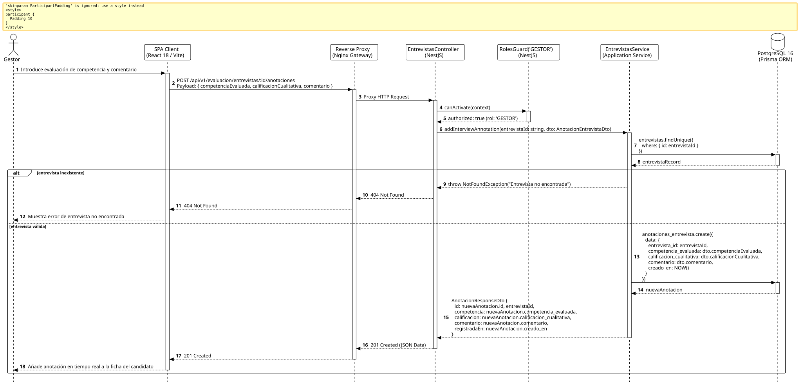

<div align="center">

| [Inicio](/README.md) | [RUP Hub](/RUP/README.md) | [00 Dominio](/RUP/00-modelo-del-dominio/README.md) | [01 Requisitos](/RUP/01-requisitos/README.md) | [02 Análisis](/RUP/02-analisis/README.md) | [03 Diseño](/RUP/03-diseño/README.md) | [Catálogo Diseño](/RUP/03-diseño/casos-uso/README.md) |
|:---:|:---:|:---:|:---:|:---:|:---:|:---:|

<sub>**Fase 03 Diseño** › **Realización de Casos de Uso** › `registrarAnotacionesEntrevista()`</sub>

</div>

# Realización de Diseño: `registrarAnotacionesEntrevista()`

Esta especificación formaliza el diseño técnico y contrato de interfaz para el caso de uso `registrarAnotacionesEntrevista()`. Modela la captura en vivo de valoraciones cualitativas y notas de competencia realizadas por el Gestor de Admisiones durante o tras la sesión en Google Meet ([ADR-009](/RUP/BITACORA.md#adr-009-delimitaci%C3%B3n-de-actores-opacidad-de-tests-para-el-candidato-entrevistas-google-meet-en-el-perfil-por-el-gestor-y-aislamiento-del-tl)), almacenadas en `motor_evaluacion.anotaciones_entrevista`.

---

<div align="center">

| Diagrama de Secuencia de Diseño UML |
| :---: |
|  |
| <sup><i>[Código fuente PlantUML](secuenciaDiseño.puml)</i></sup> |

</div>

---

## 1. Contrato de Interfaz REST (OpenAPI 3.1)

### 1.1 Definición del Endpoint

* **Ruta HTTP**: `POST /api/v1/evaluacion/entrevistas/:id/anotaciones`
* **Acceso / Seguridad**: Autenticado con `Bearer <accessToken>` y rol `GESTOR`.
* **Parámetros de Ruta**:
  * `id` (`uuid`, obligatorio): Identificador de la entidad `Entrevista`.
* **Cabeceras de Petición**:
  * `Authorization: Bearer <accessToken>`
  * `Content-Type: application/json`

### 1.2 DTO de Entrada (`AnotacionEntrevistaDto`)

```typescript
import { IsString, IsNotEmpty, IsIn } from 'class-validator';

export class AnotacionEntrevistaDto {
  @IsString()
  @IsNotEmpty()
  competenciaEvaluada: string;

  @IsIn(['SOBRESALIENTE', 'COMPETENTE', 'EN_DESARROLLO', 'NO_IDONEO'])
  calificacionCualitativa: 'SOBRESALIENTE' | 'COMPETENTE' | 'EN_DESARROLLO' | 'NO_IDONEO';

  @IsString()
  @IsNotEmpty()
  comentario: string;
}
```

### 1.3 Respuestas Canónicas (DTOs de Salida)

#### `201 Created` — Anotación Registrada

```json
{
  "statusCode": 201,
  "message": "Anotación cualitativa registrada correctamente",
  "data": {
    "id": "5f6e7d8c-9b0a-1c2d-3e4f-5a6b7c8d9e0f",
    "entrevistaId": "9b1deb4d-3b7d-4bad-9bdd-2b0d7b3dcb6d",
    "competencia": "Comunicación Asertiva y Trabajo en Equipo",
    "calificacion": "SOBRESALIENTE",
    "comentario": "El candidato demostró gran madurez al explicar cómo resolvió desacuerdos técnicos en proyectos anteriores.",
    "registradaEn": "2026-11-15T15:45:10.000Z"
  }
}
```

---

## 2. Componentes de Software de Diseño (NestJS)

* **`EntrevistasController`**: Endpoint `POST /entrevistas/:id/anotaciones` protegido con `@Roles('GESTOR')`.
* **`EntrevistasService.addInterviewAnnotation`**: Validación de existencia e inserción append-only en `motor_evaluacion.anotaciones_entrevista`.

---

## 3. Trazabilidad con Requisitos y Análisis

| Requisito / Análisis | Realización de Diseño |
| :--- | :--- |
| **Caso de Uso `registrarAnotacionesEntrevista()`** | Endpoint `POST /api/v1/evaluacion/entrevistas/:id/anotaciones`. |
| **Evaluación Cualitativa (ADR-007, ADR-009)** | Captura de impresiones conductuales y de actitud complementarias a los tests técnicos. |
| **Persistencia 1:N** | Relación `entrevistas ||--o{ anotaciones_entrevista` en PostgreSQL 16. |

---

<div align="center">

[Ver Análisis previo (Fase 02)](/RUP/02-analisis/casos-uso/registrarAnotacionesEntrevista/README.md) • [Catálogo de Casos de Uso (Diseño)](/RUP/03-diseño/casos-uso/README.md) • [Siguiente: `admitirAlumnoProfer()`](../admitirAlumnoProfer/README.md)

</div>
