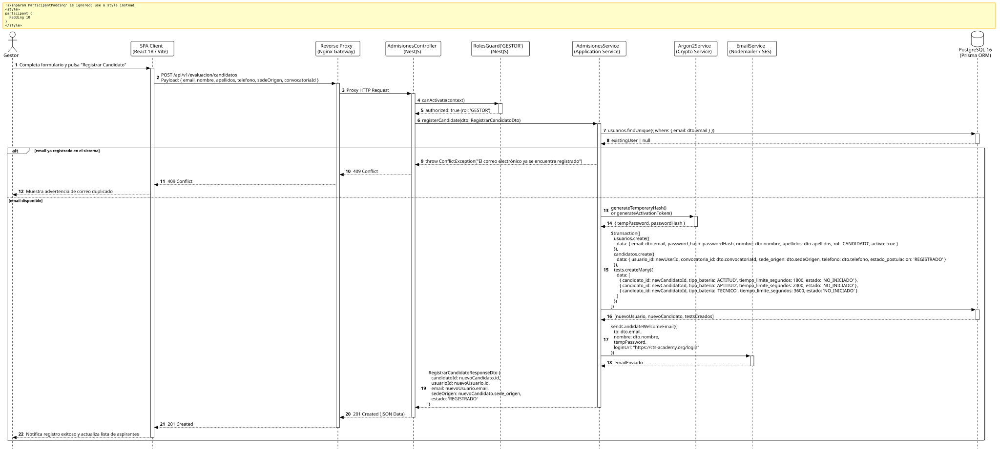

<div align="center">

| [Inicio](/README.md) | [RUP Hub](/RUP/README.md) | [00 Dominio](/RUP/00-modelo-del-dominio/README.md) | [01 Requisitos](/RUP/01-requisitos/README.md) | [02 Análisis](/RUP/02-analisis/README.md) | [03 Diseño](/RUP/03-diseño/README.md) | [Catálogo Diseño](/RUP/03-diseño/casos-uso/README.md) |
|:---:|:---:|:---:|:---:|:---:|:---:|:---:|

<sub>**Fase 03 Diseño** › **Realización de Casos de Uso** › `registrarCandidato()`</sub>

</div>

# Realización de Diseño: `registrarCandidato()`

Esta especificación formaliza el diseño técnico y contrato de interfaz para el caso de uso `registrarCandidato()`. Implementa el alta individual y controlada de un aspirante remitido por sedes internacionales ([ADR-008](/RUP/BITACORA.md#adr-008-canalizaci%C3%B3n-de-candidatos-por-sedes-internacionales-y-eliminaci%C3%B3n-de-usuarionologueado)), aprovisionando su cuenta en `motor_equipos.usuarios`, su ficha en `motor_evaluacion.candidatos` y la instanciación de su **batería de 3 tests diagnósticos** ([ADR-007](/RUP/BITACORA.md#adr-007-admisi%C3%B3n-continua-por-ciclos-acad%C3%A9micos-bater%C3%ADa-de-3-tests-e-inclusi%C3%B3n-de-entrevista)).

---

<div align="center">

| Diagrama de Secuencia de Diseño UML |
| :---: |
|  |
| <sup><i>[Código fuente PlantUML](secuenciaDiseño.puml)</i></sup> |

</div>

---

## 1. Contrato de Interfaz REST (OpenAPI 3.1)

### 1.1 Definición del Endpoint

* **Ruta HTTP**: `POST /api/v1/evaluacion/candidatos`
* **Acceso / Seguridad**: Autenticado mediante `Bearer <accessToken>` con rol exclusivo `GESTOR`.
* **Cabeceras de Petición**:
  * `Authorization: Bearer <accessToken>`
  * `Content-Type: application/json`

### 1.2 DTO de Entrada (`RegistrarCandidatoDto`)

```typescript
import { IsEmail, IsNotEmpty, IsString, IsUUID, IsPhoneNumber, IsOptional } from 'class-validator';

export class RegistrarCandidatoDto {
  @IsEmail({}, { message: 'El correo debe tener un formato válido' })
  @IsNotEmpty()
  email: string;

  @IsString()
  @IsNotEmpty()
  nombre: string;

  @IsString()
  @IsNotEmpty()
  apellidos: string;

  @IsOptional()
  telefono?: string;

  @IsString()
  @IsNotEmpty()
  sedeOrigen: string;

  @IsUUID('4')
  @IsNotEmpty()
  convocatoriaId: string;
}
```

### 1.3 Respuestas Canónicas (DTOs de Salida)

#### `201 Created` — Candidato Creado e Inicializado

```json
{
  "statusCode": 201,
  "message": "Candidato registrado exitosamente con batería de tests inicializada",
  "data": {
    "candidatoId": "c1f7a049-74d6-444a-97a6-8968987ecda8",
    "usuarioId": "a9b8c7d6-e5f4-3a2b-1c0d-e9f8a7b6c5d4",
    "email": "carlos.gomez@alumnos.uneatlantico.es",
    "sedeOrigen": "El Salvador (SDR)",
    "estado": "REGISTRADO",
    "testsCreados": ["ACTITUD", "APTITUD", "TECNICO"]
  }
}
```

#### `409 Conflict` — Email Previamente Existente

```json
{
  "statusCode": 409,
  "error": "Conflict",
  "message": "Ya existe una cuenta registrada con este correo electrónico"
}
```

---

## 2. Componentes de Software de Diseño (NestJS)

* **`AdmisionesController`**: Endpoint `POST /candidatos` con `@Roles('GESTOR')`.
* **`AdmisionesService.registerCandidate`**: Transacción PostgreSQL que inserta en `usuarios`, `candidatos` y `tests`.
* **`Argon2Service`**: Generación de hash para contraseña provisoria.
* **`EmailService`**: Notificación de bienvenida con enlace seguro para activar contraseña.

---

## 3. Trazabilidad con Requisitos y Análisis

| Requisito / Análisis | Realización de Diseño |
| :--- | :--- |
| **Caso de Uso `registrarCandidato()`** | Endpoint `POST /api/v1/evaluacion/candidatos`. |
| **Ingreso por Sedes (ADR-008)** | Alta por el Gestor sin registro público anónimo en web. |
| **Batería Inicial de Tests (ADR-007)** | Alta de 3 instancias en `motor_evaluacion.tests` en estado `NO_INICIADO`. |

---

<div align="center">

[Ver Análisis previo (Fase 02)](/RUP/02-analisis/casos-uso/registrarCandidato/README.md) • [Catálogo de Casos de Uso (Diseño)](/RUP/03-diseño/casos-uso/README.md) • [Siguiente: `importarCandidatosSede()`](../importarCandidatosSede/README.md)

</div>
