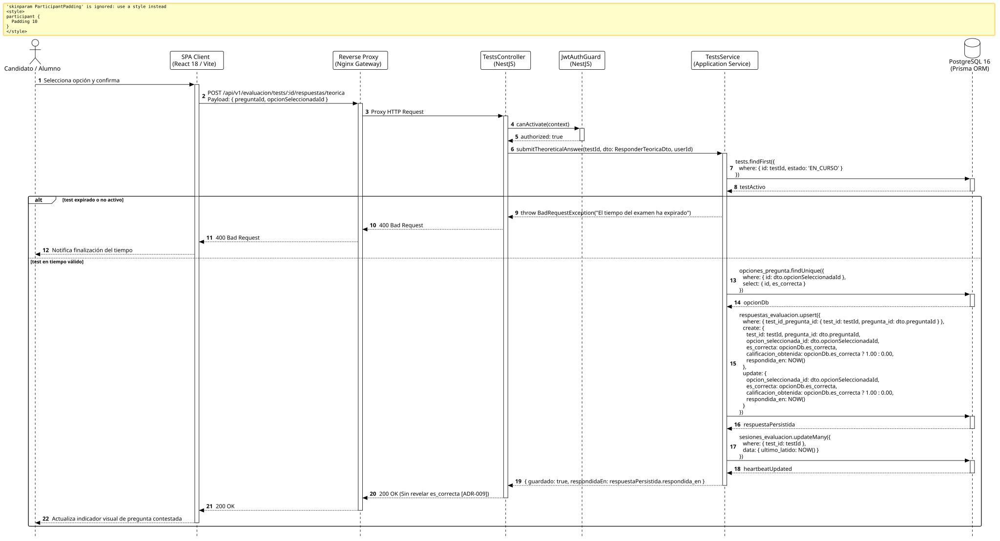

<div align="center">

| [Inicio](/README.md) | [RUP Hub](/RUP/README.md) | [00 Dominio](/RUP/00-modelo-del-dominio/README.md) | [01 Requisitos](/RUP/01-requisitos/README.md) | [02 Análisis](/RUP/02-analisis/README.md) | [03 Diseño](/RUP/03-diseño/README.md) | [Catálogo Diseño](/RUP/03-diseño/casos-uso/README.md) |
|:---:|:---:|:---:|:---:|:---:|:---:|:---:|

<sub>**Fase 03 Diseño** › **Realización de Casos de Uso** › `responderPreguntaTeorica()`</sub>

</div>

# Realización de Diseño: `responderPreguntaTeorica()`

Esta especificación formaliza el diseño técnico y contrato de interfaz para el caso de uso `responderPreguntaTeorica()`. Permite el guardado idempotente de respuestas de selección múltiple sobre la entidad `motor_evaluacion.respuestas_evaluacion`, evaluando en servidor la corrección técnica pero manteniendo la **estricta opacidad** de acierto frente al postulante ([ADR-009](/RUP/BITACORA.md#adr-009-delimitaci%C3%B3n-de-actores-opacidad-de-tests-para-el-candidato-entrevistas-google-meet-en-el-perfil-por-el-gestor-y-aislamiento-del-tl)).

---

<div align="center">

| Diagrama de Secuencia de Diseño UML |
| :---: |
|  |
| <sup><i>[Código fuente PlantUML](secuenciaDiseño.puml)</i></sup> |

</div>

---

## 1. Contrato de Interfaz REST (OpenAPI 3.1)

### 1.1 Definición del Endpoint

* **Ruta HTTP**: `POST /api/v1/evaluacion/tests/:id/respuestas/teorica`
* **Acceso / Seguridad**: Autenticado mediante `Bearer <accessToken>` con rol `CANDIDATO` o `ALUMNO`.
* **Parámetros de Ruta**:
  * `id` (`uuid`, obligatorio): Identificador del examen `Test`.
* **Cabeceras de Petición**:
  * `Authorization: Bearer <accessToken>`
  * `Content-Type: application/json`

### 1.2 DTO de Entrada (`ResponderTeoricaDto`)

```typescript
import { IsUUID, IsNotEmpty } from 'class-validator';

export class ResponderTeoricaDto {
  @IsUUID('4', { message: 'El identificador de la pregunta debe ser un UUID v4 válido' })
  @IsNotEmpty()
  preguntaId: string;

  @IsUUID('4', { message: 'El identificador de la opción seleccionada debe ser un UUID v4 válido' })
  @IsNotEmpty()
  opcionSeleccionadaId: string;
}
```

### 1.3 Respuestas Canónicas (DTOs de Salida)

#### `200 OK` — Respuesta Guardada Idempotentemente

Confirmación de persistencia sin revelar si la opción elegida es correcta.

```json
{
  "statusCode": 200,
  "message": "Respuesta registrada correctamente",
  "data": {
    "preguntaId": "7f8a9b0c-1d2e-3f4a-5b6c-7d8e9f0a1b2c",
    "guardado": true,
    "respondidaEn": "2026-11-02T13:15:30.120Z"
  }
}
```

#### `400 Bad Request` — Tiempo Agotado

```json
{
  "statusCode": 400,
  "error": "Bad Request",
  "message": "El tiempo reglamentario de la prueba ha concluido. No se aceptan más respuestas."
}
```

---

## 2. Componentes de Software de Diseño (NestJS)

* **`TestsController`**: Enrutamiento `POST /tests/:id/respuestas/teorica`.
* **`TestsService.submitTheoreticalAnswer`**: Orquestación de consulta de validez temporal y persistencia relacional.
* **`RespuestasRepository.upsert`**: Inserción o actualización atómica con clave compuesta `(test_id, pregunta_id)` en PostgreSQL.
* **`SesionesEvaluacionRepository.update`**: Registro de latido de actividad (`ultimo_latido`).

---

## 3. Trazabilidad con Requisitos y Análisis

| Requisito / Análisis | Realización de Diseño |
| :--- | :--- |
| **Caso de Uso `responderPreguntaTeorica()`** | Endpoint `POST /api/v1/evaluacion/tests/:id/respuestas/teorica`. |
| **Regla de Opacidad (ADR-009)** | La respuesta HTTP omite deliberadamente `es_correcta` y `calificacion_obtenida`. |
| **Idempotencia de Guardado** | Sentencia `UPSERT` en PostgreSQL 16 sobre índice único `(test_id, pregunta_id)`. |

---

<div align="center">

[Ver Análisis previo (Fase 02)](/RUP/02-analisis/casos-uso/responderPreguntaTeorica/README.md) • [Catálogo de Casos de Uso (Diseño)](/RUP/03-diseño/casos-uso/README.md) • [Siguiente: `entregarPreguntaPractica()`](../entregarPreguntaPractica/README.md)

</div>
