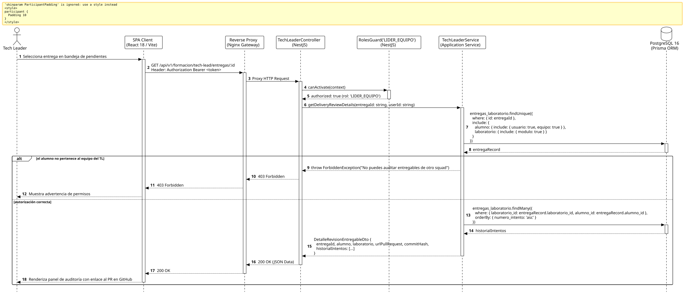

<div align="center">

| [Inicio](/README.md) | [RUP Hub](/RUP/README.md) | [00 Dominio](/RUP/00-modelo-del-dominio/README.md) | [01 Requisitos](/RUP/01-requisitos/README.md) | [02 Análisis](/RUP/02-analisis/README.md) | [03 Diseño](/RUP/03-diseño/README.md) | [Catálogo Diseño](/RUP/03-diseño/casos-uso/README.md) |
|:---:|:---:|:---:|:---:|:---:|:---:|:---:|

<sub>**Fase 03 Diseño** › **Realización de Casos de Uso** › `revisarEntregable()`</sub>

</div>

# Realización de Diseño: `revisarEntregable()`

Esta especificación formaliza el diseño técnico y contrato de interfaz para el caso de uso `revisarEntregable()`. Provee al Tech Leader del Squad la vista holística del entregable, enlace directo al Pull Request de GitHub/GitLab ([ADR-013](/RUP/BITACORA.md#adr-013-simplificaci%C3%B3n-pragm%C3%A1tica-del-modelo-de-datos-der-y-alineaci%C3%B3n-con-la-operativa-real-de-cts)) y el histórico cronológico de iteraciones del becario en el laboratorio.

---

<div align="center">

| Diagrama de Secuencia de Diseño UML |
| :---: |
|  |
| <sup><i>[Código fuente PlantUML](secuenciaDiseño.puml)</i></sup> |

</div>

---

## 1. Contrato de Interfaz REST (OpenAPI 3.1)

### 1.1 Definición del Endpoint

* **Ruta HTTP**: `GET /api/v1/formacion/tech-lead/entregas/:id`
* **Acceso / Seguridad**: Autenticado mediante `Bearer <accessToken>` con rol exclusivo `LIDER_EQUIPO`.
* **Parámetros de Ruta**:
  * `id` (`uuid`, obligatorio): Identificador de la entrega en revisión.
* **Cabeceras de Petición**:
  * `Authorization: Bearer <accessToken>`
  * `Accept: application/json`

### 1.2 Respuestas Canónicas (DTOs de Salida)

#### `200 OK` — Expediente de Revisión del Laboratorio

```json
{
  "statusCode": 200,
  "data": {
    "entregaId": "e1f2a3b4-c5d6-7e8f-9a0b-1c2d3e4f5a6b",
    "alumno": {
      "nombre": "Carlos Gómez",
      "email": "carlos.gomez@alumnos.uneatlantico.es"
    },
    "laboratorio": {
      "id": "lab-1",
      "titulo": "Refactor de Repositorio Desacoplado",
      "modulo": "Clean Architecture & Principios SOLID"
    },
    "urlPullRequest": "https://github.com/CTS-PROFER/proyecto-base/pull/12",
    "commitHash": "9f8379f71e832e3a5f423abac32f19523f009249",
    "numeroIntento": 2,
    "estado": "EN_REVISION",
    "fechaEnvio": "2026-11-02T14:26:00.000Z",
    "historialIntentos": [
      {
        "intento": 1,
        "estado": "CAMBIOS_SOLICITADOS",
        "calificacion": 6.5,
        "feedback": "Faltaba manejo de excepciones en el mock."
      }
    ]
  }
}
```

---

## 2. Componentes de Software de Diseño (NestJS)

* **`TechLeaderController`**: Endpoint `GET /tech-lead/entregas/:id`.
* **`TechLeaderService.getDeliveryReviewDetails`**: Validación de aislamiento de squad ([ADR-009](/RUP/BITACORA.md#adr-009-delimitaci%C3%B3n-de-actores-opacidad-de-tests-para-el-candidato-entrevistas-google-meet-en-el-perfil-por-el-gestor-y-aislamiento-del-tl)) asegurando que `alumno.equipo_id == tl.equipo_id`.

---

## 3. Trazabilidad con Requisitos y Análisis

| Requisito / Análisis | Realización de Diseño |
| :--- | :--- |
| **Caso de Uso `revisarEntregable()`** | Endpoint `GET /api/v1/formacion/tech-lead/entregas/:id`. |
| **Integración Git (ADR-013)** | Inspección directa en GitHub/GitLab a través de `urlPullRequest`. |
| **Histórico de Iteraciones** | Proyección del historial de intentos en `motor_formacion.entregas_laboratorio`. |

---

<div align="center">

[Ver Análisis previo (Fase 02)](/RUP/02-analisis/casos-uso/revisarEntregable/README.md) • [Catálogo de Casos de Uso (Diseño)](/RUP/03-diseño/casos-uso/README.md) • [Siguiente: `aprobarEntregable()`](../aprobarEntregable/README.md)

</div>
