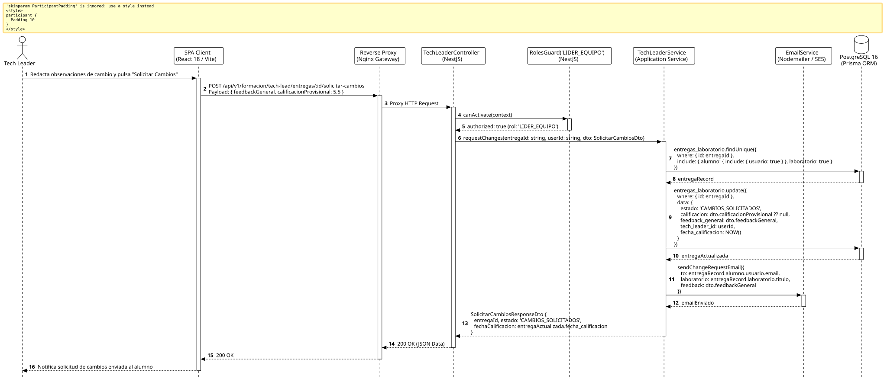

<div align="center">

| [Inicio](/README.md) | [RUP Hub](/RUP/README.md) | [00 Dominio](/RUP/00-modelo-del-dominio/README.md) | [01 Requisitos](/RUP/01-requisitos/README.md) | [02 Análisis](/RUP/02-analisis/README.md) | [03 Diseño](/RUP/03-diseño/README.md) | [Catálogo Diseño](/RUP/03-diseño/casos-uso/README.md) |
|:---:|:---:|:---:|:---:|:---:|:---:|:---:|

<sub>**Fase 03 Diseño** › **Realización de Casos de Uso** › `solicitarCambiosEntregable()`</sub>

</div>

# Realización de Diseño: `solicitarCambiosEntregable()`

Esta especificación formaliza el diseño técnico y contrato de interfaz para el caso de uso `solicitarCambiosEntregable()`. Modela la devolución de una entrega práctica al becario con observaciones técnicas para su refactorización en el Pull Request ([ADR-013](/RUP/BITACORA.md#adr-013-simplificaci%C3%B3n-pragm%C3%A1tica-del-modelo-de-datos-der-y-alineaci%C3%B3n-con-la-operativa-real-de-cts)), actualizando el estado a `CAMBIOS_SOLICITADOS` en `motor_formacion.entregas_laboratorio`.

---

<div align="center">

| Diagrama de Secuencia de Diseño UML |
| :---: |
|  |
| <sup><i>[Código fuente PlantUML](secuenciaDiseño.puml)</i></sup> |

</div>

---

## 1. Contrato de Interfaz REST (OpenAPI 3.1)

### 1.1 Definición del Endpoint

* **Ruta HTTP**: `POST /api/v1/formacion/tech-lead/entregas/:id/solicitar-cambios`
* **Acceso / Seguridad**: Autenticado mediante `Bearer <accessToken>` con rol exclusivo `LIDER_EQUIPO`.
* **Parámetros de Ruta**:
  * `id` (`uuid`, obligatorio): Identificador de la entrega.
* **Cabeceras de Petición**:
  * `Authorization: Bearer <accessToken>`
  * `Content-Type: application/json`

### 1.2 DTO de Entrada (`SolicitarCambiosDto`)

```typescript
import { IsString, IsNotEmpty, IsOptional, IsNumber, Min, Max } from 'class-validator';

export class SolicitarCambiosDto {
  @IsString()
  @IsNotEmpty({ message: 'El feedback técnico es imprescindible para indicar los cambios requeridos' })
  feedbackGeneral: string;

  @IsOptional()
  @IsNumber()
  @Min(0.0)
  @Max(6.99)
  calificacionProvisional?: number;
}
```

### 1.3 Respuestas Canónicas (DTOs de Salida)

#### `200 OK` — Cambios Solicitados

```json
{
  "statusCode": 200,
  "message": "Solicitud de cambios registrada y notificada al alumno",
  "data": {
    "entregaId": "e1f2a3b4-c5d6-7e8f-9a0b-1c2d3e4f5a6b",
    "estado": "CAMBIOS_SOLICITADOS",
    "fechaCalificacion": "2026-11-02T14:35:00.000Z"
  }
}
```

---

## 2. Componentes de Software de Diseño (NestJS)

* **`TechLeaderController`**: Endpoint `POST /tech-lead/entregas/:id/solicitar-cambios`.
* **`TechLeaderService.requestChanges`**: Transición de estado a `CAMBIOS_SOLICITADOS` y asignación de `tech_leader_id`.
* **`EmailService`**: Notificación transaccional al alumno instándole a actualizar su PR en GitHub.

---

## 3. Trazabilidad con Requisitos y Análisis

| Requisito / Análisis | Realización de Diseño |
| :--- | :--- |
| **Caso de Uso `solicitarCambiosEntregable()`** | Endpoint `POST /api/v1/formacion/tech-lead/entregas/:id/solicitar-cambios`. |
| **Iteración en Pull Request (ADR-013)** | El alumno mantiene la rama de Git abierta y actualiza con nuevos commits sin reiniciar expediente. |
| **Trazabilidad de Tutoría** | `tech_leader_id` registrado para auditoría docente. |

---

<div align="center">

[Ver Análisis previo (Fase 02)](/RUP/02-analisis/casos-uso/solicitarCambiosEntregable/README.md) • [Catálogo de Casos de Uso (Diseño)](/RUP/03-diseño/casos-uso/README.md) • [Siguiente: `evaluarCapacitacionAlumno()`](../evaluarCapacitacionAlumno/README.md)

</div>
