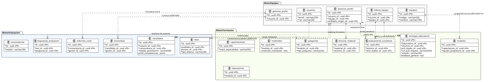
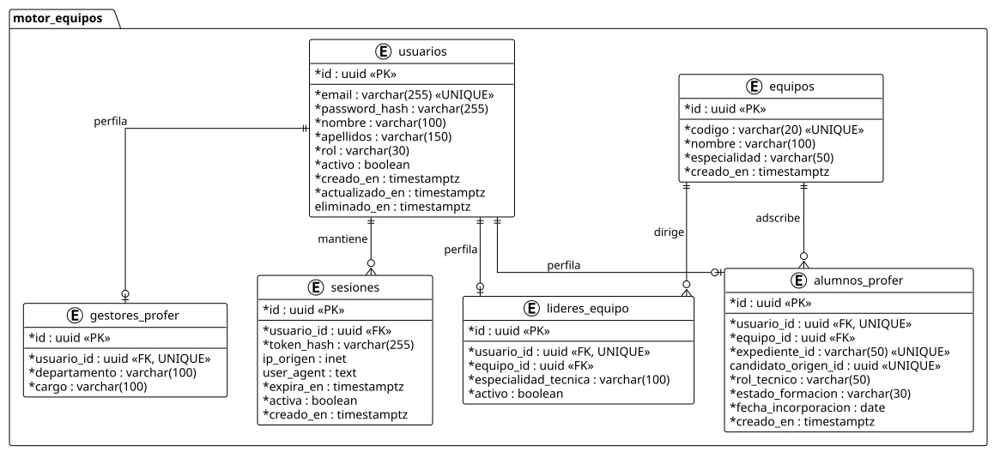
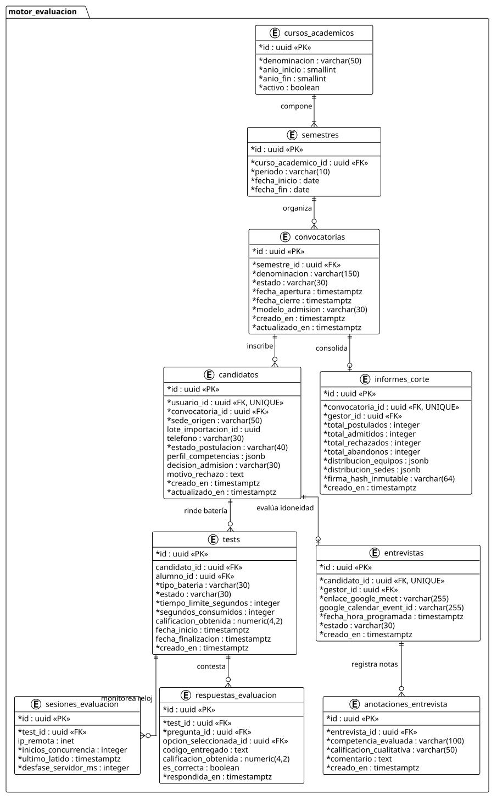
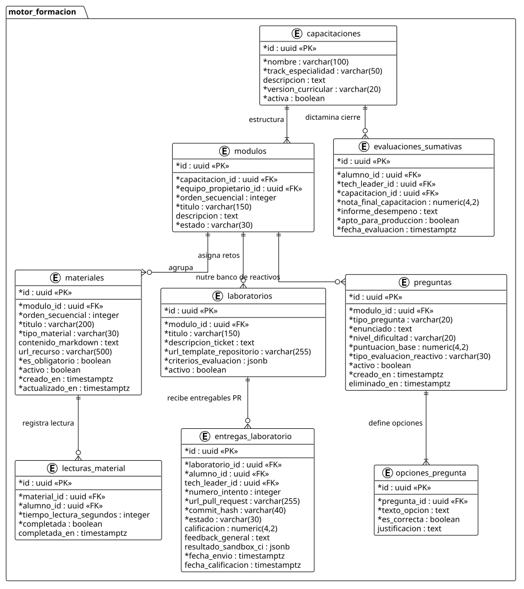

| [Inicio](/README.md) | [RUP Hub](/RUP/README.md) | [Bitácora ADR](/RUP/BITACORA.md) | [00 Dominio](/RUP/00-modelo-del-dominio/README.md) | [01 Requisitos](/RUP/01-requisitos/README.md) | [02 Análisis](/RUP/02-analisis/README.md) | [03 Diseño](/RUP/03-diseño/README.md) |
|:---:|:---:|:---:|:---:|:---:|:---:|:---:|

# Modelo de Datos Relacional (DER) — PostgreSQL

Este documento especifica el diseño de persistencia relacional en **PostgreSQL 16** para **CTS Academy & Evaluator**, estructurado en estricta conformidad con la descomposición arquitectónica en tres microservicios independientes ([ADR-006](/RUP/BITACORA.md#adr-006-descomposici%C3%B3n-arquitect%C3%B3nica-en-3-microservicios)) y simplificado según las directivas pragmáticas de gobernanza y operativa real de CTS ([ADR-013](/RUP/BITACORA.md#adr-013-simplificaci%C3%B3n-pragm%C3%A1tica-del-modelo-de-datos-der-y-alineaci%C3%B3n-con-la-operativa-real-de-cts)).

---

## 1. Diagrama Entidad-Relación General (DER Consolidado)

El esquema general ilustra las entidades de los tres esquemas de base de datos (`motor_equipos`, `motor_evaluacion`, `motor_formacion`) y las claves foráneas de integración inter-servicios.

| Diagrama Entidad-Relación General |
| :---: |
|  |
| <i>[Código fuente PlantUML](derGeneral.puml)</i> |

---

## 2. Esquemas de Base de Datos por Microservicio

### 2.1 Subsistema `motor_equipos` (Gobernanza y Estructura Organizativa)

Centraliza los usuarios autenticados, perfiles de rol y los 6 squads técnicos permanentes de CTS ([ADR-004](/RUP/BITACORA.md#adr-004-embudo-en-2-fases-y-asignaci%C3%B3n-a-los-6-equipos-de-cts)). Se prescinde de tablas redundantes de perfil para Gestores y Tech Leaders: la autorización se gestiona limpiamente mediante RBAC (`usuarios.rol`), y cada equipo vincula directamente a su Tech Leader titular mediante `lider_usuario_id` ([ADR-013](/RUP/BITACORA.md#adr-013-simplificaci%C3%B3n-pragm%C3%A1tica-del-modelo-de-datos-der-y-alineaci%C3%B3n-con-la-operativa-real-de-cts)).

| DER `motor_equipos` |
| :---: |
|  |
| <i>[Código fuente PlantUML](derMotorEquipos.puml)</i> |

#### Diccionario de Tablas: `motor_equipos` (4 Tablas)

* **`usuarios`**:
  * `id` (`uuid`, PK): Identificador universal único generado mediante `gen_random_uuid()`.
  * `email` (`varchar(255)`, UNIQUE, NOT NULL): Correo institucional.
  * `password_hash` (`varchar(255)`, NOT NULL): Hash argon2id para autenticación.
  * `nombre` (`varchar(100)`, NOT NULL), `apellidos` (`varchar(150)`, NOT NULL).
  * `rol` (`varchar(30)`, NOT NULL): `CHECK (rol IN ('CANDIDATO', 'ALUMNO', 'LIDER_EQUIPO', 'GESTOR'))`. Define directamente las capacidades operativas sin tablas accesorias.
  * `activo` (`boolean`, DEFAULT true): Estado de habilitación de acceso.
  * `creado_en`, `actualizado_en` (`timestamptz`, NOT NULL): Marcas de tiempo de auditoría.
  * `eliminado_en` (`timestamptz`, NULL): Soporte para borrado lógico (*soft-delete*).

* **`sesiones`**:
  * `id` (`uuid`, PK), `usuario_id` (`uuid`, FK -> `usuarios.id`, ON DELETE CASCADE).
  * `token_hash` (`varchar(255)`, NOT NULL): Hash de la firma del Refresh Token JWT.
  * `ip_origen` (`inet`), `user_agent` (`text`): Trazabilidad de accesos.
  * `expira_en` (`timestamptz`, NOT NULL), `activa` (`boolean`, DEFAULT true).

* **`equipos`** (Los 6 squads técnicos de CTS):
  * `id` (`uuid`, PK).
  * `lider_usuario_id` (`uuid`, UNIQUE, NOT NULL, FK -> `usuarios.id`): Tech Leader titular asignado a la dirección del squad ([RN-TL-01](/RUP/01-requisitos/03-detalle-casos-uso/abrirPanelLider/README.md)).
  * `codigo` (`varchar(20)`, UNIQUE, NOT NULL): Clave unívoca (`TEAM-01` a `TEAM-06`).
  * `nombre` (`varchar(100)`, NOT NULL): Denominación funcional del equipo.
  * `especialidad` (`varchar(50)`, NOT NULL): Especialidad técnica predominante.
  * *Nota de diseño:* No se fijan límites rígidos de cupo; la distribución de becarios entre squads es flexible (equipos con 12, 4 o 1 integrante) según demanda de proyectos.

* **`alumnos_profer`**:
  * `id` (`uuid`, PK), `usuario_id` (`uuid`, UNIQUE, FK -> `usuarios.id`).
  * `equipo_id` (`uuid`, FK -> `equipos.id`, NULLABLE): Squad al que pertenece el becario (permite adscripción inmediata o asignación diferida en la ventana previa a la incorporación presencial [ADR-016]).
  * `expediente_id` (`varchar(50)`, UNIQUE, NOT NULL): Código de matrícula institucional.
  * `candidato_origen_id` (`uuid`, UNIQUE, NULL): Trazabilidad con el candidato admitido ([ADR-010](/RUP/BITACORA.md#adr-010-refinamiento-estructural-del-dominio-top-to-bottom-transici%C3%B3n-candidato-alumno-y-redise%C3%B1o-pedag%C3%B3gico-de-materiales)).
  * `rol_tecnico` (`varchar(50)`, NOT NULL): `CHECK (rol_tecnico IN ('FRONTEND', 'BACKEND', 'FULLSTACK', 'DEVOPS'))`.
  * `estado_formacion` (`varchar(30)`, NOT NULL): `EN_NIVELACION`, `EN_CAPACITACION`, `CAPACITACION_CONCLUIDA`, `BAJA_PROGRAMA`.
  * `fecha_incorporacion` (`date`, NOT NULL).

---

### 2.2 Subsistema `motor_evaluacion` (Captación, Admisión y Exámenes)

Gobierna el ciclo de admisión continua de 365 días ([ADR-007](/RUP/BITACORA.md#adr-007-admisi%C3%B3n-continua-por-ciclos-acad%C3%A9micos-bater%C3%ADa-de-3-tests-e-inclusi%C3%B3n-de-entrevista)), la batería diagnóstica de 3 tests con perfil competencial para gráfico de radar y la formalización de entrevistas Google Meet ([ADR-009](/RUP/BITACORA.md#adr-009-delimitaci%C3%B3n-de-actores-opacidad-de-tests-para-el-candidato-entrevistas-google-meet-en-el-perfil-por-el-gestor-y-aislamiento-del-tl)).

| DER `motor_evaluacion` |
| :---: |
|  |
| <i>[Código fuente PlantUML](derMotorEvaluacion.puml)</i> |

#### Diccionario de Tablas: `motor_evaluacion` (10 Tablas)

* **`cursos_academicos`** y **`semestres`**:
  * Marco temporal lectivo (`anio_inicio`, `anio_fin`, `periodo` 'S1'/'S2', `fecha_inicio`, `fecha_fin`).

* **`convocatorias`**:
  * `id` (`uuid`, PK), `semestre_id` (`uuid`, FK -> `semestres.id`).
  * `denominacion` (`varchar(150)`), `estado` (`varchar(30)`, `CHECK IN ('PLANIFICADA', 'ABIERTO', 'CERRADO')`).
  * `fecha_apertura`, `fecha_cierre` (`timestamptz`, NOT NULL, `CHECK (fecha_apertura < fecha_cierre)`).
  * `modelo_admision` (`varchar(30)`, DEFAULT 'CONTINUO_365').

* **`candidatos`**:
  * `id` (`uuid`, PK), `usuario_id` (`uuid`, UNIQUE, FK -> `usuarios.id`), `convocatoria_id` (`uuid`, FK).
  * `sede_origen` (`varchar(50)`, NOT NULL): Santander, México, Colombia, Perú, etc. ([ADR-008](/RUP/BITACORA.md#adr-008-canalizaci%C3%B3n-de-candidatos-por-sedes-internacionales-y-eliminaci%C3%B3n-de-usuarionologueado)).
  * `estado_postulacion` (`varchar(40)`, NOT NULL): `REGISTRADO`, `EN_EVALUACION`, `EVALUADO`, `ENTREVISTA_PENDIENTE`, `ENTREVISTADO`, `ADMITIDO`, `RECHAZADO`, `ABANDONO`.
  * `perfil_competencias` (`jsonb`, NULL): Desglose multidimensional de aptitudes obtenido de los tests (ej. `{"actitud": 85, "logica": 90, "frontend": 75, "backend": 40}`), utilizado para renderizar el **gráfico de radar** en el perfil del Gestor ([ADR-007](/RUP/BITACORA.md#adr-007-admisi%C3%B3n-continua-por-ciclos-acad%C3%A9micos-bater%C3%ADa-de-3-tests-e-inclusi%C3%B3n-de-entrevista)).
  * `decision_admision` (`varchar(30)`, NULL), `motivo_rechazo` (`text`, NULL).
  * *Nota de diseño:* No se solicita titulación universitaria previa, ya que los candidatos ingresan a cursar estudios de grado universitario.

* **`tests`**:
  * `id` (`uuid`, PK), `candidato_id` (`uuid`, NULL), `alumno_id` (`uuid`, NULL).
  * `tipo_bateria` (`varchar(30)`, NOT NULL): `ACTITUD`, `APTITUD`, `TECNICO`.
  * `estado` (`varchar(30)`, NOT NULL): `NO_INICIADO`, `EN_CURSO`, `PAUSADO`, `FINALIZADO`, `CANCELADO`, `BLOQUEADO`.
  * `tiempo_limite_segundos` (`integer`, NOT NULL), `segundos_consumidos` (`integer`, DEFAULT 0).
  * `calificacion_obtenida` (`numeric(4,2)`, NULL).

* **`sesiones_evaluacion`**:
  * `id` (`uuid`, PK), `test_id` (`uuid`, FK -> `tests.id`), `inicios_concurrencia` (`integer`, DEFAULT 1).
  * `ultimo_latido` (`timestamptz`), `desfase_servidor_ms` (`integer`): Prevención de desincronización horaria.

* **`respuestas_evaluacion`**:
  * `id` (`uuid`, PK), `test_id` (`uuid`, FK), `pregunta_id` (`uuid`, FK -> `motor_formacion.preguntas.id`).
  * `opcion_seleccionada_id` (`uuid`, NULL), `codigo_entregado` (`text`, NULL).
  * `calificacion_obtenida` (`numeric(4,2)`), `es_correcta` (`boolean`).

* **`entrevistas`** y **`anotaciones_entrevista`**:
  * Enlace Google Meet, fecha programada, estado, competencias evaluadas y notas cualitativas del Gestor.

* **`informes_corte`**:
  * Consolidado inmutable de fin de ciclo con hash criptográfico SHA-256 (`firma_hash_inmutable`), distribución de admitidos en formato JSONB ([RN-CORTE-03](/RUP/01-requisitos/03-detalle-casos-uso/cerrarCorteSemestral/README.md)).

---

### 2.3 Subsistema `motor_formacion` (LMS, Módulos, Entregables y Banco de Preguntas)

Soporta la plataforma formativa para alumnos matriculados, seguimiento curricular por módulos, integración con Pull Requests de GitHub y el banco transversal de reactivos.

| DER `motor_formacion` |
| :---: |
|  |
| <i>[Código fuente PlantUML](derMotorFormacion.puml)</i> |

#### Diccionario de Tablas: `motor_formacion` (9 Tablas)

* **`capacitaciones`**:
  * `id` (`uuid`, PK), `nombre` (`varchar(100)`), `track_especialidad` (`varchar(50)`).
  * `version_curricular` (`varchar(20)`), `activa` (`boolean`).

* **`modulos`**:
  * `id` (`uuid`, PK), `capacitacion_id` (`uuid`, FK -> `capacitaciones.id`).
  * `equipo_propietario_id` (`uuid`, FK -> `motor_equipos.equipos.id`): Squad responsable del módulo ([RN-LEAD-01](/RUP/01-requisitos/03-detalle-casos-uso/crearMaterial/README.md)).
  * `orden_secuencial` (`integer`, NOT NULL), `titulo` (`varchar(150)`), `estado` (`varchar(30)`).
  * `UNIQUE (capacitacion_id, orden_secuencial)`.

* **`materiales`** y **`lecturas_material`**:
  * `contenido_markdown` (`text`): Guías didácticas vivas redactadas en formato Markdown por el Tech Leader (incluyen bloques de código con resaltado de sintaxis, listas y notas), consumidas y renderizadas directamente por la SPA sin riesgo de inyecciones HTML ni dependencia de archivos binarios pesados.
  * Registro de lectura obligatoria completada por el alumno ([RN-FORM-05](/RUP/01-requisitos/03-detalle-casos-uso/consultarMaterial/README.md)).

* **`laboratorios`**:
  * Retos prácticos, tickets simulados, plantilla base Git y rúbricas en JSONB.

* **`entregas_laboratorio`**:
  * `id` (`uuid`, PK), `laboratorio_id` (`uuid`, FK), `alumno_id` (`uuid`, FK), `tech_leader_id` (`uuid`, NULL, FK).
  * `url_pull_request` (`varchar(255)`): Enlace directo al Pull Request de GitHub entregado por el becario.
  * `commit_hash` (`varchar(40)`): Hash del commit auditado.
  * `estado` (`varchar(30)`): `PENDIENTE_REVISION`, `EN_REVISION`, `APROBADO`, `CAMBIOS_SOLICITADOS`.
  * `calificacion` (`numeric(4,2)`, NULL): Calificación global (umbral mínimo de 7.0/10.0 [RN-FORM-06](/RUP/01-requisitos/03-detalle-casos-uso/consultarFeedbackEntregable/README.md)).
  * `feedback_general` (`text`, NULL): Resumen cualitativo de la evaluación emitido por el Tech Leader.
  * `resultado_sandbox_ci` (`jsonb`, NULL): Salida del contenedor Docker de pruebas automáticas.
  * *Nota de diseño:* Se delega la revisión línea por línea a la interfaz nativa de GitHub/GitLab PRs, simplificando la base de datos al prescindir de tablas redundantes de comentarios de código.

* **`preguntas`** y **`opciones_pregunta`**:
  * Banco de reactivos teóricos y prácticos compartidos con `MotorEvaluacion`.
  * `tipo_evaluacion_reactivo` ('ACTITUD', 'APTITUD', 'TECNICO').
  * Soporte de borrado lógico (`eliminado_en`) para preservar exámenes históricos ([RN-LEAD-06](/RUP/01-requisitos/03-detalle-casos-uso/eliminarPregunta/README.md)).

* **`evaluaciones_sumativas`**:
  * Dictamen global emitido por el Tech Leader al culminar el 100% curricular ([RN-LEAD-11](/RUP/01-requisitos/03-detalle-casos-uso/evaluarCapacitacionAlumno/README.md)).

---

## 3. Directivas de Integridad y Rendimiento

1. **Estrategia de Claves Primarias**: Toda tabla utiliza identificadores `UUID v4` generados nativamente por el motor PostgreSQL (`gen_random_uuid()`), garantizando unicidad global e impidiendo enumeración predecible de recursos en APIs REST.
2. **Auditoría Append-Only e Inmutabilidad**: Las evaluaciones completadas, respuestas de candidatos e informes de corte formalizados tienen prohibida la mutación (`UPDATE`/`DELETE`). Cualquier recalificación o corrección crea una nueva transacción auditada.
3. **Optimización con Índices Compuestos (B-Tree y GIN)**:
   * `CREATE INDEX idx_candidatos_convocatoria_estado ON motor_evaluacion.candidatos (convocatoria_id, estado_postulacion);`
   * `CREATE INDEX idx_candidatos_perfil_gin ON motor_evaluacion.candidatos USING GIN (perfil_competencias);`
   * `CREATE INDEX idx_entregas_laboratorio_estado ON motor_formacion.entregas_laboratorio (laboratorio_id, estado);`
   * `CREATE INDEX idx_sesiones_usuario_activa ON motor_equipos.sesiones (usuario_id, activa);`
4. **Almacenamiento Semiestructurado (JSONB)**: Se emplea `jsonb` para:
   * El perfil multidimensional de competencias del candidato (datos del gráfico de radar).
   * Los resultados de pipelines del sandbox Docker CI.
   * La distribución agregada de cohortes en informes de corte.

---

[Fase 02: Análisis](/RUP/02-analisis/README.md) • [Fase 03: Diseño](/RUP/03-diseño/README.md)

